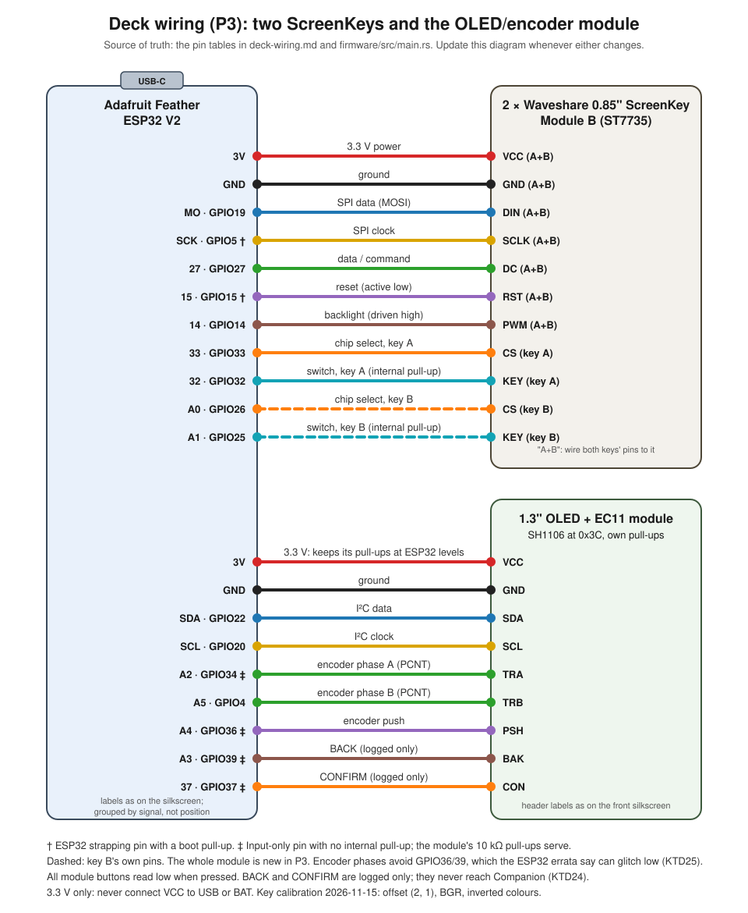

# Deck wiring and calibration

How the two Waveshare 0.85" ScreenKey Module B keys and the 1.3" OLED/encoder module are wired to the Adafruit Feather ESP32 V2, and the panel values the firmware uses. The P2 section closes the three bench checks P1 left open in [the board decision](board-and-framework-decision.md): KEY polarity, the pull-up, and the panel offset. The module itself is described in [oled-encoder-module.md](oled-encoder-module.md).

> **Status:**
> - **Key A** was calibrated on the bench on 2026-11-15 (U8 in [the PoC plan](../plans/2026-11-13-1722-feat-companion-network-deck-poc-plan.md)), with one Feather ESP32 V2 (ESP32-PICO-V3-02, rev v3.0) and one ScreenKey Module B.
> - **Key B and the OLED/encoder module** (P3) were checked on the bench on 2026-11-16 with the pins below (U13 and U14).

## Wiring

[`deck-wiring.svg`](deck-wiring.svg) is hand-maintained. Whenever a pin changes, update the tables below, the pin setup in `firmware/src/main.rs` and the diagram in the same commit.

### Keys

Both keys share the SPI bus, DC, RST and the backlight; each has its own CS and KEY.

| ScreenKey pin | Key A | Key B | Notes |
|---|---|---|---|
| VCC | 3V | 3V | 3.3 V only |
| GND | GND | GND | |
| SCLK | GPIO5 (SCK) | GPIO5 (SCK) | SPI2. Strapping pin with a boot pull-up. |
| DIN | GPIO19 (MOSI) | GPIO19 (MOSI) | MISO unused |
| CS | GPIO33 | GPIO26 (A0) | One per key |
| DC | GPIO27 | GPIO27 | Shared |
| RST | GPIO15 | GPIO15 | Shared; pulsed once at boot. Strapping pin with a boot pull-up. |
| PWM | GPIO14 | GPIO14 | Driven high; no brightness control yet (THI-81) |
| KEY | GPIO32 | GPIO25 (A1) | Internal pull-up; one per key |

### OLED/encoder module

The module has its own 10 kΩ pull-ups on every signal, so the input-only pins work without internal pull-ups. The encoder phases avoid GPIO36 and GPIO39, which the ESP32 errata say can see short low glitches (KTD25 in the plan).

| Module pin | Feather ESP32 V2 | Notes |
|---|---|---|
| VCC | 3V | 3.3 V keeps the module's pull-ups at ESP32 levels |
| GND | GND | |
| SDA | GPIO22 (SDA) | I²C0 |
| SCL | GPIO20 (SCL) | I²C0 |
| TRA | GPIO34 (A2) | Encoder phase A, counted by PCNT. Input only. |
| TRB | GPIO4 (A5) | Encoder phase B, counted by PCNT |
| PSH | GPIO36 (A4) | Encoder push. Input only. |
| BAK | GPIO39 (A3) | BACK; logged, never sent to Companion. Input only. |
| CON | GPIO37 | CONFIRM; logged, never sent to Companion. Input only. |

The pins are set in `firmware/src/main.rs`.

## Calibration

### Keys

| Value | Firmware setting | Bench result |
|---|---|---|
| Panel offset (x, y) in the 132×162 RAM | `(2, 1)` in `firmware/src/display.rs` | Key A: correct. The test border sits exactly on the glass edge. Its corners are hidden by the panel's rounded corners, which is expected. Key B: correct with the same value. |
| Colour order | `Bgr` | Both keys: correct |
| Colour inversion | `Inverted` | Both keys: required. With `Normal`, every colour showed as its complement (red as cyan, white as black). |
| SPI clock | 20 MHz, mode 0 | Key A: works. A full 128×128 frame decodes and draws in 26 ms. |
| KEY when pressed | low (`ACTIVE_LOW` in `firmware/src/inputs.rs`) | Both keys: confirmed |
| KEY needs the internal pull-up | yes | Both keys: work with only the internal pull-up |
| Debounce interval | 20 ms | Key A: 20 presses logged exactly 20 `key pressed` and 20 `key released` (P2 log wording) |
| Board boots with everything attached | expected | Key A alone: yes. GPIO5 and GPIO15 (strapping pins) do not disturb boot. All P3 parts: yes. |

The OLED and encoder values are in [oled-encoder-module.md](oled-encoder-module.md#calibration).

## How to calibrate the keys

1. Flash the firmware (`firmware/README.md`). For 3 s after boot each key shows a test pattern: a 1 px white border, a red block top-left, green top-right, blue bottom-left and white bottom-right, with "KEY A" or "KEY B" in the middle.
2. **Offset.** Every border edge must be visible, and none may be doubled or show noise beyond it. Adjust `calibration::OFFSET`; common values for this panel size are `(2, 1)`, `(2, 3)` and `(0, 0)`.
3. **Colours.** If red and blue swap places, switch `COLOR_ORDER`. If every colour shows as its complement (white as black, red as cyan, green as magenta), switch `INVERSION`.
4. **Buttons.** Press and release each button 20 times while watching the serial log. Each press must log exactly one `KeyA pressed` (or `KeyB`, `EncoderPush`, `Back`, `Confirm`), and each release one `… released`. If presses log as releases, flip `ACTIVE_LOW`. If edges are missing or doubled, check the pull-up and tune the debounce interval.
