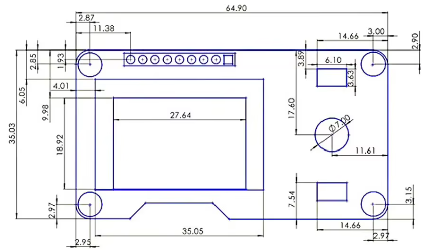

# OLED/encoder module (P3)

What the 1.3" OLED + EC11 rotary encoder module is, how it is built, and the values the firmware uses for it. It is the deck's encoder control: Companion's 128×64 image on the OLED, encoder rotation and push reported to Companion, and two device buttons (BACK, CONFIRM) that stay local.

> **Status:** identified from the vendor's interface description and schematics on 2026-11-16; the operator confirmed the listing matches the part on hand. Checked on the bench the same day (U14 in [the PoC plan](../plans/2026-11-13-1722-feat-companion-network-deck-poc-plan.md)); the [calibration](#calibration) table says what was confirmed and what is still open.

## Identity

- Sold as "OLED display screen with EC11 rotary encoder combination module, IIC interface, 1.3 inches / 0.96 inches" (brand Javino/Liludin, Weinuo Module Store). The deck uses the **1.3" white** version.
- Source: <https://de.aliexpress.com/item/1005010470649235.html>. The product description has the interface description and schematics; they are only shown after expanding it.
- Board 65.2 × 35.1 mm (vendor's manual measurement; the drawing says 64.90 × 35.03), four M3 mounting holes. Full dimensions under [Mechanical drawing](#mechanical-drawing).

## Hardware, from the vendor schematics

| Part | Details |
|---|---|
| Display | 1.3" 128×64 white OLED, **SH1106** driver (the 0.96" version uses an SSD1306). Strapping fixes I²C mode; D/C# tied low gives address **0x3C**. |
| Display reset | Power-on RC circuit (10 kΩ, 10 µF), not on the header. Firmware can re-initialise the panel but not hard-reset it. |
| I²C pull-ups | 10 kΩ on SDA and SCL to the module's 3.3 V |
| Encoder | EC11, 20 pulses and 20 detents per turn, with a push switch. Common pin to GND. |
| Encoder phases | Each has a 10 kΩ pull-up, 100 Ω in series and 100 nF to GND (hardware debounce) |
| Buttons | BACK (`KEY0`) and CONFIRM (`KEY1`), plus the encoder push. Each has a 10 kΩ pull-up and 100 nF to GND and reads **low when pressed**. |
| Power | Vendor text: "VCC: 3.3V power supply". The back silkscreen says 3.3–5 V and there is a small regulator, but every schematic rail is 3.3 V. The deck feeds 3.3 V so the pull-ups stay at ESP32 levels. |

### Header J1

| Pin | Front silkscreen | Back silkscreen | Signal |
|---|---|---|---|
| 1 | VCC | 3V3-5V | +3V3 |
| 2 | GND | GND | GND |
| 3 | BAK | BAK | BACK (`KEY0`) |
| 4 | TRB | ENCODER_TRB | Encoder phase B |
| 5 | TRA | ENCODER_TRA | Encoder phase A |
| 6 | PSH | ENCODER_PUSH | Encoder push |
| 7 | SCL | OLED_SCL | I²C clock |
| 8 | SDA | OLED_SDA | I²C data |
| 9 | CON | CONFIRM | CONFIRM (`KEY1`) |

The front silkscreen lists the pins in the reverse order (CON first, VCC last). Wiring to the Feather is in [deck-wiring.md](deck-wiring.md#oled-encoder-module).

## Mechanical drawing

The vendor's dimension drawing, from the product description (copied 2026-11-17). It is the 1.3" board: large glass, BACK top right, CONFIRM bottom right, encoder between them. Top view, header side up.

Transcribed below. "From top" and "from left" are from the board edges in the drawing's orientation (header at the top). Offsets are from the board centre (32.45, 17.515), with +x right and +y towards the header; the case model (`cad/src/opendeck_case/params.py`) uses these offsets.

| Feature | Size (mm) | Position on the drawing | Offset from board centre (mm) |
|---|---|---|---|
| Board | 64.90 × 35.03 | | |
| M3 hole, top left | M3 | 2.87 from left, 2.85 from top | (−29.58, +14.67) |
| M3 hole, top right | M3 | 3.00 from right, 2.90 from top | (+29.45, +14.62) |
| M3 hole, bottom left | M3 | 2.95 from left, 2.97 from bottom | (−29.50, −14.55) |
| M3 hole, bottom right | M3 | 2.97 from right, 3.15 from bottom | (+29.48, −14.37) |
| OLED glass outline | 35.05 × 22.85 | 4.01 from left, 6.05 from top | (−10.92, +0.04) |
| OLED inner box (as drawn) | 27.64 × 18.92 | centred in the glass width, 9.98 from top | (−10.92, −1.93) |
| Encoder shaft bushing (EC11) | Ø 7.00 | 11.61 from right, 17.60 from top | (+20.84, −0.09) |
| BACK button body | 6.10 × 3.63 | 14.66 from right to its left edge, 3.89 from top | (+20.84, +11.81) |
| CONFIRM button body | 6.10 × 3.63 | 14.66 from right to its left edge, 7.54 from bottom to its top | (+20.84, −11.79) |
| Header J1, 9 pins, 2.54 mm pitch | | pin 1 (CON) 11.38 from left, 1.93 from top; VCC (square pad) at the right end | pin 1 (−21.07, +15.59) |

Not on the drawing:

- **Which box is the screen.** The 35.05 × 22.85 glass outline is the 1.3" screen; the product photos show the display's flex cable leaving the bottom edge of that box (the notch in the drawing's bottom edge). The case cuts its display window to this outline. The drawn 27.64 × 18.92 inner box is narrower than a 1.3" 128 × 64 panel's active area (typically about 29.4 × 14.7), so it is not used.
- **Knob.** EC11 with a knurled ("plum blossom") shaft, 15 mm long, 20 detents (vendor text). The supplied knob is about 14 mm across, estimated from the product photo.
- The FPC tail of the display folds round the bottom edge (the notch in the drawing's bottom edge).

## How the firmware uses it

- The OLED is driven by an in-tree SH1106 driver over async I²C (`firmware/src/oled.rs`). Companion's 128×64 `rgb` image becomes on/off pixels at a luma threshold of 128 (`crates/deck-core/src/mono.rs`), so OLED buttons read best designed white-on-black in Companion.
- The encoder phases are counted in hardware by a PCNT unit (`firmware/src/encoder.rs`). Each detent is sent to Companion as one `KEY-ROTATE`.
- BACK and CONFIRM are logged and never sent to Companion. The local menu (THI-80) will give them a job.

## Calibration

| Value | Firmware setting | Bench result |
|---|---|---|
| SH1106 answers at 0x3C | `ADDRESS` in `firmware/src/oled.rs` | Confirmed: `OLED ready at 0x3c` |
| Column offset (132-column RAM) | `calibration::COLUMN_OFFSET = 2` in `firmware/src/oled.rs` | Correct: Companion's image showed whole and sharp |
| Orientation (not mirrored) | segment remap `0xA1`, COM scan `0xC8` in `INIT` | Correct: text upright |
| I²C clock | `calibration::I2C_KHZ = 400`; 100 is the fallback | Works: no write errors over two bench runs; a frame takes 7 ms end to end |
| Counts per detent | `calibration::COUNTS_PER_DETENT = 4` in `firmware/src/encoder.rs` | Correct: a full turn gives 20–21 detents, slow or fast |
| Clockwise sign | `calibration::CLOCKWISE_SIGN = -1` | Was reversed with 1 (count fell clockwise); set to −1 |
| Buttons read low when pressed | `ACTIVE_LOW` in `firmware/src/inputs.rs` | Confirmed: each press and release logged once |

## How to calibrate

1. Flash the firmware (`firmware/README.md`). For 3 s after boot the OLED shows a test pattern: a 1 px border, a filled block in the top-left corner and "OLED" in the middle. The log says `OLED ready at 0x3c`, or that it did not answer.
2. **Offset.** Every border edge must be visible. If the left or right edge is missing or shifted, adjust `COLUMN_OFFSET` (0 and 2 are the common values).
3. **Orientation.** The block must be top-left. If it is top-right, flip the segment remap (`0xA0`); if bottom-left, flip the COM scan (`0xC0`).
4. **I²C clock.** If the log shows OLED write errors, set `I2C_KHZ` to 100.
5. **Encoder.** Turn one full turn clockwise while watching the log: the `encoder` lines must add up to exactly +20, and an anticlockwise turn to −20, at slow and fast speed. If a turn adds up to ±40, set `COUNTS_PER_DETENT` to 8; if ±10, set it to 2. If clockwise adds up negative, set `CLOCKWISE_SIGN` to −1.
