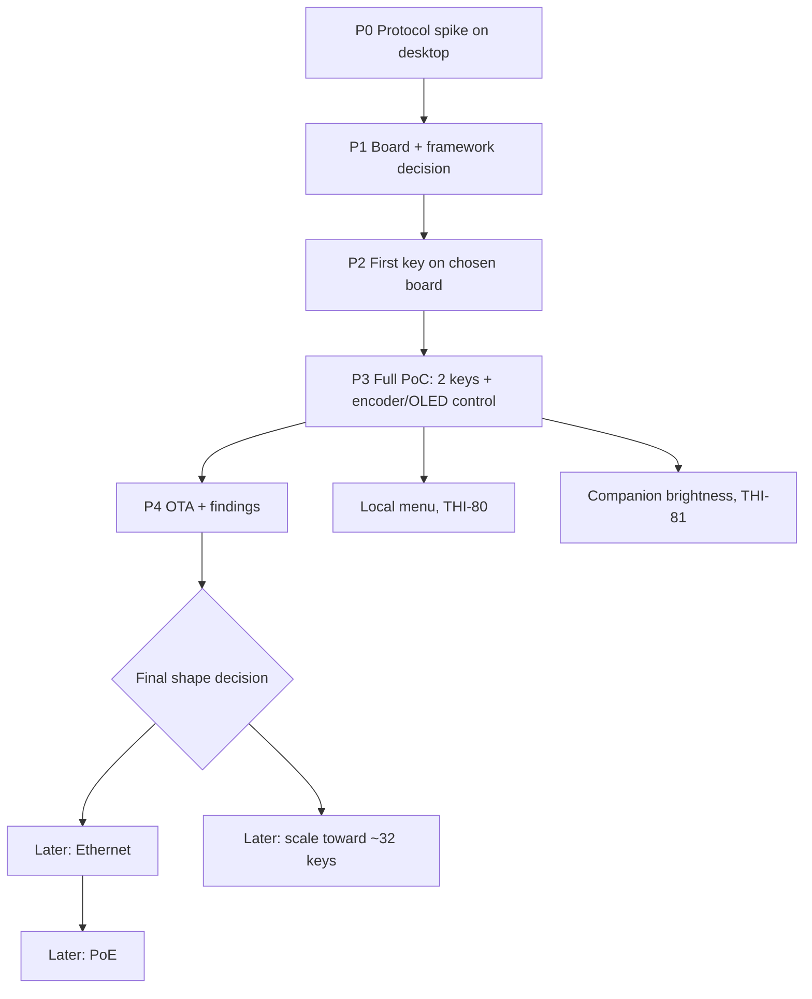
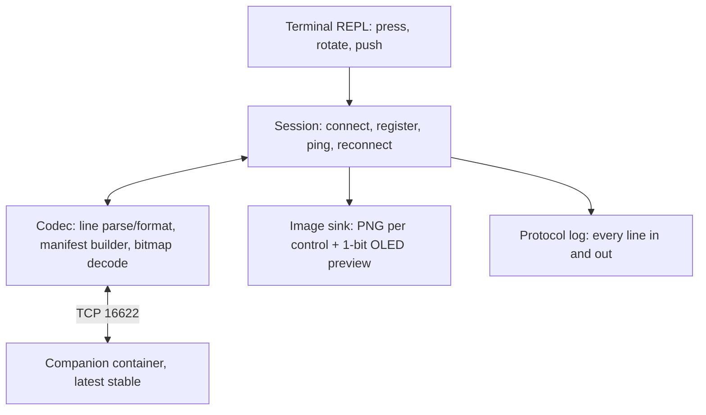
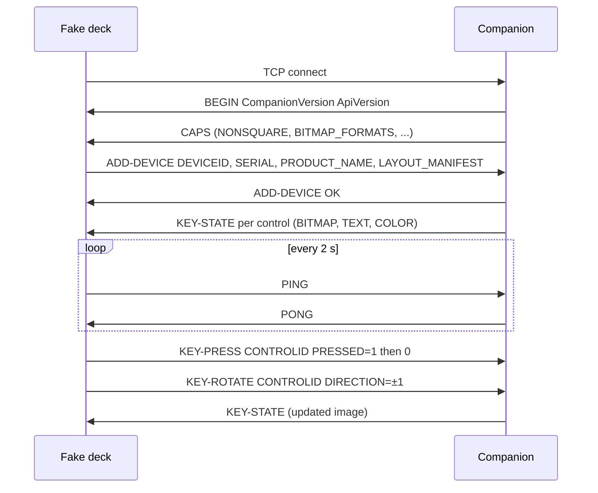
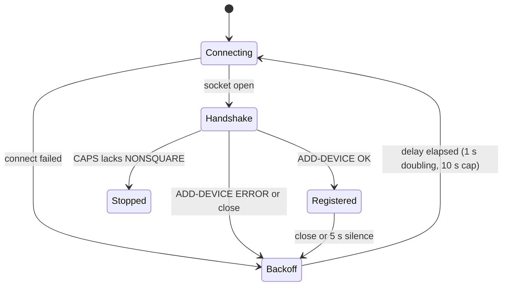
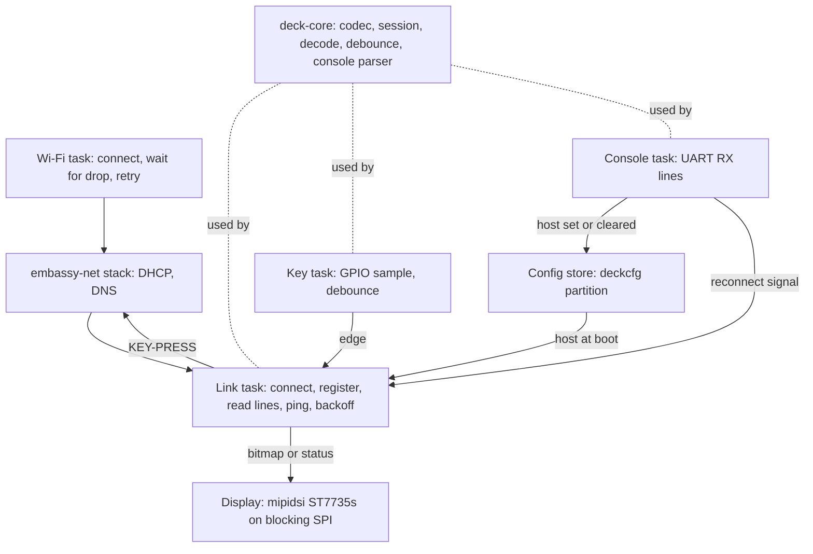
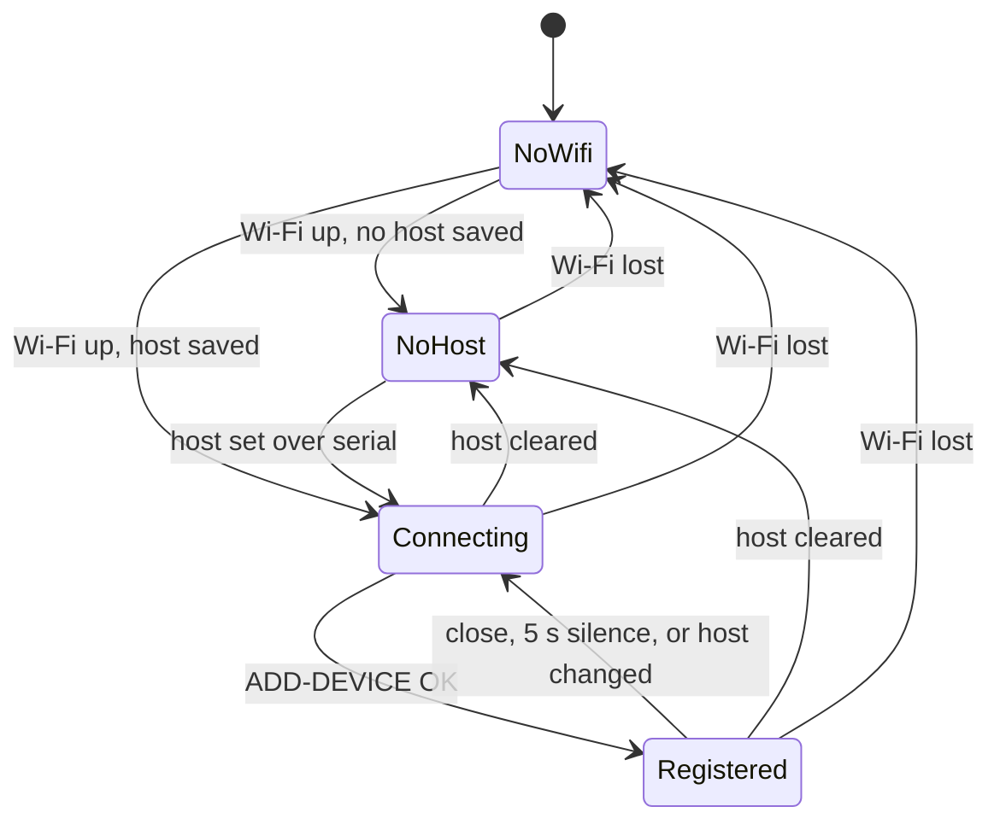
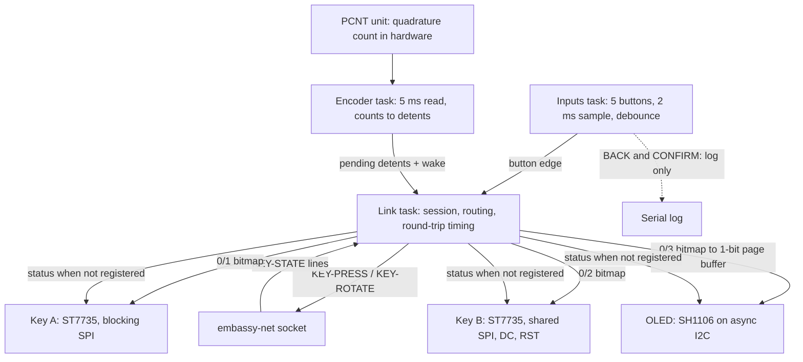

# Companion Network Deck PoC - Plan

## Goal Capsule

- **Objective:** A self-built deck works as one Bitfocus Companion surface over Wi-Fi. Every piece of hardware on hand has been proven in it: two LCD keys, a rotary encoder with menu buttons, and an OLED. Enough has been learned to choose the final device shape and to start the Ethernet/PoE stages.
- **Product authority:** This plan covers the proof-of-concept stages (P0–P4 below). The final device shape, Ethernet/PoE and scaling toward ~32 keys are context only. Each gets its own plan once the PoC is done.
- **Open blockers:** None. The board, firmware framework and key module were settled in P1 (see `docs/notes/board-and-framework-decision.md`). The OLED/encoder module was identified from the vendor's schematics in the P3 brainstorm (see Dependencies / Assumptions) and is confirmed on the bench in P3.
- **Planning scope:** Implementation planning below covers P0 (R14, done: U1–U4), P2 (R16, done: U5–U10) and P3 (R17: U11–U15). P1 (R15) was a spec-sheet decision and needed no implementation plan. P4 is planned, each enriching this file once the previous stage's findings are in.
- **Objective (P3):** Both LCD keys and the OLED/encoder module work as one Companion surface. The encoder and OLED are a Companion control only, with no local menu. A measured press-to-image round trip shows the deck is responsive over Wi-Fi (R17). The local menu (R9, R10) is THI-80, and Companion-driven brightness is THI-81. Neither is P3 scope.
- **Means (P3):** Extend the P2 firmware. The session registers three controls (KTD20), the keys share one SPI bus (KTD21), the OLED gets an in-tree SH1106 driver on async I²C (KTD22), and the encoder is counted by PCNT (KTD23). Pure logic stays in `deck-core` with host tests (KTD10).
- **Execution profile (P3):** As for P2, plus the second key and the OLED/encoder module wired per Wiring (P3). An agent can build, host-test and lint everything. The bench and end-to-end checks in U13–U15 need the operator's hardware, and an agent records them as passed only from the operator's reported results.
- **Stop conditions (P3):** Stop and report if the SH1106 answers at neither 400 kHz nor 100 kHz, or if PCNT cannot count the encoder's phases on the chosen pins. Either would change the module or the pin plan, which is the operator's call.
- **Authority:** The Product Contract wins on behaviour, the Planning Contract's KTDs win on mechanism, and units override neither.
- **Execution profile (P0):** A desktop-only spike, with a TypeScript (Node) fake-deck client and the latest Companion in a container on the Linux desktop. No hardware is involved.
- **Stop conditions (P0):** Stop and report back if the latest Companion cannot register a layout-manifest surface with two keys and one encoder control. That would mean R2 cannot be met through the Satellite protocol as planned.
- **Objective (P2):** With one ScreenKey wired to the Feather ESP32 V2, the operator sets the Companion host over USB serial. The key then shows whatever Companion assigns, its presses run Companion actions, and it recovers on its own when Companion goes away and comes back.
- **Means (P2):** Rust no_std firmware with the pure logic in a host-tested core crate (KTD9, KTD10), with tools pinned and installed through mise (KTD19). Hardware behaviour is checked on the bench against the P0 Companion container.
- **Execution profile (P2):** Firmware for the Feather ESP32 V2, flashed over USB. The latest Companion runs from `tools/fake-deck/compose.yaml` on the Linux desktop, and the deck joins the same LAN over WPA2 Wi-Fi.
- **Stop conditions (P2):**
  - **Toolchain outside mise.** Tools are installed only through the project's mise setup (KTD19). If `mise` itself is missing, or a tool can't be installed through mise, stop and tell the operator. Don't install anything any other way. On 2026-11-14, mise 2026.11.8 was installed (shims mode, not activated), and rustup had no toolchains.
  - **Stack can't do it.** Stop and report if the pinned no_std stack (KTD9) cannot join Wi-Fi on this board, or still cannot hold a 66 KB line after the buffer moves to PSRAM. Moving the buffer is not a reason to stop. That would trigger the Rust std fallback from `docs/notes/board-and-framework-decision.md`, which is the operator's decision to make.

---

## Product Contract

### Summary

Build a microcontroller-based deck that connects to Bitfocus Companion as a network surface over Companion's Satellite protocol. Its keys show images pushed by Companion and report presses. Its encoder works as a Companion control, and its OLED doubles as a local device menu. The work runs in five proof-of-concept stages, from a desktop protocol spike to an OTA-updatable deck with every part working. After the PoC, the final shape is decided.

### Problem Frame

The Elgato Stream Deck Studio is the reference: a networked, PoE-powered control surface with LCD keys and push-dials. Elgato's software stack doesn't fit this setup. Every desktop host runs Linux, and Elgato's Stream Deck app only exists for Windows and macOS. The Studio's network protocol is undocumented, and posing as an Elgato device is fragile and depends on Elgato's goodwill.

The parts on hand are a Feather ESP32 V2, a Pico 2 W, a Pi Zero 2 W, two Waveshare 0.85" ScreenKey Module B keys (ST7735, 128×128), and a 1.3" I²C OLED module with a rotary encoder and BACK/CONFIRM buttons. The intended use is mostly dev work, but nothing is fixed. The deck must be general-purpose rather than tuned to one workflow.

### Key Decisions

- **Bitfocus Companion is the only host software; the Satellite protocol is the device contract.** Companion runs natively on Linux, its protocol is open and versioned, and missing integrations can be written as custom Companion modules. (session-settled: user-directed — chosen over Elgato's Stream Deck app, alone or alongside Companion: no Linux build, undocumented network protocol, depends on impersonating a device.) Governs R1, R2, R3.
- **The deck is a pure network surface; Companion runs on a Linux desktop or server.** Companion can only run shell actions on the machine it runs on, so desktop-side dev actions work directly. (session-settled: user-directed — chosen over running Companion inside the deck on the Pi Zero 2 W: desktop actions would need extra plumbing.) Governs R1, R4.
- **The OLED module is mode-switched.** It is normally a Companion control and becomes a local device menu on a menu-button action. (session-settled: user-directed — chosen over Companion-only or local-menu-only.) Governs R8, R9, R10.
- **BACK and CONFIRM belong to the device; BACK opens the local menu.** Neither button is ever reported to Companion. The encoder's rotation and push are Companion's in control mode. (session-settled: user-directed — chosen over exposing both buttons to Companion as display-less buttons with a long-press menu gesture, and over sending CONFIRM to Companion: no long-press delay on any Companion input.) Governs R8, R9.
- **P3 proves the hardware as a Companion surface; the local menu is its own issue.** P3 covers both keys and the encoder/OLED control. The local menu and its settings (R9, R10) move to THI-80. (session-settled: user-directed — chosen over a P3 menu with brightness only, and over a read-only P3 menu: keeps P3 to proving the hardware.) Governs R17.
- **Companion's `BRIGHTNESS` is not honoured in P3.** The key backlights stay fully on, as in P2. THI-81 tracks it. (session-settled: user-directed — chosen over dimming backlights and OLED contrast from Companion in P3.) Governs R17.
- **P3 responsiveness is measured, not gated.** The measurement and its bar are in Success Criteria. (session-settled: user-approved — chosen over a hard p95 target and over bench feel alone.) Governs Success Criteria.
- **The deck runs on a microcontroller, not a Linux board.** It matches the appliance-style end goal: instant boot, low power and a proven PoE path. A desktop "fake deck" spike provides the protocol learning first. (session-settled: user-directed — chosen over a Pi Zero 2 W as the deck's brain, and over a Linux reference implementation later ported to a microcontroller.) Governs R14, R15.
- **Compiled firmware with OTA updates; no MicroPython.** OTA keeps flashing out of the iteration loop. Governs R12, R13.
- **The deck board is the Feather ESP32 V2.** It is the only candidate with mature OTA, it has a native Ethernet MAC on the same chip family as ready-made PoE boards, and its 2 MB PSRAM holds 128×128 image lines with room to spare. (session-settled: user-directed — chosen over the Pico 2 W: OTA on the RP2350 has no official flow, and its wired path is W5500 only.) Governs R15, R16.
- **Firmware is Rust no_std: `esp-hal` + embassy, `esp-radio` for Wi-Fi, `esp-bootloader-esp-idf` for A/B OTA.** It is pure Rust with async throughout, and it is the stack Espressif funds. The accepted costs: pinned crate versions through pre-1.0 API churn, our own OTA rollback and upload endpoint, and community crates or W5500 for Ethernet. Rust std (`esp-idf-svc`) on the same board is the fallback. (session-settled: user-directed — chosen over Rust std, whose bindings are community-maintained and whose peripherals are mostly blocking, and over Arduino-ESP32 3.x on PlatformIO, ESP-IDF in C and Zephyr.) Governs R12, R13, R16.
- **P1 decides from spec sheets, without bench tests.** Both boards are on hand and switching later is cheap, so P2 becomes the first hardware proof. (session-settled: user-directed — chosen over bench-testing both boards for toolchain, Wi-Fi/Satellite, OTA and an ST7735 key.) Governs R15.
- **The board comparison comes before deck-feature work.** (session-settled: user-directed — chosen over building a single key first and comparing boards afterwards: the basic setup would be done twice.) Governs R15, R16.
- **The final shape is decided after the PoC, not now.** Rack mounting is dropped. Key count (~32 eventually), display technology and enclosure stay open until the PoC has shown what works. (session-settled: user-directed — chosen over fixing the final form now.) Governs R18.

### Actors

- A1. Operator: the person setting up and using the deck (mainly for dev work).
- A2. Companion: Bitfocus Companion on a Linux desktop or server. It owns button layouts, images, actions and integrations.
- A3. Deck: the microcontroller device. It shows what Companion sends and reports input.

### Requirements

**Host integration**

- R1. The deck connects to a Companion instance over the LAN and registers as a single Satellite surface; nothing besides Companion runs on the desktop.
- R2. The surface exposes both LCD keys and the encoder control to Companion, so Companion's normal button editor configures them.
- R3. Companion's own and custom modules drive all actions; the deck holds no action logic.
- R4. The operator sets which Companion host the deck connects to without reflashing firmware.

**Keys and display output**

- R5. Each LCD key shows the image Companion assigns it and updates when Companion changes it.
- R6. Pressing and releasing a key reports press and release to Companion.
- R7. When Companion is unreachable, the deck shows a clear disconnected/searching state on every display, keys and OLED alike, and reconnects automatically when Companion returns.

**Encoder and OLED**

- R8. In control mode, encoder rotation, encoder push and the OLED appear in Companion as one control. Each encoder detent is reported as one rotation step, push and release are reported, and the OLED shows that control's image from Companion.
- R9. Pressing BACK switches the OLED module into a local device menu and back; while the menu is open, encoder input goes to the menu and not to Companion. (THI-80)
- R10. The local menu shows connection status and the Companion host, and lets the operator adjust brightness and Wi-Fi settings. (THI-80)

**Connectivity and updates**

- R11. The PoC deck connects over Wi-Fi.
- R12. Firmware updates install over the network (OTA), without a USB cable.
- R13. The deck accepts OTA updates only from the operator, enforced in the PoC by a password or shared secret on the OTA endpoint.

**PoC stages and outcomes**

- R14. P0, protocol spike: a desktop "fake deck" script registers with Companion, shows key images and sends presses. Done when the Satellite protocol's key/encoder/image behaviour is understood well enough to implement in firmware.
- R15. P1, board and framework decision: the key module's controller and pinout are identified, and the Pico 2 W and Feather ESP32 are compared from spec sheets on OTA, Wi-Fi plus Satellite, ST7735 support and toolchain. A written decision names one board and one firmware framework with reasons. It also records each board's path to wired Ethernet/PoE and its headroom for more keys. Done in `docs/notes/board-and-framework-decision.md`.
- R16. P2, first key on the chosen board: one LCD key works end-to-end with Companion (R5, R6), on the firmware stack chosen in R15.
- R17. P3, full PoC: both keys and the encoder/OLED control work together as one surface, meeting R2 and R5–R8. BACK and CONFIRM are wired and their presses are logged, but they do nothing until THI-80 adds the local menu. The OLED/encoder module is identified and documented.
- R18. P4, OTA and wrap-up: OTA works on the full PoC (R12, R13), and a written findings note feeds the final-shape decision (key count, display technology, enclosure, Ethernet/PoE hardware). The note records measured image memory per key, the time to refresh all keys after a Companion page change, and SPI redraw time per display, extrapolated to ~32 keys for both the per-key and shared-panel options.

### PoC Stages



Each stage is defined by its requirement (R14–R18). The stages after the decision point are context, not scope. THI-80 and THI-81 follow P3 as separate issues. Their order relative to P4 is open.

### Key Flows

- F1. Power-on and connect
  - **Trigger:** The deck powers on.
  - **Actors:** A3, A2
  - **Steps:** The deck joins Wi-Fi and connects to the configured Companion host. It registers as a surface and Companion pushes the current images. Until then the deck shows the disconnected/searching state.
  - **Covered by:** R1, R4, R5, R7, R11
- F2. Press a key
  - **Trigger:** The operator presses an LCD key.
  - **Actors:** A1, A3, A2
  - **Steps:** The deck reports press and release. Companion runs the action and may push a new image, which the deck shows.
  - **Covered by:** R5, R6
- F3. Use the encoder
  - **Trigger:** The operator turns or pushes the encoder.
  - **Actors:** A1, A3, A2
  - **Steps:** Each detent and each push and release goes to Companion. Companion runs the control's actions and may push a new image, which the OLED shows.
  - **Covered by:** R8
- F5. Open the local menu (THI-80)
  - **Trigger:** The operator presses BACK.
  - **Actors:** A1, A3, A2
  - **Steps:** The OLED switches to the local menu, where encoder input navigates the menu. Leaving the menu returns to control mode with Companion's content restored.
  - **Covered by:** R9, R10
- F4. Update firmware
  - **Trigger:** The operator pushes a new firmware build.
  - **Actors:** A1, A3
  - **Steps:** The deck accepts the operator's update, installs it, restarts, and reconnects via F1.
  - **Covered by:** R12, R13

### Acceptance Examples

- AE1. **Covers R7.** **Given** the deck is connected, **when** Companion is stopped, **then** the deck shows the disconnected state within a few seconds, **and** when Companion restarts it reconnects and restores the key images without operator action.
- AE2. **Covers R9 (THI-80).** **Given** the local menu is open, **when** the operator turns the encoder, **then** the menu moves and Companion receives no rotation events.
- AE3. **Covers R9, R8 (THI-80).** **Given** Companion changed the encoder control's image while the local menu was open, **when** the operator leaves the menu, **then** the OLED shows Companion's latest content.
- AE5. **Covers R8.** **Given** the encoder control's button in Companion has rotary actions that count steps, **when** the operator turns the encoder five detents right and then two left, **then** the right action runs exactly five times, the left action exactly twice, and the OLED shows the updated image.
- AE6. **Covers R17.** **Given** the P3 deck is connected, **when** the operator presses BACK or CONFIRM, **then** the press is logged on the serial console, Companion receives nothing, and the OLED keeps Companion's content.
- AE4. **Covers R13.** **Given** a firmware image pushed without the OTA password, **when** it reaches the deck, **then** the deck rejects it and keeps running its current firmware.

### Success Criteria

- The full PoC (P3) feels responsive in daily use: a key press triggers its Companion action, and the key's new image appears, without noticeable delay over Wi-Fi.
- P3's notes record the measured time from a key press, and from an encoder detent, to the matching image being drawn, as median and worst case over a bench session. A median of about 100 ms or less backs "feels instant". A miss is recorded as a finding to investigate, not a failed stage.
- The P4 findings note is enough to decide the final shape without repeating PoC experiments.

### Scope Boundaries

**Deferred for later**

- The local device menu and its Wi-Fi and brightness settings (R9, R10, F5, AE2, AE3): THI-80, after P3. Until then, Wi-Fi credentials stay compiled into the firmware (KTD11).
- Honouring Companion's `BRIGHTNESS` on the key backlights and OLED contrast: THI-81, after P3.
- Encoder acceleration: P3 sends one step per detent.
- Ethernet and PoE: separate stages after the final-shape decision, needing hardware not yet owned (e.g. a W5500 module or an ESP32 PoE board).
- Scaling toward ~32 keys, choosing display technology (one display per key vs a shared panel) and enclosure design.
- Custom Companion modules for specific dev workflows.
- Signed firmware for OTA; the PoC uses a password gate (R13).
- Custom PCB: a likely step once the final shape is set; the PoC uses off-the-shelf boards and modules.

**Outside this product's identity**

- Compatibility with Elgato's Stream Deck app or impersonating Elgato hardware.
- Running Companion on the deck itself.
- Rack-mount (1U) form factor.

### Dependencies / Assumptions

- A current Companion release is available on a Linux host, and the PoC is tested against the latest stable release only. Per the Satellite API docs, layout manifests (separate LCD key and encoder/OLED controls with their own bitmap sizes) need Companion 4.2+ (API 1.9), and non-square bitmaps need Companion 5.0+ (API 1.11). Older versions are not tested.
- The key modules are Waveshare 0.85" ScreenKey Module B: ST7735 over SPI, 128×128, 3.3 V, with a mechanical switch (identified in P1). The KEY output's polarity and pull-up needs and the panel offset are checked on the bench in P2.
- The OLED/encoder module is the "1.3-inch OLED + EC11 rotary encoder combination module" (Javino/Liludin, sold by Weinuo Module Store), identified from the vendor's interface description and schematics (2026-11-16). The operator confirmed it matches the part on hand. The facts below come from the schematics; P3 confirms them on the bench and records them in `docs/notes/`.
  - **Display:** 1.3" white 128×64 SH1106 over I²C. Strapping fixes I²C mode at address 0x3C. The reset is a power-on RC circuit not routed to the header, so firmware can re-initialise the panel but not hard-reset it. 10 kΩ I²C pull-ups to 3V3 are fitted.
  - **Encoder:** EC11, 20 pulses and 20 detents per turn, with a push switch. Phases A and B have 10 kΩ pull-ups and an RC filter (100 Ω, 100 nF). The common pin is GND.
  - **Buttons:** BACK (`KEY0`) and CONFIRM (`KEY1`). These and the encoder push each have a 10 kΩ pull-up and 100 nF, and read low when pressed.
  - **Header J1:** 1 +3V3, 2 GND, 3 BAK, 4 TRB, 5 TRA, 6 PSH, 7 SCL, 8 SDA, 9 CON. The front silkscreen lists them in reverse.
  - **Power:** the vendor describes VCC as a 3.3 V supply; the back silkscreen says 3.3–5 V. The deck feeds 3.3 V so the on-board pull-ups stay at ESP32 levels.
  - **Pins:** the module needs I²C (GPIO 22/20, reserved in P1) plus five inputs. With on-board pull-ups, the Feather's input-only pins 34/36/37/39 can take four of them.
  - **Bench checks:** the SH1106 column offset (commonly 2) and the encoder's rotation sense.
- The Rust no_std crates (`esp-hal`, `esp-radio`, `esp-bootloader-esp-idf`) are pinned per stage. `esp-radio` is pre-1.0, so upgrades may need migration work.
- The Pi Zero 2 W is not part of the deck. It may serve as a spare headless Companion host or test bench.
- The LAN is trusted for Satellite traffic, which is unauthenticated. Only OTA needs protection (R13).

### Outstanding Questions

**Resolve Before Planning**

- None.

**Deferred to Planning**

- How Wi-Fi settings are changed from the local menu (R10). This moved to THI-80 with the menu. Until then, credentials are set at build time and the Companion host over USB serial (KTD11).
- Whether compressed key bitmaps (`png`/`webp`) are worth their decode cost at scale. P2 uses 128×128 `rgb` (KTD12), and THI-76 tracks the comparison.
- How OTA rollback is confirmed (e.g. the new image is marked valid only after `ADD-DEVICE OK`) and how builds are uploaded behind the R13 password (P4).
- How Companion's image becomes 1-bit on the OLED (P3): answered by KTD22, a fixed threshold.
- Where the second key and the encoder control sit in Companion's grid, and which Feather pins each new input uses (P3): answered by KTD20 and KTD25.

### Sources / Research

- P1 board, framework and key module decision, with its own sources: `docs/notes/board-and-framework-decision.md`
- P2 firmware research (2026-11-14), which shapes KTD9–KTD19: [mise Rust docs](https://mise.jdx.dev/lang/rust.html), [mise environments](https://mise.jdx.dev/environments/), [esp-radio README](https://github.com/esp-rs/esp-hal/blob/main/esp-radio/README.md), the esp-hal v1.2.2 examples ([`embassy_dhcp`](https://github.com/esp-rs/esp-hal/blob/esp-hal-v1.2.2/examples/wifi/embassy_dhcp/src/main.rs), [`flash_read_write`](https://github.com/esp-rs/esp-hal/blob/esp-hal-v1.2.2/examples/peripheral/flash_read_write/src/main.rs), [`ota/update`](https://github.com/esp-rs/esp-hal/tree/esp-hal-v1.2.2/examples/ota/update)), [esp-generate](https://github.com/esp-rs/esp-generate), [mipidsi 0.10](https://docs.rs/mipidsi/0.10.0/mipidsi/), [embassy-net 0.9.1 TcpSocket](https://docs.rs/embassy-net/0.9.1/embassy_net/tcp/struct.TcpSocket.html), [WPA3 issue esp-hal#1600](https://github.com/esp-rs/esp-hal/issues/1600), [throughput issue esp-hal#6698](https://github.com/esp-rs/esp-hal/issues/6698)
- OLED/encoder module listing, with its interface description and schematics in the product description (read 2026-11-16): https://de.aliexpress.com/item/1005010470649235.html
- Companion Satellite API: https://companion.free/for-developers/Satellite-API and https://companion.free/user-guide/remote_control/satellite
- Companion 3.4 release (Stream Deck Studio support, surfaces over 32 keys; background only, below the version baseline): https://newreleases.io/project/github/bitfocus/companion/release/v3.4.0
- Companion module development: https://companion.free/for-developers/setting-up-developer-environment
- Elgato HID protocol docs, for reference only: https://docs.elgato.com/streamdeck/hid/
- Prior DIY Elgato emulation, background on the rejected path: https://github.com/DDRBoxman/picodeck

---

## Planning Contract

Product Contract preservation:
- **P0 (changed):** Dependencies / Assumptions (Companion version). P0 now tests against the latest Companion only and no longer confirms a minimum version. The user directed this change. The documented requirements still stand: layout manifests need API 1.9 (Companion 4.2), and non-square bitmaps need API 1.11 (Companion 5.0).
- **P2 (unchanged):** Requirements are unchanged. Outstanding Questions were narrowed to what is still open after P2's planning decisions (KTD11, KTD12).

This contract plans P0 (R14), P2 (R16) and P3 (R17). P1 (R15) was settled without an implementation plan, and P4 (R18) is not yet planned. Product Contract preservation (P3 planning): Product Contract unchanged; the two P3 questions deferred to planning are answered by KTD20, KTD22 and KTD25. Each stage is planned on its own, using the previous stage's findings.

### Key Technical Decisions (P0)

- KTD1. **The fake deck is a small TypeScript project on Node 24+ at `tools/fake-deck/`, managed with npm. `pngjs` is its only runtime dependency.** (session-settled: user-directed — chosen over Python: the user ruled Python out.) Node runs `.ts` files directly through type stripping, so there is no build step. `node:net` and `node:readline` give line-based TCP and the REPL. `node --test` runs the tests, and `tsc --noEmit` type-checks. The code sticks to erasable TypeScript syntax (no enums or namespaces), so type stripping can run it. `bitfocus/companion-satellite` is a full surface bridge, not a library, so the codec is hand-written. That project is a reference to read, not a dependency, because reusing it would hide the protocol details P0 must learn.
- KTD2. **The fake deck uses the raw TCP transport on port 16622, not WebSocket (16623).** The firmware will use raw TCP, which needs no WebSocket framing or HTTP upgrade on the microcontroller. The spike exercises the same transport the device will. The port stays configurable because the docs say it may become configurable on the server side.
- KTD3. **The surface registers in advanced mode with a `LAYOUT_MANIFEST` and targets the latest Companion only.** The manifest declares two key controls and one encoder control, each with its own style preset (R2, R14). The client logs `ApiVersion` and `CAPS` from the handshake. If `CAPS` lacks `NONSQUARE`, it refuses to register and says that it needs a current Companion. `SERIAL` is always sent.
- KTD4. **The spike requests `rgb` bitmaps by default, and a flag asks for `png` when `BITMAP_FORMATS` offers it.** `rgb` is always available and needs no decoder on the device. The `png` run only measures wire size, so the notes can weigh decode cost against bandwidth for P1.
- KTD5. **The OLED question is answered by asking for both a 128×64 bitmap and text on the encoder control, and comparing them.** The encoder preset requests a 128×64 bitmap plus `text` and `textStyle`. The fake deck saves each received bitmap with a 1-bit preview next to it, and logs the decoded text. The notes recommend image, text or both for a mono OLED, based on those artifacts.
- KTD6. **Companion runs in the official container image, `ghcr.io/bitfocus/companion/companion`, pinned to the latest stable release tag.** (session-settled: user-directed — chosen over also testing a 4.2 floor version: not needed.) The container keeps the spike off any Companion the operator already runs. Pinning the tag keeps the notes tied to a known version. Host ports are remapped away from 8000/16622, and the config volume lives under a gitignored directory.
- KTD7. **Connection policy: one reconnect policy that the firmware can copy.** The client sends `PING` every 2 s. It treats the link as dead after 5 s without any server line, or on socket close. It reconnects with capped exponential backoff (1 s doubling to a 10 s cap) and re-runs the full `ADD-DEVICE` registration on every connect, because disconnect removes the device on the Companion side. The spike measures whether these numbers hold. The final values go in the notes, not here.
- KTD8. **Findings live in one firmware-facing note, `docs/notes/satellite-protocol-firmware-notes.md`, backed by trimmed protocol-log excerpts.** P1 and P2 read one page instead of a log dump. Raw logs and images stay in the gitignored `tools/fake-deck/out/`.

### High-Level Technical Design (P0)

Components of the fake deck and the test bench:



Session sequence the spike must exercise (and the firmware will copy):



Connection states (KTD7):



### Output Structure (P0)

```text
tools/fake-deck/
  package.json
  tsconfig.json        # type-check only (noEmit, erasable syntax)
  README.md            # how to start Companion and run the spike
  compose.yaml         # pinned Companion service
  .gitignore           # node_modules/, out/, companion-data/
  companion-config/    # committed Companion config export
  src/
    main.ts            # CLI entry and REPL
    protocol.ts        # codec and manifest builder
    session.ts         # connection lifecycle and reconnect
    images.ts          # bitmap decode and PNG / mono preview output
  test/
    protocol.test.ts
    session.test.ts
    images.test.ts
docs/notes/
  satellite-protocol-firmware-notes.md
```

### Assumptions (P0)

- The ST7735 key size is unknown until P1, so key bitmap size is a CLI option. The spike runs at Companion's default 72×72 and at least one plausible ST7735 size (80×80 or 128×128), so the notes cover the memory range.
- Buttons are configured by hand in the Companion web UI for the spike. The resulting Companion config export is committed so a rerun needs no manual setup.
- The encoder control works as a Companion button with rotary actions enabled. The spike confirms this and records the steps in the notes.
- The operator's own Companion install is not used or modified.

### Deferred to Follow-Up Work (P0)

- Implementation planning for P3–P4 (R17–R18), one stage at a time. P2 is planned below.

### Considered and Not Built (P0)

- WebSocket transport: the firmware will not use it (KTD2). Revisit if raw TCP turns out to be blocked on the target network.
- Testing older Companion versions: the user ruled it out (KTD6). The notes cite the documented API version of each feature used, so a later stage can work out an older floor if it ever needs one.
- Subscriptions, variables, pincode lock, bitmap cache, LEDs and `DEVICE-APPEARANCE`: no R-ID needs them for the PoC. The notes list them with their API versions so later stages can opt in.
- A GUI window that renders the keys: PNG files per control show the same evidence with less code. Revisit only if inspecting files slows the spike down.
- CI for the spike: it is a throwaway learning tool, and running `npm test` locally is enough.

### Risks & Dependencies (P0)

- Satellite quoting rules (embedded quotes, escapes) are only partly documented. The codec tests start from the Satellite API page examples. Cases seen in the U4 logs are added to `test/protocol.test.ts`, and the notes record the rules observed.
- The newest tagged release may predate API 1.15/1.16 (Companion 5.2). The notes list the API level actually tested and do not claim that later features were verified.
- Companion's server-side idle timeout is undocumented. The spike measures it with `--no-ping`, and the notes record the value.

### Deferred to Implementation (P0)

- The exact latest stable container tag at the time of the run.
- Exact control IDs and grid positions in the manifest, chosen so Companion's button editor shows the two keys and the encoder in one row.
- The 1-bit conversion method for the OLED preview (threshold vs dither), whichever is more legible.

### Key Technical Decisions (P2)

- KTD9. **Firmware starts from the `esp-generate` 2.0.0 template and pins the late-2026 esp-rs set.** The template options are `esp32`, `embassy`, `unstable-hal`, `alloc`, `wifi`, `log` and `esp-backtrace`. The pins are:
  - `esp-hal ~1.2.2` (`unstable`)
  - `esp-rtos 0.4` for embassy start-up. `esp-hal-embassy` is abandoned.
  - `esp-radio =1.0.0-beta.1`. beta.2 was yanked, and 0.18 has the older API.
  - `esp-bootloader-esp-idf 0.6`
  - `embassy-net 0.9.1` with `tcp`, `dhcpv4` and `dns`
  - `mipidsi 0.10`, with the embedded-graphics version it requires
  - `esp-storage 0.10`, reached through `FlashRegion` (KTD14)
  - the `esp` Xtensa toolchain v1.100.0.0
  
  `Cargo.lock` holds the exact versions. Upgrades are deliberate migrations, because esp-radio is still in beta.
- KTD10. **There are two cargo roots: a host workspace for pure logic, and a separate firmware root.** The root `Cargo.toml` is a host workspace with `crates/deck-core`, tested with `cargo test` on a stable host toolchain. `crates/deck-core` is a `no_std` library with no esp or embassy dependencies; time is passed in as milliseconds, and flash is reached through the `embedded-storage` traits. `firmware/` is excluded from that workspace and has its own `.cargo/config.toml`, `rust-toolchain.toml` (`channel = "esp"`) and lockfile. Cargo config and toolchain files apply by directory, so a shared root would make host tests build for Xtensa. On-target tests are not possible: the Feather's CH9102F is USB-UART only, with no JTAG.
- KTD11. **Wi-Fi credentials are set at build time, and the Companion host at runtime over USB serial.** (session-settled: user-directed — chosen over a serial console for both, a captive portal, and serial plus mDNS discovery: least code before the first key works, and the local menu takes over Wi-Fi settings for R10, now in THI-80.) `firmware/build.rs` reads the gitignored `firmware/wifi.env`, which holds `DECK_WIFI_SSID` and `DECK_WIFI_PASSWORD`. It passes both to the compiler and rebuilds when the file changes. If the file is missing, the build fails with an error that names the file. The access point must offer WPA2-Personal, because esp-radio has no WPA3/SAE (esp-hal#1600). The serial console is KTD13.
- KTD12. **The deck registers one 128×128 `rgb` key as control `0/1` (row 0, column 1).** (session-settled: user-directed — chosen over 128×128 `png`, which needs an inflate decoder and about 32 KB of working memory in the first hardware stage, and over a smaller preset, which needs scaling or a border: native size, no decoder. THI-76 revisits compression.) `ADD-DEVICE` sends no `BITMAP_FORMAT`. Column 1 avoids the page buttons a new Companion page puts in column 0 (P0 notes, Layout manifest). P3 lays out the full surface.
- KTD13. **The serial console is a receive-only async UART beside the logger.** `UartRx` on UART0 RX (GPIO3) runs at 115200 baud, and esp-println keeps TX through the ROM routine. The commands are:
  - `host <hostname-or-ip>[:port]`, where the port defaults to 16622
  - `host clear`
  - `show`
  - `help`
  
  The host accepts a hostname or an IP address, because embassy-net's DNS query returns IP literals without a lookup. A valid `host` command is saved first, then the link reconnects at once.
- KTD14. **The flash layout reserves OTA slots now, and the config lives in its own partition.** `firmware/partitions.csv` declares `nvs`, `otadata`, two 3 MB slots `ota_0` and `ota_1`, and a 64 KB `deckcfg` data partition of subtype `undefined` (0x06), found by its label. esp-bootloader-esp-idf 0.6 panics on custom data subtypes (0x40–0xFE) when it builds a `FlashRegion`. Changing the layout in P4 would move `deckcfg` and wipe the saved host. The config is one versioned, CRC-checked record in the first sector of `deckcfg`, written by erase-then-write. It is accessed through esp-bootloader-esp-idf's `FlashRegion` (`embedded-storage` feature), with esp-storage 0.10 underneath until esp-hal releases its replacement. A blank, unknown-version or bad-CRC record means no host is set. If a write is interrupted, the key shows "No host" and the operator types the host again.
- KTD15. **A whole line is buffered, then decoded and drawn without a framebuffer.** One static 72 KB line buffer lives in internal RAM; P2 does not use PSRAM. A line longer than the buffer is skipped up to the next newline and logged, and the session stays up. A `KEY-STATE` bitmap must decode to exactly 128 × 128 × 3 bytes, or it is logged and not drawn. An iterator decodes base64 to RGB888 to RGB565 straight from the buffer into mipidsi's `set_pixels` (`ST7735s` model) over blocking SPI. That blocks the executor for about 10 ms per frame, which is acceptable for one key.
- KTD16. **The link follows the firmware policy from the P0 notes, which lowered KTD7's backoff cap from 10 s to 5 s.** The rules are in `docs/notes/satellite-protocol-firmware-notes.md#reconnect-behaviour`: 2 s `PING`, 5 s silence watchdog, 5 s connect timeout, backoff from 1 s doubling to a 5 s cap, and `ADD-DEVICE` on every connection. Two things are P2-specific:
  - The firmware resets the backoff on `ADD-DEVICE OK` and resolves the host again on every attempt.
  - `DEVICEID` (`opendeck-<12 hex>`) and `SERIAL` (`opendeck:<12 hex>`) come from the Wi-Fi MAC, so Companion remembers the surface across reboots.
  
  P2 does not require `NONSQUARE`, because its only control is square. P3 adds that check together with the OLED.
- KTD17. **The firmware owns the key image until registration.** Until `ADD-DEVICE OK` the key shows a status screen drawn with an embedded-graphics mono font: "No Wi-Fi", "No host" (with a hint to set it over serial), or "Connecting" (with the host). It returns to a status screen on any disconnect (R7). `KEYS-CLEAR` blanks the key.
- KTD18. **Key edges go to Companion only while registered, and are never queued.** KEY is read on a GPIO with the internal pull-up, assumed active-low until U8's bench check. `deck-core` debounces it by requiring a stable level for 20 ms, and the debounce interval can be tuned. An edge that happens while the link is not registered is dropped.
- KTD19. **mise pins and installs every tool.** (session-settled: user-directed — chosen over installing with rustup and `cargo install` by hand, and over an `espressif/idf-rust` dev container: tools are pinned in the repo and USB flashing works without passing the device into a container.)
  - **Repo root.** `mise.toml` pins `rust = "stable"` (a dated stable release) and `cargo:espup`, `cargo:espflash` and `cargo:esp-generate` at the KTD9 versions. It also defines an `esp-toolchain` task that runs `espup install` for toolchain v1.100.0.0 and writes `export-esp.sh` to a gitignored path inside the repo.
  - **`firmware/`.** `firmware/mise.toml` loads that file with `[env] _.source` and sets `RUSTUP_TOOLCHAIN = "esp"`. Without that override, the root's stable pin would win over `firmware/rust-toolchain.toml`, because mise sets `RUSTUP_TOOLCHAIN`.
  - **Shared rustup home.** espup and mise must use the same rustup home, the default `~/.rustup`, so the `esp` toolchain is visible to both.
  - **How commands run.** mise runs here through shims, not shell activation, so commands go through `mise exec --` or `mise run` to get the project environment. A fresh checkout needs `mise trust` once.

### High-Level Technical Design (P2)

Firmware tasks and their channels:



The key's status, as KTD17 and R7 require:



In `Registered` the key shows Companion's latest bitmap until a `KEYS-CLEAR` blanks it. In every other state it shows that state's status screen.

### Output Structure (P2)

```text
mise.toml                  # pinned tools and esp-toolchain task
Cargo.toml                 # host workspace: members crates/*, excludes firmware
crates/deck-core/
  Cargo.toml
  src/
    lib.rs                 # no_std, no esp/embassy deps
    line.rs                # line framing and Satellite codec
    session.rs             # registration, ping, watchdog, backoff state machine
    bitmap.rs              # base64 → RGB565 streaming decode
    debounce.rs
    console.rs             # serial command parser
    config.rs              # host/port record, validation and store over generic NOR flash
  tests/                   # host integration tests where unit tests are not enough
firmware/
  Cargo.toml
  build.rs                 # wifi.env → build-time env
  rust-toolchain.toml
  .cargo/config.toml
  mise.toml              # esp toolchain env and RUSTUP_TOOLCHAIN override
  espflash.toml
  partitions.csv
  wifi.env.example         # committed template; wifi.env is gitignored
  README.md
  src/
    main.rs
    wifi.rs
    link.rs
    display.rs
    key.rs
    console.rs
    config_store.rs
docs/notes/
  deck-wiring.md
```

### Wiring (P2)

These pin assignments are planned and become fixed when U8 confirms them on the bench. U8 records the final assignment in `docs/notes/deck-wiring.md`. They use the Feather's hardware SPI pins plus pins that `docs/notes/board-and-framework-decision.md#headroom-for-more-keys` lists as free. GPIO5 (SCK) and GPIO15 (RST) are ESP32 strapping pins whose boot defaults are pull-ups. The panel's inputs should not override them, and U8 confirms that the board boots normally with the key attached.

| ScreenKey pin | Feather ESP32 V2 | Notes |
|---|---|---|
| VCC / GND | 3V / GND | |
| SCLK | GPIO5 (SCK) | SPI2, shared with later keys |
| DIN | GPIO19 (MOSI) | MISO unused |
| CS | GPIO33 | One per key |
| DC | GPIO27 | Shared |
| RST | GPIO15 | Shared |
| PWM | GPIO14 | Driven high; brightness is not built in P2 |
| KEY | GPIO32 | Internal pull-up; one per key |

### Assumptions (P2)

- The board's ESP32-PICO-MINI-02 module carries an ESP32-PICO-V3-02 chip, which is silicon revision v3, as esp-hal requires.
- A 72 KB static buffer fits in internal RAM alongside Wi-Fi. U10 logs the free heap after registration to confirm it.
- The ST7735 accepts SPI at 20–26 MHz with these wires.
- The P0 Companion container is still the latest stable release, or its tag is moved to the latest before the U10 runs.

### Deferred to Follow-Up Work (P2)

- Compressed key bitmaps: THI-76.
- Implementation planning for P3 and P4.

### Considered and Not Built (P2)

- **PSRAM heap:** a single key fits in internal RAM, and PSRAM forces release-only builds and blocks DMA on classic ESP32. Revisit when P3's second key and OLED show memory pressure.
- **Async raw-command ST7735 driver:** a 10 ms blocking draw is fine for one key. Revisit if P4 measures redraw stalls hurting Wi-Fi at higher key counts.
- **`BRIGHTNESS` handling:** no P2 requirement needs it, and the backlight stays fully on. THI-81 honours Companion's value, and THI-80 adds the menu setting (R10).
- **Queuing presses made while offline:** replaying stale presses later would run actions the operator didn't mean to run now (KTD18).
- **A `NONSQUARE` gate:** P2 has no non-square control (KTD16).
- **On-device automated tests and firmware CI:** with no JTAG, on-device tests can't run; host tests cover the logic. Revisit if an ESP-Prog is added.
- **OTA code:** this is P4 (R12, R13). P2 only reserves the flash layout (KTD14).
- **A `sequential-storage` key-value map:** the deck stores one host record, written only when the operator types `host`, so wear levelling and power-fail recovery buy nothing that retyping the host doesn't. Revisit if the deck ever stores many settings.

### Risks & Dependencies (P2)

- **esp-radio is a pinned beta (KTD9).** Its APIs used outside the esp-hal examples may change or fail. If Wi-Fi does not work on this board, that is a P2 stop condition (Goal Capsule).
- **Internal RAM may run short with Wi-Fi buffers.** U10 logs the free heap after registration. If the 72 KB buffer does not fit, moving it to PSRAM (release builds) is the first fallback.
- **TCP throughput defaults are low (esp-hal#6698).** A 65 KB image may take 0.3–0.5 s. U10 measures it, and the measurement feeds P4 (R18) and THI-76.
- **The panel offset, colour order, inversion and KEY polarity are undocumented.** U8 calibrates them with a test pattern before anything relies on them.
- **Opening the serial port may reset the board.** On the Feather V2 the CH9102F's DTR/RTS lines drive EN/IO0. This is acceptable for a dev console, and the README notes it.
- **esp-storage is deprecated on esp-hal `main` (KTD14).** Code against the `FlashRegion` abstraction so the eventual switch stays local to `firmware/src/config_store.rs`.

### Deferred to Implementation (P2)

- The final pins, panel offset, colour order, inversion, SPI clock and debounce interval, all from U8's bench run.
- How the status screens are laid out on 128×128.
- The exact text of serial command replies and error messages.

### Key Technical Decisions (P3)

- KTD20. **The surface registers three controls in one row, and P3 requires `NONSQUARE`.** The keys are `0/1` (P2's key, so its Companion button keeps working) and `0/2`, and the encoder control is `0/3`. The manifest has two presets: `default` at 128×128 for the keys, and `encoder` at 128×64 with a bitmap only. P0 requested text for comparison, and its recommendation drops it. A `CAPS` without `NONSQUARE` ends the connection as a rejection: no `ADD-DEVICE` is sent, the reason is logged, and the link backs off (KTD16 promised this check for P3). The session reports which control a `KEY-STATE` is for, and sends presses and rotations with their own control IDs. Governs R2, R8.
- KTD21. **Both keys share SPI2, DC and RST; each has its own CS and KEY line.** The two panels share one SPI bus through `embedded-hal-bus`'s `RefCellDevice`, and one DC pin through a small shared-pin wrapper. Only the first panel takes the RST pin, so its init resets both, and the second panel then initialises without a reset. Draws stay blocking (KTD15), so the worst case is two 26 ms key draws back to back. U15's measurement shows whether that matters.
- KTD22. **The OLED gets a minimal in-tree SH1106 driver over async I²C, fed from a 1-bit framebuffer in `deck-core`.** I²C0 runs at 400 kHz on SDA GPIO22 and SCL GPIO20, talking to address 0x3C. The driver sends the init sequence, then writes eight 128-byte pages at a column offset (2 until U14 measures it). It is async, because a 1 KB frame takes about 25 ms at 400 kHz and must not stall the executor on top of the SPI draws. `deck-core` converts Companion's 128×64 `rgb` bitmap into a 1,024-byte page-major buffer with a fixed luma threshold (≥ 128 lit), as P0 recommended. The firmware draws status screens into the same buffer through embedded-graphics. A third-party SH1106 crate was not chosen: the device needs only init plus page writes, and the stack is pinned and upgraded deliberately (KTD9). Governs R7, R8.
- KTD23. **The encoder is counted in hardware by PCNT, and the link sends one `KEY-ROTATE` per detent.** One PCNT unit decodes the two phases in quadrature with its glitch filter on, so no edge is lost while a blocking SPI draw stalls the executor. That matters because every detent makes Companion redraw the OLED (AE5). The ESP32's counter resets to zero when it reaches its high or low limit rather than wrapping, so the unit's limits are set to ± a multiple of the counts per detent (for example ±4,000). A 5 ms task reads the count, and `deck-core` turns successive readings into whole detents: it takes deltas modulo that limit and keeps partial steps. U14 confirms the reset behaviour. The task adds detents to a shared pending count and wakes the link. While registered, the link drains the count into one `KEY-ROTATE DIRECTION=±1` per detent (P0 notes, Rotation amounts). While not registered, it drops the count, as KTD18 does for presses. A channel per detent was rejected because it can overflow during a fast spin while the link is drawing. Software decoding by GPIO polling was rejected because it misses transitions during draws. Governs R8.
- KTD24. **One inputs task samples all five buttons and debounces them in `deck-core`.** It replaces P2's key task. It samples key A, key B, the encoder push, BACK and CONFIRM every 2 ms, debounces each with the existing 20 ms `Debouncer`, and sends `(button, pressed)` edges to the link. Keys and the push become `KEY-PRESS` for their control (KTD18 rules). BACK and CONFIRM are logged and never reported to Companion. The three module buttons rely on the module's own 10 kΩ pull-ups; the keys keep the internal pull-up. Governs R6, R8, R17.
- KTD25. **The encoder phases avoid GPIO36 and GPIO39.** Per the ESP32 errata, those two inputs see short low glitches when some RTC peripherals power up. Debounced buttons ignore them, but an edge counter might not. The phases go on GPIO34 and GPIO4; the push, BACK and CONFIRM take GPIO36, GPIO39 and GPIO37. Key B uses GPIO26 (CS) and GPIO25 (KEY, internal pull-up). None of these is a strapping pin. The full table is Wiring (P3).
- KTD26. **Every display shows the link status (R7); a missing OLED doesn't stop the deck.** The keys keep the KTD17 screens. The OLED shows the same state ("No Wi-Fi", "No host", or "Connecting" with the host) in a 128×64 layout. `KEYS-CLEAR` blanks all three displays. If the OLED doesn't answer at init or on a write, the error is logged and the keys carry on. A single module fault shouldn't take down the whole surface. Governs R7.
- KTD27. **Round trips are measured on the device and summarised in the log.** When a key press edge (press, not release) or a rotation is sent, `deck-core` records the time for that control, unless an earlier send for it is still unanswered, so a burst of detents is timed from its first one. The next completed draw for the same control within 2 s yields one sample, logged with the control and the milliseconds. After every 20 samples, the firmware logs the median and the maximum over the last 64. Companion's processing is included, so the bench buttons must change their own image on press and on rotation. Implements the responsiveness Key Decision (user-approved), whose bar is in Success Criteria.

### High-Level Technical Design (P3)

Firmware tasks and data flow after P3. New parts are the inputs task, the encoder path, the OLED and the second key:



The status state machine from High-Level Technical Design (P2) is unchanged. In P3 it drives all three displays instead of one.

### Wiring (P3)

Planned additions to Wiring (P2). They become fixed when U13 and U14 confirm them on the bench, and `docs/notes/deck-wiring.md` records the result.

| Signal | Feather ESP32 V2 | Notes |
|---|---|---|
| Key B CS | GPIO26 (A0) | One CS per key |
| Key B KEY | GPIO25 (A1) | Internal pull-up |
| Key B SCLK, DIN, DC, RST, PWM | GPIO5, 19, 27, 15, 14 | Shared with key A (KTD21) |
| OLED VCC / GND | 3V / GND | 3.3 V keeps the module's pull-ups at ESP32 levels |
| OLED SDA / SCL | GPIO22 / GPIO20 | I²C0; module has 10 kΩ pull-ups |
| Encoder TRA / TRB | GPIO34 (A2) / GPIO4 (A5) | PCNT; not GPIO36/39 (KTD25) |
| Encoder PSH | GPIO36 (A4) | Module pull-up, active low |
| BAK | GPIO39 (A3) | Module pull-up, active low |
| CON | GPIO37 | Module pull-up, active low |

### Assumptions (P3)

- The OLED's disconnected screens repeat the keys' status text in a smaller font. The brainstorm proposed that, and nobody objected.
- I²C at 400 kHz works with the module's 10 kΩ pull-ups over short bench wires. If U14 sees errors, 100 kHz is the fallback; it makes an OLED frame about 4× slower, still async.
- The EC11 gives 4 quadrature counts per detent (20 pulses, 20 detents). U14 confirms it.
- With the 72 KB line buffer already covering the 32 KB encoder line, P3 adds only a 1 KB framebuffer and fits in internal RAM without PSRAM. U15 logs the free heap after registration.
- The P0 Companion container is still the latest stable release, or its tag is moved before the U15 runs.

### Deferred to Follow-Up Work (P3)

- The local device menu with Wi-Fi and brightness settings: THI-80.
- Honouring Companion's `BRIGHTNESS`: THI-81.
- Compressed key bitmaps: THI-76.
- Implementation planning for P4.

### Considered and Not Built (P3)

- **Dithering the OLED image:** P0 found Companion's text legible after a plain threshold, and dithering speckles text on a 128×64 panel. Revisit if icon-heavy OLED buttons look bad on the bench.
- **Requesting `TEXT` for the OLED:** it would need a local font renderer and lose Companion's layout (P0 notes, OLED).
- **Async or DMA SPI for the keys:** KTD15's blocking draw stays. U15's round-trip numbers show whether two keys make it noticeable, and P4 measures redraw at scale.
- **Supporting a Companion without `NONSQUARE`:** the PoC tests only the latest Companion (Dependencies / Assumptions); KTD20 refuses older ones.
- **PSRAM heap:** still not needed (Assumptions (P3)).

### Risks & Dependencies (P3)

- **Blocking key draws delay everything else in the link task.** Two keys can block for about 50 ms in a row. PCNT keeps rotation exact, but press sampling and OLED writes wait. U15's measurement decides whether async SPI is needed.
- **The encoder's RC filter (10 kΩ, 100 nF) makes slow edges.** A slow edge can chatter at the input threshold. Quadrature counting cancels chatter on one phase, and the PCNT glitch filter removes short pulses. U14's 20-detent test checks that no extra steps appear.
- **PCNT and async I²C are behind esp-hal's `unstable` feature,** which the firmware already enables (KTD9). A breaking change would come with a deliberate esp-hal upgrade.
- **The SH1106 column offset varies by panel.** U14 calibrates it with a border test pattern before anything relies on it.

### Deferred to Implementation (P3)

- The final pins, OLED column offset, I²C clock, counts per detent and rotation direction, all from the U13 and U14 bench runs.
- How the status screens are laid out on 128×64.
- The exact log line format for round-trip samples and summaries.

---

## Implementation Units

### U1. Companion test bench

- **Goal:** One command starts the pinned latest Companion, reachable from the desktop on remapped ports (KTD6).
- **Requirements:** R14
- **Dependencies:** None
- **Files:** `tools/fake-deck/compose.yaml`, `tools/fake-deck/README.md`, `tools/fake-deck/.gitignore`, `tools/fake-deck/companion-config/` (committed config export, added after the first U4 run)
- **Approach:**
  1. One compose service pinned to the latest stable tag, with host ports remapped for the web UI and Satellite TCP, and a gitignored data volume.
  2. The README covers starting it, opening the web UI, confirming the Satellite listener is on, and importing the committed config.
- **Execution note:** This is mostly environment setup, so verify it by starting Companion and connecting, not with unit tests.
- **Test expectation:** none, because this is environment configuration that U4 proves by running it.
- **Verification:** Companion starts and its web UI loads. A raw TCP connection to the remapped Satellite port receives `BEGIN` and a `CAPS` line that includes `NONSQUARE`. The README records the Companion and API versions it reported.

### U2. Satellite protocol codec

- **Goal:** Pure functions that parse and format Satellite lines, build the layout manifest, and check the handshake capabilities (KTD3).
- **Requirements:** R14, R2
- **Dependencies:** None
- **Files:** `tools/fake-deck/package.json`, `tools/fake-deck/tsconfig.json`, `tools/fake-deck/src/protocol.ts`, `tools/fake-deck/test/protocol.test.ts`
- **Approach:**
  1. Represent a line as a command name plus an ordered key/value map. Quote values on output when they contain spaces or special characters.
  2. Parse `KEY=value`, `KEY="quoted value"` and bare flags. Keep `=` inside values, because base64 padding ends in `=`.
  3. Normalise booleans (`0`/`1`/`true`/`false`) and split responses into `OK` and `ERROR`.
  4. Build the manifest as base64 JSON with `stylePresets` (`default`, `key`, `encoder`) and three `controls`. The encoder preset is 128×64 (KTD5).
  5. Parse `CAPS` flags and the `BITMAP_FORMATS` list into a capabilities record.
- **Patterns to follow:** The message syntax on the Satellite API page. `bitfocus/companion-satellite` is a read-only reference for edge cases.
- **Test scenarios:**
  - Formatting `KEY-PRESS` with `CONTROLID` `0/1` and `PRESSED` true gives one line with the control ID quoted, `PRESSED=1`, and a trailing newline.
  - Parsing a `KEY-STATE` line with `CONTROLID="0/0"`, a base64 `BITMAP` ending in `==`, `COLOR=#ff0000` and a base64 `TEXT` keeps the bitmap's `=` padding intact and decodes the text.
  - Parsing `ADD-DEVICE ERROR DEVICEID=x MESSAGE="Unknown control"` gives an error response with the message text.
  - A bare `ERROR MESSAGE="Unknown command: FOO"` parses as an error with no device ID.
  - An unknown command such as `FUTURE-THING A=1` parses into a generic message and does not throw.
  - `PRESSED=true`, `PRESSED=1`, `PRESSED=false` and `PRESSED=0` normalise to the right booleans.
  - The manifest decodes to presets that include `default`, has three controls, and gives the encoder a 128×64 bitmap preset with `text` enabled.
  - The `CAPS` line `CAPS SUBSCRIPTIONS=1 NONSQUARE=1 BITMAP_FORMATS=rgb,png` parses into flags plus a format list containing `png`.
- **Verification:** The codec tests pass, and no network or file I/O exists in this module.

### U3. Fake deck client: session, images and REPL

- **Goal:** A runnable fake deck that registers with Companion, saves every received image, sends key and encoder input from a terminal REPL, and reconnects on its own (R14, KTD7).
- **Requirements:** R14. It exercises R2, R5, R6, R7 and R8 at protocol level. Covers AE1 at protocol level.
- **Dependencies:** U2
- **Files:** `tools/fake-deck/src/session.ts`, `tools/fake-deck/src/images.ts`, `tools/fake-deck/src/main.ts`, `tools/fake-deck/test/session.test.ts`, `tools/fake-deck/test/images.test.ts`
- **Approach:**
  1. The session follows the state diagram in High-Level Technical Design. It reads `BEGIN` and `CAPS`, sends `ADD-DEVICE` with a stable `DEVICEID` and `SERIAL` (KTD3), answers server `PING` with `PONG`, sends its own `PING` every 2 s, and re-registers after every reconnect.
  2. On each `KEY-STATE`, the image module decodes `rgb` or a `data:` PNG URL with `pngjs`. It checks the byte length against the preset size, writes `out/<control>.png`, and for the encoder also writes the 1-bit preview (KTD5). On each `KEYS-CLEAR`, all controls reset to black.
  3. Every line in and out is logged with a timestamp to `out/protocol.log`, together with each bitmap's raw and base64 byte size.
  4. REPL commands: `press <key>` sends `PRESSED=1`, then `0` after a short hold. `rotate <+n|-n>` sends `KEY-ROTATE`. `push` presses and releases the encoder control. `quit` sends `QUIT`.
  5. CLI options: host, port, key bitmap size, bitmap format (KTD4), device ID, and `--no-ping`. The last one stops the client's own `PING` and turns off the silence watchdog, so only a socket close ends the session. The client still answers server `PING`.
- **Execution note:** Test the session against an in-process `node:net` fake server that plays scripted Companion lines, so the reconnect and capability paths are covered without a container.
- **Test scenarios:**
  - When the fake server sends `BEGIN` and `CAPS NONSQUARE=1`, the client sends one `ADD-DEVICE` with `SERIAL` and a `LAYOUT_MANIFEST` whose decoded content has three controls.
  - When `CAPS` lacks `NONSQUARE`, the client sends no `ADD-DEVICE`, logs that it needs a current Companion, and exits with a non-zero status.
  - When the server advertises `BITMAP_FORMATS=rgb,png` and the client runs with the png flag, `ADD-DEVICE` carries `BITMAP_FORMAT=png`. Without `png` in `CAPS` the client sends no format parameter.
  - A server `PING abc` gets the reply `PONG abc`.
  - With the ping interval shortened in the test, the client sends `PING` repeatedly while registered.
  - With `--no-ping`, the client sends no `PING` and stays connected through server silence until the server closes the socket.
  - Covers AE1. When the server closes the socket after registration, the client logs a disconnected state, reconnects after the backoff, and sends `ADD-DEVICE` again on the new connection.
  - Covers AE1. When the server goes silent without closing (no `PONG`), the client declares the link dead within the silence timeout and reconnects.
  - A server `ADD-DEVICE ERROR MESSAGE="..."` is logged with its message, and the client backs off instead of looping without delay.
  - The REPL command `press 1` sends `KEY-PRESS` for key 1's control ID with `PRESSED=1` and then `PRESSED=0`.
  - The REPL commands `rotate +1` and `rotate -1` send `KEY-ROTATE` with `DIRECTION=1` and `DIRECTION=-1` on the encoder control ID, and `push` sends a press/release pair on that same control.
  - A `KEY-STATE` with a 72×72 `rgb` bitmap writes a 72×72 PNG for that control.
  - A `KEY-STATE` for the encoder writes the 128×64 PNG and a 1-bit preview.
  - A bitmap whose decoded length does not match the preset size is logged as a mismatch with expected and actual bytes, the session stays up, and no PNG is written.
  - A `KEY-STATE` carrying a `data:image/png;base64,` bitmap decodes through the PNG path.
- **Verification:** The session and image tests pass. Running the fake deck against the U1 Companion lists the surface in Companion's Surfaces table.

### U4. Spike runs and firmware notes

- **Goal:** Run the fake deck against the pinned latest Companion and write the firmware-facing note that answers every R14 question (KTD8).
- **Requirements:** R14. It informs R15 and the Deferred to Planning question on API version and image sizes.
- **Dependencies:** U1, U3
- **Files:** `docs/notes/satellite-protocol-firmware-notes.md`, `tools/fake-deck/companion-config/` (exported Companion config)
- **Approach:** Run this checklist, keeping the log excerpt each answer rests on:
  1. Registration: the surface appears with two keys and one encoder control laid out as intended.
  2. Images: assign text, colour and icon buttons, and record each image's size, format and byte cost per control.
  3. Input: key press and release trigger actions, encoder rotate and push trigger rotary actions, and Companion pushes updated images afterwards.
  4. OLED: compare the 128×64 bitmap preview with the decoded text, and pick a recommendation.
  5. Reconnect: stop and start the container, pause it to simulate a half-open link, run with `--no-ping` to measure the server's idle timeout (time from the client's last line to the server's close), and confirm that images and surface config are restored after re-registration.
- **Execution note:** Use the logs and images as evidence. Every claim in the note cites a run (Companion version, date) or a log excerpt.
- **Test expectation:** none, because this unit produces a document from manual runs. Its checks are the content checks in Verification.
- **Verification:** The note has one section for each R14 item:
  - the messages the firmware must send and handle
  - image sizes and formats per control, with byte budgets
  - reconnect behaviour, with measured timings
  - the Satellite API version tested, plus the documented minimum API version for each feature used
  - the image-vs-TEXT recommendation for a 128×64 mono OLED

  It also lists the protocol features left out, with their API versions.

### U5. Workspace layout and firmware boot skeleton

- **Goal:** The repo builds a host-tested core crate and a firmware image that boots on the Feather, logs its chip and heap state, and finds the `deckcfg` partition (KTD9, KTD10, KTD14).
- **Requirements:** R16
- **Dependencies:** None
- **Files:** `mise.toml`, `firmware/mise.toml`, `Cargo.toml`, `crates/deck-core/Cargo.toml`, `crates/deck-core/src/lib.rs`, `firmware/` (generated by `esp-generate`, then trimmed), `firmware/partitions.csv`, `firmware/espflash.toml`, `firmware/README.md`, `.gitignore`
- **Approach:**
  1. Set up the tools first (KTD19): add the two `mise.toml` files, `mise trust`, `mise install`, then `mise run esp-toolchain`. Check that `mise exec -- rustup show active-toolchain` reports stable at the repo root and `esp` in `firmware/`. If any step fails, stop under the Goal Capsule stop condition.
  2. Generate `firmware/` with the KTD9 options, pin the crate set, and exclude it from the root workspace (KTD10).
  3. Add the KTD14 partition table and point espflash at it with an 8 MB flash size.
  4. On boot, log the chip revision, the free heap and whether the `deckcfg` partition was found.
  5. The README covers tool setup through mise, `wifi.env`, building, flashing, opening the serial monitor, and serial-port access (the `dialout` group).
- **Execution note:** This is mostly scaffolding. Prove it by building and booting on the board, not with unit tests.
- **Test expectation:** none, because this unit is scaffolding. `cargo test` at the root runs an empty `deck-core`.
- **Verification:** `mise exec -- cargo test` passes at the root on stable. `mise exec -- cargo build --release` in `firmware/` builds with the `esp` toolchain. When flashed, the serial log shows chip revision ≥ v3, the free heap, and `deckcfg` found at the planned offset.

### U6. deck-core: Satellite codec and session state machine

- **Goal:** Pure, host-tested logic for line framing, parsing and formatting the Satellite messages P2 uses, the one-key manifest, and the connection policy as a state machine driven by events and timestamps (KTD12, KTD15, KTD16).
- **Requirements:** R1, R5, R6, R7, R16. Covers AE1 at the logic level.
- **Dependencies:** U5
- **Files:** `crates/deck-core/src/line.rs`, `crates/deck-core/src/session.rs`, `crates/deck-core/Cargo.toml`
- **Approach:**
  1. The line framer accepts bytes into a caller-owned buffer and yields complete lines. On overflow, it discards bytes up to the next newline and reports that it did (KTD15).
  2. The parser splits a line into a command, an optional `OK`/`ERROR`, and key/value parameters, without copying. It splits on the first `=` only and handles quoting and backslash escapes, following the rules in `docs/notes/satellite-protocol-firmware-notes.md#messages`.
  3. The formatter writes `ADD-DEVICE` (with the KTD12 manifest as base64 JSON), `KEY-PRESS`, `PING` and `PONG`.
  4. The session takes these inputs: connected, line, tick(now), key edge and closed. It returns actions: send line, draw bitmap (a borrowed slice), show status, close, and wait for backoff. Timers follow KTD16, and edges follow KTD18.
- **Patterns to follow:** `tools/fake-deck/src/protocol.ts` and `tools/fake-deck/src/session.ts` (the P0 codec and session), and their tests in `tools/fake-deck/test/`.
- **Test scenarios:**
  - The framer, given one line split across three byte chunks, yields one complete line.
  - The framer, given a line longer than its buffer followed by a normal line, reports one overflow and then yields the normal line intact.
  - A `KEY-STATE` line with a quoted `CONTROLID="0/1"` and a `BITMAP` ending in `==` parses with the padding intact.
  - `ADD-DEVICE ERROR DEVICEID="x" MESSAGE="Device exists elsewhere"` parses as an error with that message.
  - The codec handles an unknown command (`FUTURE-THING A=1`) and acknowledgements (`KEY-PRESS OK`) without failing.
  - The manifest decodes to the required `default` style preset plus one `0/1` control at row 0, column 1, using a 128×128 bitmap preset. `ADD-DEVICE` carries no `BITMAP_FORMAT` parameter.
  - After `connected` and `BEGIN`+`CAPS`, the session emits exactly one `ADD-DEVICE` carrying the MAC-derived `DEVICEID` and `SERIAL`.
  - A server `PING abc` produces `PONG abc`.
  - While registered, ticks emit `PING` every 2 s.
  - Covers AE1. While registered, 5 s with no line produces close plus a "connecting" status.
  - Covers AE1. After a close, backoff delays are 1, 2, 4 and 5 s, then stay at 5 s. A later `ADD-DEVICE OK` resets the next delay to 1 s.
  - `ADD-DEVICE ERROR` produces close and backoff, not an immediate retry.
  - A key edge while registered emits `KEY-PRESS` for `0/1` with `PRESSED=1`, then `0`. The same edge while connecting emits nothing.
  - `KEY-STATE` for `0/1` produces a draw action. `KEY-STATE` for an unknown control is logged and ignored. `KEYS-CLEAR` produces a blank-key action.
- **Verification:** The scenarios pass under `cargo test`, and `deck-core` builds as `no_std` with no esp or embassy dependency.

### U7. deck-core: bitmap decode, debounce, console parser and config record

- **Goal:** Host-tested helpers for streaming base64 to RGB565, key debouncing, parsing serial commands, and encoding and validating the stored host record (KTD13, KTD14, KTD15, KTD18).
- **Requirements:** R4, R5, R6, R16
- **Dependencies:** U5
- **Files:** `crates/deck-core/src/bitmap.rs`, `crates/deck-core/src/debounce.rs`, `crates/deck-core/src/console.rs`, `crates/deck-core/src/config.rs`
- **Approach:**
  1. `bitmap`: an iterator over a base64 slice yields RGB565 pixels and checks the decoded length against width × height × 3 before drawing starts.
  2. `debounce`: a state machine fed (level, now in ms) yields pressed and released edges after the level has been stable for the interval.
  3. `console`: parses one line into `SetHost`, `ClearHost`, `Show` or `Help`, or returns an error with a reason. Hosts are at most 63 characters, limited to hostname or IPv4 characters, and ports run from 1 to 65535.
  4. `config`: the host and port record that the firmware stores, with a version field so a later format change can be detected.
- **Test scenarios:**
  - A 2×1 bitmap of pure red and pure blue decodes to `0xF800` and `0x001F`.
  - A 128×128 bitmap of the correct length yields 16,384 pixels.
  - A bitmap one byte short is rejected before any pixel is yielded.
  - Invalid base64 characters are rejected, not decoded as garbage.
  - A 5 ms bounce (low, high, low) followed by a stable low for 20 ms yields exactly one press edge.
  - Release yields one release edge after 20 ms stable.
  - `host 192.168.1.10` parses to that host with port 16622.
  - `host companion.lan:16700` parses to that host with port 16700.
  - `host`, `host a b`, `host x:0`, `host x:70000` and a 64-character host each return an error, and nothing is set.
  - `host clear`, `show` and `help` parse to their commands. An unknown word returns an error that suggests `help`.
  - A config record round-trips through encode and decode. A record with an unknown version decodes as "no host".
- **Verification:** The scenarios pass under `cargo test`.

### U8. Key hardware: display, switch, status screens and bench calibration

- **Goal:** One wired ScreenKey shows a calibrated test pattern, then the status screens, and its switch produces debounced edges in the log. The bench results are documented (KTD15, KTD17, KTD18).
- **Requirements:** R5, R6, R7, R16
- **Dependencies:** U5, U7
- **Files:** `firmware/src/display.rs`, `firmware/src/key.rs`, `firmware/src/main.rs`, `docs/notes/deck-wiring.md`
- **Approach:**
  1. Wire the key per the Wiring (P2) table, and bring up SPI2 plus mipidsi `ST7735s` at 128×128.
  2. Draw a test pattern: a 1 px white border, red, green and blue corner blocks, and a centred label. Adjust the offset, colour order and inversion until the border is complete and the colours are right.
  3. Measure the KEY level when idle and when pressed, with and without the internal pull-up, and settle the polarity.
  4. Draw the KTD17 status screens from a fixed state for now. U10 drives them from the session.
  5. Write `docs/notes/deck-wiring.md`: final pins, calibrated offset, colour order and inversion, KEY polarity and pull-up result, SPI clock, and a photo or sketch of the wiring. These close the three P1 bench checks from `docs/notes/board-and-framework-decision.md`.
- **Execution note:** Calibrate on the bench before writing the status screens, so nothing relies on an unverified offset or colour order.
- **Test expectation:** none, because this unit is hardware bring-up. Its logic (debounce, decode) is tested in U7, and its checks are bench observations.
- **Verification:**
  - The test pattern's border is visible on all four edges, and the corner colours match their labels.
  - Each status screen is legible.
  - Pressing and releasing the key logs exactly one press and one release, each time across 20 presses.
  - The board boots normally with the key wired, so the strapping pins are unaffected.
  - The wiring note records every calibrated value.

### U9. Wi-Fi, config store and serial console

- **Goal:** The deck joins the build-time Wi-Fi, keeps a Companion host in `deckcfg` across reboots, and lets the operator set, clear and show it over USB serial (KTD11, KTD13, KTD14).
- **Requirements:** R4, R11, R16
- **Dependencies:** U5, U7
- **Files:** `firmware/build.rs`, `firmware/wifi.env.example`, `firmware/src/wifi.rs`, `firmware/src/config_store.rs`, `firmware/src/console.rs`, `firmware/src/main.rs`, `crates/deck-core/src/config.rs` (the store over a generic NOR flash, with its host tests), `.gitignore`
- **Approach:**
  1. `build.rs` handles `wifi.env` as KTD11 describes, and `.gitignore` covers `firmware/wifi.env`.
  2. The Wi-Fi task connects as a WPA2 station, waits for a disconnect, and reconnects after 5 s, following the esp-hal `embassy_dhcp` example. It publishes up/down to the link and status.
  3. The store logic (load, save and clear for the U7 record) lives in `deck-core`. It is generic over an `embedded-storage` NOR flash, so it runs in host tests. `firmware/src/config_store.rs` only hands it the `deckcfg` region as KTD14 describes.
  4. The console task collects bytes into a line with echo and backspace, parses it with `deck-core::console`, saves through the store, replies, and signals the link to reconnect.
- **Patterns to follow:** esp-hal v1.2.2 `examples/wifi/embassy_dhcp` and `examples/peripheral/flash_read_write`.
- **Execution note:** Test the store against a RAM-backed NOR flash on the host first, then on the device.
- **Test scenarios:**
  - On the host, with a RAM-backed `NorFlash`: save, then load, returns the same host and port.
  - Clear, then load, returns none.
  - Load from a blank region returns none.
  - Two saves in a row load as the second.
  - A record with a corrupted CRC loads as none.
- **Verification:**
  - With a valid `wifi.env` the log shows a DHCP address. Without one, the build fails with the KTD11 error.
  - `host <companion-ip>` followed by a power cycle shows the same host in `show`.
  - `host clear` followed by a reboot shows no host, and the key shows "No host".
  - Log output stays intact after the console's UART receiver starts, so the shared UART0 settings do not garble TX.

### U10. On-device Satellite link and end-to-end runs

- **Goal:** The deck registers with Companion, shows and updates the key image, sends presses, shows its status while disconnected and recovers on its own. P2's measured behaviour is recorded (KTD12, KTD15, KTD16, KTD17, KTD18).
- **Requirements:** R1, R4, R5, R6, R7, R11, R16. Covers F1, F2 and AE1.
- **Dependencies:** U6, U8, U9
- **Files:** `firmware/src/link.rs`, `firmware/src/main.rs`, `firmware/README.md`, `docs/notes/satellite-protocol-firmware-notes.md`, `tools/fake-deck/compose.yaml` (tag bump only, if a newer stable release exists)
- **Approach:**
  1. The link task resolves the saved host, connects with the KTD16 timeout, and splits the socket. It feeds received bytes through the U6 framer and session, and carries out the session's actions: send, draw via U8, status, close and backoff.
  2. Nagle is off, so key edges leave at once.
  3. Each bitmap logs its receive time (first byte to newline) and its draw time.
  4. Run the end-to-end checklist below against the P0 Companion container. Use page 1, button `1/0/1`, with a text button whose press action changes its own text.
  5. Add an "On hardware (P2)" section to the P0 notes with the measured timings, the free heap, and anything that behaved differently from the fake deck.
- **Execution note:** Each checklist item cites a log excerpt and the Companion version it ran against, as in U4.
- **Test expectation:** none beyond U6 and U7, because this unit is integration on hardware. Its checks are the checklist in Verification.
- **Verification:**
  1. **First connect (F1):** with Companion running, the surface appears in Companion's Surfaces list with one 128×128 key, and the key shows button `1/0/1`'s image.
  2. **Image updates (R5):** editing the button's text or colour in Companion updates the key.
  3. **Press and release (F2, R6):** pressing the key runs the press action, releasing it runs the release action, and the changed image appears on the key.
  4. **Recovery (AE1, R7):**
     - Stopping the container shows "Connecting" within 5 s, and starting it again restores the image without any operator action.
     - Pausing the container (half-open link) behaves the same way.
     - Turning the access point off shows "No Wi-Fi", and turning it back on recovers.
  5. **Host change (R4):** `host` with a wrong address shows "Connecting" and keeps retrying. Setting the right address recovers without a reboot or reflash.
  6. **Offline presses (KTD18):** presses while disconnected trigger nothing in Companion after reconnecting.
  7. **Notes:** the P0 notes record the per-image receive and draw times and the free heap after registration.

### U11. deck-core: three-control session

- **Goal:** The session registers two keys and the encoder control, gates on `NONSQUARE`, routes each `KEY-STATE` to its control, and sends presses and rotations with the right control IDs (KTD20, KTD23, KTD24).
- **Requirements:** R2, R6, R8, R17. Covers AE5 at protocol level.
- **Dependencies:** none (builds on U6)
- **Files:** `crates/deck-core/src/session.rs` (code and tests)
- **Approach:**
  1. Replace the single `KEY_CONTROL` with a control enum (key A, key B, encoder) that maps to and from `0/1`, `0/2` and `0/3`.
  2. Rebuild the manifest per KTD20.
  3. At `CAPS`, check for `NONSQUARE=1`. Without it, return a rejection with a reason that names the missing capability, and send nothing.
  4. `KEY-STATE` returns a draw event that carries the control. `KEYS-CLEAR` keeps meaning "blank everything".
  5. Generalise the key method to take a control. Add a rotate method that writes `KEY-ROTATE` with `DIRECTION=1` or `-1` for the encoder control, only while registered.
- **Patterns to follow:** the existing `Session` methods and the harness in its tests.
- **Test scenarios:**
  - The manifest has a `default` preset of 128×128, an `encoder` preset of 128×64 with no `text` key, and exactly three controls at `0/1`, `0/2` and `0/3` in row 0.
  - `CAPS NONSQUARE=1` sends exactly one `ADD-DEVICE`.
  - `CAPS` without `NONSQUARE` sends nothing and returns a rejection naming `NONSQUARE`. After `closed`, the backoff applies.
  - `KEY-STATE` for `0/1`, `0/2` and `0/3` each returns a draw for key A, key B and the encoder respectively, with the bitmap text.
  - `KEY-STATE` for `0/4` is ignored.
  - A key B press writes `KEY-PRESS … CONTROLID="0/2" PRESSED=1`, and an encoder push writes `CONTROLID="0/3"`.
  - Covers AE5. Rotate +1 writes `KEY-ROTATE DEVICEID="opendeck-a0b7650102ff" CONTROLID="0/3" DIRECTION=1`, and rotate −1 writes `DIRECTION=-1`. Five rotate calls write five lines.
  - Rotations and presses while disconnected or in handshake write nothing.
  - `KEYS-CLEAR` returns the blank-all event.
  - The P2 tests that assumed one control are updated to the new layout, not deleted.
- **Verification:** `cargo test` passes at the repo root, and clippy is clean (Verification Contract).

### U12. deck-core: OLED page buffer, detent counting and round-trip stats

- **Goal:** The pure logic behind the OLED image, the encoder detents and the responsiveness measurement, all tested on the host (KTD22, KTD23, KTD27).
- **Requirements:** R8, Success Criteria (P3 measurement)
- **Dependencies:** none
- **Files:** `crates/deck-core/src/mono.rs`, `crates/deck-core/src/encoder.rs`, `crates/deck-core/src/latency.rs`, `crates/deck-core/src/bitmap.rs` (reuse its validation and decode), `crates/deck-core/src/lib.rs`, with unit tests in each module
- **Approach:**
  1. `mono`: a 128×64 page-major 1-bit buffer (byte = 8 vertical pixels, page = 8 rows) with set/clear pixel. A function fills it from a base64 `rgb` bitmap by thresholding integer BT.601 luma at 128. It validates the whole bitmap first, like `bitmap.rs`, so a bad image leaves the buffer untouched.
  2. `encoder`: an accumulator that takes successive counter readings and returns whole detents. It takes deltas modulo the configured counter limit (KTD23), keeps the remainder, and takes the counts per detent and the limit as constructor parameters (4 and 4,000 until U14 confirms them).
  3. `latency`: a tracker that records the send time per control and turns the next draw of that control within 2 s into a sample. A ring of the last 64 samples reports the median and the maximum, and says when 20 new samples have arrived.
- **Execution note:** Implement test-first; these are pure functions.
- **Test scenarios:**
  - An all-white 128×64 bitmap fills every byte with `0xFF`, and an all-black one with `0x00`.
  - Only pixel (0, 0) white sets bit 0 of byte 0. Pixel (5, 9) sets bit 1 of byte 128 + 5 (page 1, column 5).
  - Grey luma 127 stays dark, and 128 lights.
  - Pure red (luma about 76) stays dark, matching the P0 caveat.
  - A bitmap of the wrong length returns the length error, and invalid base64 returns the base64 error. In both cases the buffer keeps its previous contents.
  - Readings 0 → 4 give +1 detent. 0 → 3 gives 0, then → 4 gives +1. 0 → −8 gives −2. With a limit of 4,000: 3,999 → 0 (the counter reset at +4,000) gives +1 count, and −3,999 → 0 gives −1 count. 0 → 2 → 0 gives 0.
  - With 2 counts per detent configured, 0 → 4 gives +2.
  - A send for key A at 100 ms and a draw for key A at 160 ms gives a 60 ms sample.
  - Sends for the encoder at 100, 120 and 140 ms and a draw at 200 ms give one 100 ms sample, timed from the first send.
  - A draw for key B while only key A is pending gives no sample.
  - A draw with nothing pending gives no sample.
  - A pending send older than 2 s at draw time gives no sample and clears it.
  - Samples 10, 20, 30, 40 report a median of 25 (mean of the middle two) and a maximum of 40. After 70 samples, only the last 64 count.
- **Verification:** `cargo test` passes, and the new modules carry no esp or embassy dependency (KTD10).

### U13. Second key and button inputs

- **Goal:** Two calibrated keys draw independently on one bus, and all five buttons produce debounced, named edges in the log (KTD21, KTD24, KTD25).
- **Requirements:** R5, R6, R17. Covers AE6 at the input level.
- **Dependencies:** U11
- **Files:** `firmware/src/display.rs`, `firmware/src/inputs.rs` (replaces `firmware/src/key.rs`), `firmware/src/main.rs`, `docs/notes/deck-wiring.md`, `docs/notes/deck-wiring.svg`
- **Approach:**
  1. Share SPI2 and DC between two `KeyDisplay`s, and give RST to the first only (KTD21). Draw the calibration pattern on both at boot.
  2. Generalise the key task into the inputs task (KTD24). It sends `(button, pressed)` edges on one channel. BACK and CONFIRM edges are logged with their names.
  3. Wire key B and the three module buttons per Wiring (P3). The encoder phases and I²C come in U14.
  4. Update the wiring note's table and diagram for the new pins in the same commit, as the note requires.
- **Execution note:** Bring up key B on the bench before touching the link; P2's calibration values should apply unchanged to the second panel.
- **Test expectation:** none for this unit itself. Its logic (debounce, session routing) is tested in U7 and U11, and its checks are bench observations.
- **Verification:**
  - Both keys show the full test-pattern border with correct corner colours, so P2's offset, colour order and inversion apply to key B.
  - 20 presses on each of key A, key B, the encoder push, BACK and CONFIRM log exactly 20 named presses and 20 releases each.
  - The board boots normally with everything wired.
  - `docs/notes/deck-wiring.md` and its diagram show the P3 pins.

### U14. OLED and encoder bring-up, and the module notes

- **Goal:** The OLED shows a calibrated test pattern and the status screens, the encoder logs exact signed detents, and the module is documented (KTD22, KTD23, KTD25, KTD26).
- **Requirements:** R7, R8, R17
- **Dependencies:** U12, U13
- **Files:** `firmware/src/oled.rs`, `firmware/src/encoder.rs`, `firmware/src/main.rs`, `docs/notes/oled-encoder-module.md`, `docs/notes/deck-wiring.md`
- **Approach:**
  1. `oled.rs`: async I²C0 at 400 kHz. Send the SH1106 init sequence, then write the eight pages from the U12 buffer. Implement embedded-graphics' `DrawTarget` over that buffer for the test pattern and status screens. Errors are logged and never panic (KTD26).
  2. Calibrate the column offset with a 1 px border pattern. Confirm 400 kHz, or fall back to 100 kHz.
  3. `encoder.rs`: one PCNT unit with two channels in the quadrature configuration that esp-hal's PCNT module docs show, and the glitch filter on. A 5 ms task reads the count through the U12 accumulator, adds detents to a shared pending counter, and signals the link (KTD23). Until U15 wires the link, it logs the running detent total.
  4. Confirm the counts per detent and the clockwise sign, and fix them as constants.
  5. Write `docs/notes/oled-encoder-module.md`: the module's identity and source, the schematic facts from the plan's Dependencies / Assumptions, the bench-confirmed controller, address, offset, I²C clock, counts per detent and direction, and the pin assignment. Link it from `docs/notes/deck-wiring.md`.
- **Patterns to follow:** `firmware/src/display.rs` for test pattern and status screens. The esp-hal 1.2.2 PCNT module docs (`esp_hal::pcnt`) for the quadrature setup.
- **Execution note:** Calibrate the offset and the counts per detent before any later unit relies on them.
- **Test expectation:** none for this unit itself. The conversion and detent logic are tested in U12, and its checks are bench observations.
- **Verification:**
  - The OLED's border pattern is visible on all four edges.
  - "No Wi-Fi", "No host" and "Connecting" are legible on the OLED.
  - One full turn clockwise logs exactly +20 detents, and one anticlockwise logs −20, three times in a row at slow and at fast speed.
  - Booting with the module unplugged logs the OLED error, and the keys still work.
  - `docs/notes/oled-encoder-module.md` exists and records every calibrated value.

### U15. Link integration, end-to-end runs and the latency measurement

- **Goal:** The deck works as one three-control Companion surface, and P3's measured behaviour is recorded (KTD20, KTD23, KTD24, KTD26, KTD27).
- **Requirements:** R2, R5, R6, R7, R8, R17, Success Criteria. Covers F1, F2, F3, AE1, AE5 and AE6.
- **Dependencies:** U11, U12, U13, U14
- **Files:** `firmware/src/link.rs`, `firmware/src/main.rs`, `firmware/README.md`, `docs/notes/satellite-protocol-firmware-notes.md`
- **Approach:**
  1. Route draw events to key A, key B or the OLED, status changes to all three, and `KEYS-CLEAR` to all three. Lines are handled inside the framer's synchronous callback, where the bitmap text lives, but the OLED write is async (KTD22). So an OLED draw converts into the U12 buffer inside the callback, marks it dirty, and flushes after the callback returns. That flush is the draw completion KTD27 times.
  2. The serve loop also waits on input edges and the encoder signal. While registered, pending detents become one `KEY-ROTATE` each; otherwise they are dropped.
  3. Feed sends and completed draws into the U12 tracker. Log each sample, and a summary every 20 samples (KTD27).
  4. Run the end-to-end checklist below against the P0 Companion container. Use page 1 with text buttons on `1/0/1`, `1/0/2` and `1/0/3`. Each must change its own text on press, and the encoder button must also change it on rotate (for example, a counter).
  5. Add an "On hardware (P3)" section to the P0 notes: the round-trip median and maximum for keys and for the encoder, the free heap after registration, and anything that behaved differently from P2.
- **Execution note:** Each checklist item cites a log excerpt and the Companion version, as in U10. The operator runs the checklist; an agent records only results the operator reported.
- **Test expectation:** none beyond U11 and U12, because this unit is integration on hardware. Its checks are the checklist in Verification.
- **Verification:**
  1. **First connect (F1, R2):** the surface appears in Companion with two 128×128 keys and one 128×64 encoder control in one row, and each shows its button's image.
  2. **Image updates (R5, R8):** editing each button in Companion updates the matching display. The OLED shows white-on-black text legibly.
  3. **Presses (F2, R6):** key A, key B and the encoder push each run their press and release actions.
  4. **Rotation (F3, AE5):** five detents right then two left run exactly five rotate-right and two rotate-left actions. The OLED shows the final count.
  5. **BACK and CONFIRM (AE6):** pressing each logs it, Companion receives nothing, and the OLED keeps Companion's image.
  6. **Recovery (AE1, R7):** stopping Companion shows "Connecting" on all three displays within 5 s, and restarting restores all three images without operator action.
  7. **Offline input (KTD18, KTD23):** presses and rotations while disconnected trigger nothing after reconnecting.
  8. **Responsiveness (Success Criteria):** at least 40 key-press samples and 40 rotation samples are logged in a normal bench session. The notes record median and maximum for each, and say whether the median meets about 100 ms.
  9. **Daily use:** the operator uses the deck for dev work for a while and notes any lag in the P0 notes.

---

## Verification Contract

| Gate | Command or check | Applies to |
|---|---|---|
| Unit tests | `npm test` (runs `node --test`) from `tools/fake-deck/` | U2, U3 |
| Type check | `npm run typecheck` (runs `tsc --noEmit`) from `tools/fake-deck/` | U2, U3 |
| CLI smoke | `node src/main.ts --help` from `tools/fake-deck/` lists the host, port, size, format, device-ID and `--no-ping` options | U3 |
| Test bench | The pinned Companion starts and sends `BEGIN` and `CAPS` on its remapped Satellite port | U1 |
| End-to-end | The fake deck registers, and key press, encoder rotate and push each trigger a configured Companion action | U3, U4 |
| Findings | `docs/notes/satellite-protocol-firmware-notes.md` answers R14's done-when and the U4 Verification list, and every claim cites a run or a log excerpt | U4 |
| Core tests (P2) | `mise exec -- cargo test` at the repo root runs the `deck-core` tests | U6, U7, U9 (store test) |
| Core lint (P2) | `mise exec -- cargo clippy --all-targets -- -D warnings` at the repo root | U6, U7 |
| Firmware build (P2) | `mise exec -- cargo build --release` in `firmware/`, with the `esp` toolchain and a `wifi.env` present, builds with no warnings | U5, U8, U9, U10 |
| Firmware lint (P2) | `mise exec -- cargo clippy --release -- -D warnings` in `firmware/`, which keeps the template's `large_stack_frames` deny | U5, U8, U9, U10 |
| Bench (P2) | U8's test pattern, status screens and 20-press check pass, and `docs/notes/deck-wiring.md` records every calibrated value | U8 |
| End-to-end (P2) | The U10 checklist passes against the latest stable Companion, and each item cites a log excerpt | U10 |
| Core tests (P3) | `mise exec -- cargo test` at the repo root runs the `deck-core` tests, including the U11 and U12 scenarios | U11, U12 |
| Core lint (P3) | `mise exec -- cargo clippy --all-targets -- -D warnings` and `mise exec -- cargo fmt --check` at the repo root | U11, U12 |
| Firmware build and lint (P3) | `mise exec -- cargo build --release` and `mise exec -- cargo clippy --release -- -D warnings` in `firmware/`, as in CI | U13, U14, U15 |
| Bench (P3) | U13's and U14's Verification lists pass on the operator's bench, and the wiring and module notes record every calibrated value | U13, U14 |
| End-to-end (P3) | The U15 checklist passes against the latest stable Companion, each item cites a log excerpt, and the notes record the round-trip numbers | U15 |

---

## Definition of Done

- R14's done-when holds: the notes are enough for P1 to start firmware networking without rerunning the spike.
- U1–U4 each meet their Verification.
**P0**

- No experimental code from abandoned approaches stays in `tools/fake-deck/`. Generated output (`node_modules/`, `out/`, container data) is gitignored and not committed.

**P2**

- On the bench, the deck joins Wi-Fi and registers with the configured Companion. The key shows and updates Companion's image, and press and release reach Companion. The deck shows its status while Companion is unreachable and recovers on its own. The host changes without reflashing.
- U5–U10 each meet their Verification.
- The three P1 bench checks (KEY polarity, pull-up, panel offset) are answered in `docs/notes/deck-wiring.md`.
- `firmware/wifi.env` and build output are gitignored, and no credentials are committed.
- No test-pattern-only code, debug shortcuts or abandoned driver experiments remain in `firmware/`, apart from what the README documents as calibration tools.

**P3**

- On the bench, both keys and the encoder/OLED control work as one Companion surface. Rotations arrive exactly, BACK and CONFIRM stay local, and all three displays show the link status while Companion is unreachable.
- U11–U15 each meet their Verification. Bench and end-to-end items are marked done only from the operator's runs.
- `docs/notes/oled-encoder-module.md` documents the module, and `docs/notes/deck-wiring.md` shows every P3 pin.
- The P0 notes record P3's round-trip median and maximum for keys and the encoder.
- `firmware/src/key.rs` is gone (replaced by `inputs.rs`), and no test-pattern-only code or abandoned driver experiments remain beyond the documented calibration patterns.
