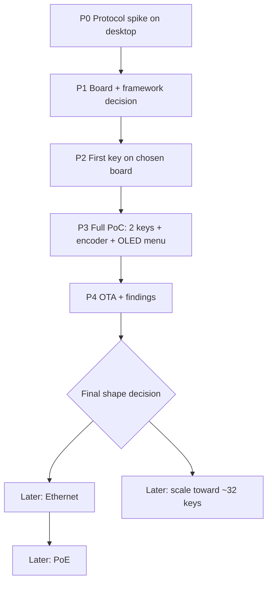
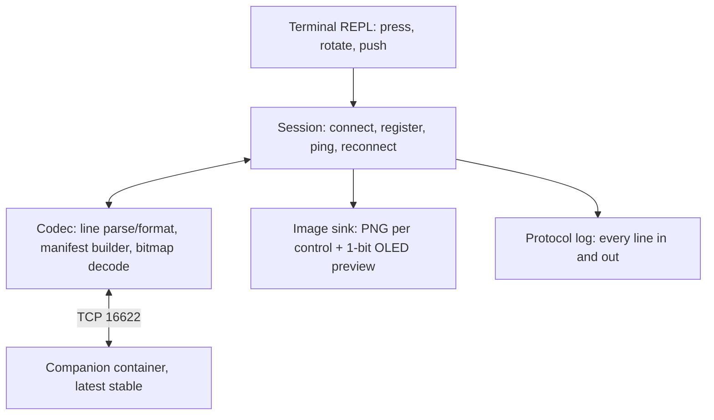
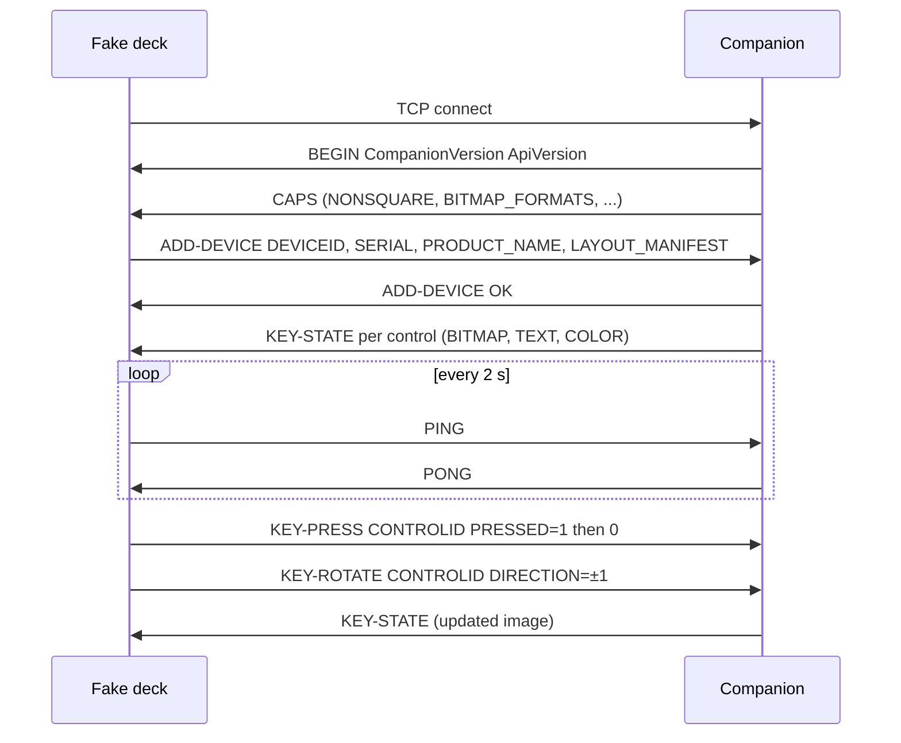
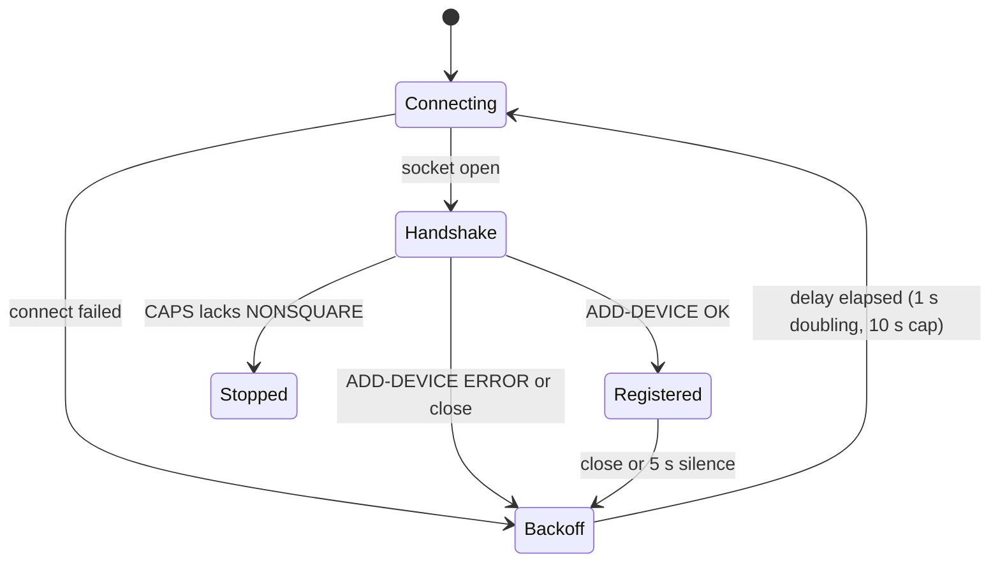

# Companion Network Deck PoC - Plan

## Goal Capsule

- **Objective:** A self-built deck works as one Bitfocus Companion surface over Wi-Fi. Every piece of hardware on hand has been proven in it: two LCD keys, a rotary encoder with menu buttons, and an OLED. Enough has been learned to choose the final device shape and to start the Ethernet/PoE stages.
- **Product authority:** This plan covers the proof-of-concept stages (P0–P4 below). The final device shape, Ethernet/PoE and scaling toward ~32 keys are context only. Each gets its own plan once the PoC is done.
- **Open blockers:** None. The board, firmware framework and key module were settled in P1 (see `docs/notes/board-and-framework-decision.md`). The OLED/encoder module is identified in P3.
- **Planning scope:** Implementation planning below covers P0 (R14) only. P1 (R15) was a spec-sheet decision and needed no implementation plan. P2–P4 are planned one stage at a time, each enriching this file once the previous stage's findings are in.
- **Authority:** The Product Contract wins on behaviour, the Planning Contract's KTDs win on mechanism, and units override neither.
- **Execution profile (P0):** A desktop-only spike, with a TypeScript (Node) fake-deck client and the latest Companion in a container on the Linux desktop. No hardware is involved.
- **Stop conditions (P0):** Stop and report back if the latest Companion cannot register a layout-manifest surface with two keys and one encoder control. That would mean R2 cannot be met through the Satellite protocol as planned.

---

## Product Contract

### Summary

Build a microcontroller-based deck that connects to Bitfocus Companion as a network surface over Companion's Satellite protocol. Its keys show images pushed by Companion and report presses. Its encoder works as a Companion control, and its OLED doubles as a local device menu. The work runs in five proof-of-concept stages, from a desktop protocol spike to an OTA-updatable deck with every part working. After the PoC, the final shape is decided.

### Problem Frame

The Elgato Stream Deck Studio is the reference: a networked, PoE-powered control surface with LCD keys and push-dials. Elgato's software stack doesn't fit this setup. Every desktop host runs Linux, and Elgato's Stream Deck app only exists for Windows and macOS. The Studio's network protocol is undocumented, and posing as an Elgato device is fragile and depends on Elgato's goodwill.

The parts on hand are a Feather ESP32 V2, a Pico 2 W, a Pi Zero 2 W, two Waveshare 0.85" ScreenKey Module B keys (ST7735, 128×128), and a 1.3" I²C OLED module with a rotary encoder and menu buttons. Nothing has been built yet, and the OLED module isn't fully identified. The intended use is mostly dev work, but nothing is fixed. The deck must be general-purpose rather than tuned to one workflow.

### Key Decisions

- **Bitfocus Companion is the only host software; the Satellite protocol is the device contract.** Companion runs natively on Linux, its protocol is open and versioned, and missing integrations can be written as custom Companion modules. (session-settled: user-directed — chosen over Elgato's Stream Deck app, alone or alongside Companion: no Linux build, undocumented network protocol, depends on impersonating a device.) Governs R1, R2, R3.
- **The deck is a pure network surface; Companion runs on a Linux desktop or server.** Companion can only run shell actions on the machine it runs on, so desktop-side dev actions work directly. (session-settled: user-directed — chosen over running Companion inside the deck on the Pi Zero 2 W: desktop actions would need extra plumbing.) Governs R1, R4.
- **The OLED module is mode-switched.** It is normally a Companion control and becomes a local device menu on a menu-button action. (session-settled: user-directed — chosen over Companion-only or local-menu-only.) Governs R8, R9, R10.
- **The deck runs on a microcontroller, not a Linux board.** It matches the appliance-style end goal: instant boot, low power and a proven PoE path. A desktop "fake deck" spike provides the protocol learning first. (session-settled: user-directed — chosen over a Pi Zero 2 W as the deck's brain, and over a Linux reference implementation later ported to a microcontroller.) Governs R14, R15.
- **Compiled firmware with OTA updates; no MicroPython.** OTA keeps flashing out of the iteration loop. Governs R12, R13.
- **The deck board is the Feather ESP32 V2.** It is the only candidate with mature OTA, it has a native Ethernet MAC on the same chip family as ready-made PoE boards, and its 2 MB PSRAM holds 128×128 image lines with room to spare. (session-settled: user-directed — chosen over the Pico 2 W: OTA on the RP2350 has no official flow, and its wired path is W5500 only.) Governs R15, R16.
- **Firmware is Rust no_std: `esp-hal` + embassy, `esp-radio` for Wi-Fi, `esp-bootloader-esp-idf` for A/B OTA.** It is pure Rust with async throughout, and it is the stack Espressif funds. The accepted costs: pinned crate versions through pre-1.0 API churn, our own OTA rollback and upload endpoint, and community crates or W5500 for Ethernet. Rust std (`esp-idf-svc`) on the same board is the fallback. (session-settled: user-directed — chosen over Rust std, whose bindings are community-maintained and whose peripherals are mostly blocking, and over Arduino-ESP32 3.x on PlatformIO, ESP-IDF in C and Zephyr.) Governs R12, R13, R16.
- **P1 decides from spec sheets, without bench tests.** Both boards are on hand and switching later is cheap, so P2 becomes the first hardware proof. (session-settled: user-directed — chosen over bench-testing both boards for toolchain, Wi-Fi/Satellite, OTA and an ST7735 key.) Governs R15.
- **The board comparison comes before deck-feature work.** (session-settled: user-directed — chosen over building a single key first and comparing boards afterwards: the basic setup would be done twice.) Governs R15, R16.
- **The final shape is decided after the PoC, not now.** Rack mounting is dropped. Key count (~32 eventually), display technology and enclosure stay open until the PoC has shown what works. (session-settled: user-directed — chosen over fixing the final form now.) Governs R18.

### Actors

- A1. Operator: the person setting up and using the deck (mainly for dev work).
- A2. Companion: Bitfocus Companion on a Linux desktop or server. It owns button layouts, images, actions and integrations.
- A3. Deck: the microcontroller device. It shows what Companion sends and reports input.

### Requirements

**Host integration**

- R1. The deck connects to a Companion instance over the LAN and registers as a single Satellite surface; nothing besides Companion runs on the desktop.
- R2. The surface exposes both LCD keys and the encoder control to Companion, so Companion's normal button editor configures them.
- R3. Companion's own and custom modules drive all actions; the deck holds no action logic.
- R4. The operator sets which Companion host the deck connects to without reflashing firmware.

**Keys and display output**

- R5. Each LCD key shows the image Companion assigns it and updates when Companion changes it.
- R6. Pressing and releasing a key reports press and release to Companion.
- R7. When Companion is unreachable, the deck shows a clear disconnected/searching state and reconnects automatically when Companion returns.

**Encoder and OLED**

- R8. In control mode, encoder rotation, encoder push and the OLED appear in Companion as one control: rotation and push are reported to Companion, and the OLED shows that control's image or text from Companion.
- R9. A menu-button action switches the OLED module into a local device menu and back; while the menu is open, encoder input goes to the menu and not to Companion.
- R10. The local menu shows connection status and the Companion host, and lets the operator adjust brightness and Wi-Fi settings.

**Connectivity and updates**

- R11. The PoC deck connects over Wi-Fi.
- R12. Firmware updates install over the network (OTA), without a USB cable.
- R13. The deck accepts OTA updates only from the operator, enforced in the PoC by a password or shared secret on the OTA endpoint.

**PoC stages and outcomes**

- R14. P0, protocol spike: a desktop "fake deck" script registers with Companion, shows key images and sends presses. Done when the Satellite protocol's key/encoder/image behaviour is understood well enough to implement in firmware.
- R15. P1, board and framework decision: the key module's controller and pinout are identified, and the Pico 2 W and Feather ESP32 are compared from spec sheets on OTA, Wi-Fi plus Satellite, ST7735 support and toolchain. A written decision names one board and one firmware framework with reasons. It also records each board's path to wired Ethernet/PoE and its headroom for more keys. Done in `docs/notes/board-and-framework-decision.md`.
- R16. P2, first key on the chosen board: one LCD key works end-to-end with Companion (R5, R6), on the firmware stack chosen in R15.
- R17. P3, full PoC: both keys, the encoder and the OLED with its local menu work together as one surface (R2–R10). The OLED/encoder module is identified and documented.
- R18. P4, OTA and wrap-up: OTA works on the full PoC (R12, R13), and a written findings note feeds the final-shape decision (key count, display technology, enclosure, Ethernet/PoE hardware). The note records measured image memory per key, the time to refresh all keys after a Companion page change, and SPI redraw time per display, extrapolated to ~32 keys for both the per-key and shared-panel options.

### PoC Stages



Each stage is defined by its requirement (R14–R18). The stages after the decision point are context, not scope.

### Key Flows

- F1. Power-on and connect
  - **Trigger:** The deck powers on.
  - **Actors:** A3, A2
  - **Steps:** The deck joins Wi-Fi and connects to the configured Companion host. It registers as a surface and Companion pushes the current images. Until then the deck shows the disconnected/searching state.
  - **Covered by:** R1, R4, R5, R7, R11
- F2. Press a key
  - **Trigger:** The operator presses an LCD key.
  - **Actors:** A1, A3, A2
  - **Steps:** The deck reports press and release. Companion runs the action and may push a new image, which the deck shows.
  - **Covered by:** R5, R6
- F3. Use the encoder, then open the local menu
  - **Trigger:** The operator turns or pushes the encoder, then uses the menu-button action.
  - **Actors:** A1, A3, A2
  - **Steps:** In control mode, input goes to Companion and the OLED shows Companion's content. The menu action switches to the local menu, where encoder input navigates the menu. Leaving the menu returns to control mode with Companion's content restored.
  - **Covered by:** R8, R9, R10
- F4. Update firmware
  - **Trigger:** The operator pushes a new firmware build.
  - **Actors:** A1, A3
  - **Steps:** The deck accepts the operator's update, installs it, restarts, and reconnects via F1.
  - **Covered by:** R12, R13

### Acceptance Examples

- AE1. **Covers R7.** **Given** the deck is connected, **when** Companion is stopped, **then** the deck shows the disconnected state within a few seconds, **and** when Companion restarts it reconnects and restores the key images without operator action.
- AE2. **Covers R9.** **Given** the local menu is open, **when** the operator turns the encoder, **then** the menu moves and Companion receives no rotation events.
- AE3. **Covers R9, R8.** **Given** Companion changed the encoder control's image while the local menu was open, **when** the operator leaves the menu, **then** the OLED shows Companion's latest content.
- AE4. **Covers R13.** **Given** a firmware image pushed without the OTA password, **when** it reaches the deck, **then** the deck rejects it and keeps running its current firmware.

### Success Criteria

- The full PoC (P3) feels responsive in daily use: a key press triggers its Companion action, and the key's new image appears, without noticeable delay over Wi-Fi.
- The P4 findings note is enough to decide the final shape without repeating PoC experiments.

### Scope Boundaries

**Deferred for later**

- Ethernet and PoE: separate stages after the final-shape decision, needing hardware not yet owned (e.g. a W5500 module or an ESP32 PoE board).
- Scaling toward ~32 keys, choosing display technology (one display per key vs a shared panel) and enclosure design.
- Custom Companion modules for specific dev workflows.
- Signed firmware for OTA; the PoC uses a password gate (R13).
- Custom PCB: a likely step once the final shape is set; the PoC uses off-the-shelf boards and modules.

**Outside this product's identity**

- Compatibility with Elgato's Stream Deck app or impersonating Elgato hardware.
- Running Companion on the deck itself.
- Rack-mount (1U) form factor.

### Dependencies / Assumptions

- A current Companion release is available on a Linux host, and the PoC is tested against the latest stable release only. Per the Satellite API docs, layout manifests (separate LCD key and encoder/OLED controls with their own bitmap sizes) need Companion 4.2+ (API 1.9), and non-square bitmaps need Companion 5.0+ (API 1.11). Older versions are not tested.
- The key modules are Waveshare 0.85" ScreenKey Module B: ST7735 over SPI, 128×128, 3.3 V, with a mechanical switch (identified in P1). The KEY output's polarity and pull-up needs and the panel offset are checked on the bench in P2.
- The OLED module is an I²C display plus encoder and buttons. This is an assumption until it is identified in P3.
- The Rust no_std crates (`esp-hal`, `esp-radio`, `esp-bootloader-esp-idf`) are pinned per stage. `esp-radio` is pre-1.0, so upgrades may need migration work.
- The Pi Zero 2 W is not part of the deck. It may serve as a spare headless Companion host or test bench.
- The LAN is trusted for Satellite traffic, which is unauthenticated. Only OTA needs protection (R13).

### Outstanding Questions

**Resolve Before Planning**

- None.

**Deferred to Planning**

- How the operator sets the Companion host and Wi-Fi credentials the first time (R4, R10): captive portal, serial, mDNS discovery, or a mix.
- Which key bitmap size to request (native 128×128 or a smaller preset) and whether to use `png`, given the Feather V2's PSRAM (P2).
- How OTA rollback is confirmed (e.g. the new image is marked valid only after `ADD-DEVICE OK`) and how builds are uploaded behind the R13 password (P4).
- Which menu-button action opens the local menu (e.g. long press vs a dedicated button), once the module's buttons are known.
- What measurement backs the responsiveness criterion, if one is needed.

### Sources / Research

- P1 board, framework and key module decision, with its own sources: `docs/notes/board-and-framework-decision.md`
- Companion Satellite API: https://companion.free/for-developers/Satellite-API and https://companion.free/user-guide/remote_control/satellite
- Companion 3.4 release (Stream Deck Studio support, surfaces over 32 keys; background only, below the version baseline): https://newreleases.io/project/github/bitfocus/companion/release/v3.4.0
- Companion module development: https://companion.free/for-developers/setting-up-developer-environment
- Elgato HID protocol docs, for reference only: https://docs.elgato.com/streamdeck/hid/
- Prior DIY Elgato emulation, background on the rejected path: https://github.com/DDRBoxman/picodeck

---

## Planning Contract

Product Contract preservation: changed: Dependencies / Assumptions (Companion version). P0 now tests against the latest Companion only and no longer confirms a minimum version. The user directed this change. The documented requirements still stand: layout manifests need API 1.9 (Companion 4.2), and non-square bitmaps need API 1.11 (Companion 5.0).

This contract plans P0 (R14) only. P1 (R15) was settled without an implementation plan, and P2–P4 (R16–R18) are not yet planned. Each stage is planned on its own, using the previous stage's findings.

### Key Technical Decisions

- KTD1. **The fake deck is a small TypeScript project on Node 24+ at `tools/fake-deck/`, managed with npm. `pngjs` is its only runtime dependency.** (session-settled: user-directed — chosen over Python: the user ruled Python out.) Node runs `.ts` files directly through type stripping, so there is no build step. `node:net` and `node:readline` give line-based TCP and the REPL. `node --test` runs the tests, and `tsc --noEmit` type-checks. The code sticks to erasable TypeScript syntax (no enums or namespaces), so type stripping can run it. `bitfocus/companion-satellite` is a full surface bridge, not a library, so the codec is hand-written. That project is a reference to read, not a dependency, because reusing it would hide the protocol details P0 must learn.
- KTD2. **The fake deck uses the raw TCP transport on port 16622, not WebSocket (16623).** The firmware will use raw TCP, which needs no WebSocket framing or HTTP upgrade on the microcontroller. The spike exercises the same transport the device will. The port stays configurable because the docs say it may become configurable on the server side.
- KTD3. **The surface registers in advanced mode with a `LAYOUT_MANIFEST` and targets the latest Companion only.** The manifest declares two key controls and one encoder control, each with its own style preset (R2, R14). The client logs `ApiVersion` and `CAPS` from the handshake. If `CAPS` lacks `NONSQUARE`, it refuses to register and says that it needs a current Companion. `SERIAL` is always sent.
- KTD4. **The spike requests `rgb` bitmaps by default, and a flag asks for `png` when `BITMAP_FORMATS` offers it.** `rgb` is always available and needs no decoder on the device. The `png` run only measures wire size, so the notes can weigh decode cost against bandwidth for P1.
- KTD5. **The OLED question is answered by asking for both a 128×64 bitmap and text on the encoder control, and comparing them.** The encoder preset requests a 128×64 bitmap plus `text` and `textStyle`. The fake deck saves each received bitmap with a 1-bit preview next to it, and logs the decoded text. The notes recommend image, text or both for a mono OLED, based on those artifacts.
- KTD6. **Companion runs in the official container image, `ghcr.io/bitfocus/companion/companion`, pinned to the latest stable release tag.** (session-settled: user-directed — chosen over also testing a 4.2 floor version: not needed.) The container keeps the spike off any Companion the operator already runs. Pinning the tag keeps the notes tied to a known version. Host ports are remapped away from 8000/16622, and the config volume lives under a gitignored directory.
- KTD7. **Connection policy: one reconnect policy that the firmware can copy.** The client sends `PING` every 2 s. It treats the link as dead after 5 s without any server line, or on socket close. It reconnects with capped exponential backoff (1 s doubling to a 10 s cap) and re-runs the full `ADD-DEVICE` registration on every connect, because disconnect removes the device on the Companion side. The spike measures whether these numbers hold. The final values go in the notes, not here.
- KTD8. **Findings live in one firmware-facing note, `docs/notes/satellite-protocol-firmware-notes.md`, backed by trimmed protocol-log excerpts.** P1 and P2 read one page instead of a log dump. Raw logs and images stay in the gitignored `tools/fake-deck/out/`.

### High-Level Technical Design

Components of the fake deck and the test bench:



Session sequence the spike must exercise (and the firmware will copy):



Connection states (KTD7):



### Output Structure

```text
tools/fake-deck/
  package.json
  tsconfig.json        # type-check only (noEmit, erasable syntax)
  README.md            # how to start Companion and run the spike
  compose.yaml         # pinned Companion service
  .gitignore           # node_modules/, out/, companion-data/
  companion-config/    # committed Companion config export
  src/
    main.ts            # CLI entry and REPL
    protocol.ts        # codec and manifest builder
    session.ts         # connection lifecycle and reconnect
    images.ts          # bitmap decode and PNG / mono preview output
  test/
    protocol.test.ts
    session.test.ts
    images.test.ts
docs/notes/
  satellite-protocol-firmware-notes.md
```

### Assumptions

- The ST7735 key size is unknown until P1, so key bitmap size is a CLI option. The spike runs at Companion's default 72×72 and at least one plausible ST7735 size (80×80 or 128×128), so the notes cover the memory range.
- Buttons are configured by hand in the Companion web UI for the spike. The resulting Companion config export is committed so a rerun needs no manual setup.
- The encoder control works as a Companion button with rotary actions enabled. The spike confirms this and records the steps in the notes.
- The operator's own Companion install is not used or modified.

### Deferred to Follow-Up Work

- Implementation planning for P2–P4 (R16–R18), one stage at a time.

### Considered and Not Built

- WebSocket transport: the firmware will not use it (KTD2). Revisit if raw TCP turns out to be blocked on the target network.
- Testing older Companion versions: the user ruled it out (KTD6). The notes cite the documented API version of each feature used, so a later stage can work out an older floor if it ever needs one.
- Subscriptions, variables, pincode lock, bitmap cache, LEDs and `DEVICE-APPEARANCE`: no R-ID needs them for the PoC. The notes list them with their API versions so later stages can opt in.
- A GUI window that renders the keys: PNG files per control show the same evidence with less code. Revisit only if inspecting files slows the spike down.
- CI for the spike: it is a throwaway learning tool, and running `npm test` locally is enough.

### Risks & Dependencies

- Satellite quoting rules (embedded quotes, escapes) are only partly documented. The codec tests start from the Satellite API page examples. Cases seen in the U4 logs are added to `test/protocol.test.ts`, and the notes record the rules observed.
- The newest tagged release may predate API 1.15/1.16 (Companion 5.2). The notes list the API level actually tested and do not claim that later features were verified.
- Companion's server-side idle timeout is undocumented. The spike measures it with `--no-ping`, and the notes record the value.

### Deferred to Implementation

- The exact latest stable container tag at the time of the run.
- Exact control IDs and grid positions in the manifest, chosen so Companion's button editor shows the two keys and the encoder in one row.
- The 1-bit conversion method for the OLED preview (threshold vs dither), whichever is more legible.

---

## Implementation Units

### U1. Companion test bench

- **Goal:** One command starts the pinned latest Companion, reachable from the desktop on remapped ports (KTD6).
- **Requirements:** R14
- **Dependencies:** None
- **Files:** `tools/fake-deck/compose.yaml`, `tools/fake-deck/README.md`, `tools/fake-deck/.gitignore`, `tools/fake-deck/companion-config/` (committed config export, added after the first U4 run)
- **Approach:**
  1. One compose service pinned to the latest stable tag, with host ports remapped for the web UI and Satellite TCP, and a gitignored data volume.
  2. The README covers starting it, opening the web UI, confirming the Satellite listener is on, and importing the committed config.
- **Execution note:** This is mostly environment setup, so verify it by starting Companion and connecting, not with unit tests.
- **Test expectation:** none, because this is environment configuration that U4 proves by running it.
- **Verification:** Companion starts and its web UI loads. A raw TCP connection to the remapped Satellite port receives `BEGIN` and a `CAPS` line that includes `NONSQUARE`. The README records the Companion and API versions it reported.

### U2. Satellite protocol codec

- **Goal:** Pure functions that parse and format Satellite lines, build the layout manifest, and check the handshake capabilities (KTD3).
- **Requirements:** R14, R2
- **Dependencies:** None
- **Files:** `tools/fake-deck/package.json`, `tools/fake-deck/tsconfig.json`, `tools/fake-deck/src/protocol.ts`, `tools/fake-deck/test/protocol.test.ts`
- **Approach:**
  1. Represent a line as a command name plus an ordered key/value map. Quote values on output when they contain spaces or special characters.
  2. Parse `KEY=value`, `KEY="quoted value"` and bare flags. Keep `=` inside values, because base64 padding ends in `=`.
  3. Normalise booleans (`0`/`1`/`true`/`false`) and split responses into `OK` and `ERROR`.
  4. Build the manifest as base64 JSON with `stylePresets` (`default`, `key`, `encoder`) and three `controls`. The encoder preset is 128×64 (KTD5).
  5. Parse `CAPS` flags and the `BITMAP_FORMATS` list into a capabilities record.
- **Patterns to follow:** The message syntax on the Satellite API page. `bitfocus/companion-satellite` is a read-only reference for edge cases.
- **Test scenarios:**
  - Formatting `KEY-PRESS` with `CONTROLID` `0/1` and `PRESSED` true gives one line with the control ID quoted, `PRESSED=1`, and a trailing newline.
  - Parsing a `KEY-STATE` line with `CONTROLID="0/0"`, a base64 `BITMAP` ending in `==`, `COLOR=#ff0000` and a base64 `TEXT` keeps the bitmap's `=` padding intact and decodes the text.
  - Parsing `ADD-DEVICE ERROR DEVICEID=x MESSAGE="Unknown control"` gives an error response with the message text.
  - A bare `ERROR MESSAGE="Unknown command: FOO"` parses as an error with no device ID.
  - An unknown command such as `FUTURE-THING A=1` parses into a generic message and does not throw.
  - `PRESSED=true`, `PRESSED=1`, `PRESSED=false` and `PRESSED=0` normalise to the right booleans.
  - The manifest decodes to presets that include `default`, has three controls, and gives the encoder a 128×64 bitmap preset with `text` enabled.
  - The `CAPS` line `CAPS SUBSCRIPTIONS=1 NONSQUARE=1 BITMAP_FORMATS=rgb,png` parses into flags plus a format list containing `png`.
- **Verification:** The codec tests pass, and no network or file I/O exists in this module.

### U3. Fake deck client: session, images and REPL

- **Goal:** A runnable fake deck that registers with Companion, saves every received image, sends key and encoder input from a terminal REPL, and reconnects on its own (R14, KTD7).
- **Requirements:** R14. It exercises R2, R5, R6, R7 and R8 at protocol level. Covers AE1 at protocol level.
- **Dependencies:** U2
- **Files:** `tools/fake-deck/src/session.ts`, `tools/fake-deck/src/images.ts`, `tools/fake-deck/src/main.ts`, `tools/fake-deck/test/session.test.ts`, `tools/fake-deck/test/images.test.ts`
- **Approach:**
  1. The session follows the state diagram in High-Level Technical Design. It reads `BEGIN` and `CAPS`, sends `ADD-DEVICE` with a stable `DEVICEID` and `SERIAL` (KTD3), answers server `PING` with `PONG`, sends its own `PING` every 2 s, and re-registers after every reconnect.
  2. On each `KEY-STATE`, the image module decodes `rgb` or a `data:` PNG URL with `pngjs`. It checks the byte length against the preset size, writes `out/<control>.png`, and for the encoder also writes the 1-bit preview (KTD5). On each `KEYS-CLEAR`, all controls reset to black.
  3. Every line in and out is logged with a timestamp to `out/protocol.log`, together with each bitmap's raw and base64 byte size.
  4. REPL commands: `press <key>` sends `PRESSED=1`, then `0` after a short hold. `rotate <+n|-n>` sends `KEY-ROTATE`. `push` presses and releases the encoder control. `quit` sends `QUIT`.
  5. CLI options: host, port, key bitmap size, bitmap format (KTD4), device ID, and `--no-ping`. The last one stops the client's own `PING` and turns off the silence watchdog, so only a socket close ends the session. The client still answers server `PING`.
- **Execution note:** Test the session against an in-process `node:net` fake server that plays scripted Companion lines, so the reconnect and capability paths are covered without a container.
- **Test scenarios:**
  - When the fake server sends `BEGIN` and `CAPS NONSQUARE=1`, the client sends one `ADD-DEVICE` with `SERIAL` and a `LAYOUT_MANIFEST` whose decoded content has three controls.
  - When `CAPS` lacks `NONSQUARE`, the client sends no `ADD-DEVICE`, logs that it needs a current Companion, and exits with a non-zero status.
  - When the server advertises `BITMAP_FORMATS=rgb,png` and the client runs with the png flag, `ADD-DEVICE` carries `BITMAP_FORMAT=png`. Without `png` in `CAPS` the client sends no format parameter.
  - A server `PING abc` gets the reply `PONG abc`.
  - With the ping interval shortened in the test, the client sends `PING` repeatedly while registered.
  - With `--no-ping`, the client sends no `PING` and stays connected through server silence until the server closes the socket.
  - Covers AE1. When the server closes the socket after registration, the client logs a disconnected state, reconnects after the backoff, and sends `ADD-DEVICE` again on the new connection.
  - Covers AE1. When the server goes silent without closing (no `PONG`), the client declares the link dead within the silence timeout and reconnects.
  - A server `ADD-DEVICE ERROR MESSAGE="..."` is logged with its message, and the client backs off instead of looping without delay.
  - The REPL command `press 1` sends `KEY-PRESS` for key 1's control ID with `PRESSED=1` and then `PRESSED=0`.
  - The REPL commands `rotate +1` and `rotate -1` send `KEY-ROTATE` with `DIRECTION=1` and `DIRECTION=-1` on the encoder control ID, and `push` sends a press/release pair on that same control.
  - A `KEY-STATE` with a 72×72 `rgb` bitmap writes a 72×72 PNG for that control.
  - A `KEY-STATE` for the encoder writes the 128×64 PNG and a 1-bit preview.
  - A bitmap whose decoded length does not match the preset size is logged as a mismatch with expected and actual bytes, the session stays up, and no PNG is written.
  - A `KEY-STATE` carrying a `data:image/png;base64,` bitmap decodes through the PNG path.
- **Verification:** The session and image tests pass. Running the fake deck against the U1 Companion lists the surface in Companion's Surfaces table.

### U4. Spike runs and firmware notes

- **Goal:** Run the fake deck against the pinned latest Companion and write the firmware-facing note that answers every R14 question (KTD8).
- **Requirements:** R14. It informs R15 and the Deferred to Planning question on API version and image sizes.
- **Dependencies:** U1, U3
- **Files:** `docs/notes/satellite-protocol-firmware-notes.md`, `tools/fake-deck/companion-config/` (exported Companion config)
- **Approach:** Run this checklist, keeping the log excerpt each answer rests on:
  1. Registration: the surface appears with two keys and one encoder control laid out as intended.
  2. Images: assign text, colour and icon buttons, and record each image's size, format and byte cost per control.
  3. Input: key press and release trigger actions, encoder rotate and push trigger rotary actions, and Companion pushes updated images afterwards.
  4. OLED: compare the 128×64 bitmap preview with the decoded text, and pick a recommendation.
  5. Reconnect: stop and start the container, pause it to simulate a half-open link, run with `--no-ping` to measure the server's idle timeout (time from the client's last line to the server's close), and confirm that images and surface config are restored after re-registration.
- **Execution note:** Use the logs and images as evidence. Every claim in the note cites a run (Companion version, date) or a log excerpt.
- **Test expectation:** none, because this unit produces a document from manual runs. Its checks are the content checks in Verification.
- **Verification:** The note has one section for each R14 item:
  - the messages the firmware must send and handle
  - image sizes and formats per control, with byte budgets
  - reconnect behaviour, with measured timings
  - the Satellite API version tested, plus the documented minimum API version for each feature used
  - the image-vs-TEXT recommendation for a 128×64 mono OLED

  It also lists the protocol features left out, with their API versions.

---

## Verification Contract

| Gate | Command or check | Applies to |
|---|---|---|
| Unit tests | `npm test` (runs `node --test`) from `tools/fake-deck/` | U2, U3 |
| Type check | `npm run typecheck` (runs `tsc --noEmit`) from `tools/fake-deck/` | U2, U3 |
| CLI smoke | `node src/main.ts --help` from `tools/fake-deck/` lists the host, port, size, format, device-ID and `--no-ping` options | U3 |
| Test bench | The pinned Companion starts and sends `BEGIN` and `CAPS` on its remapped Satellite port | U1 |
| End-to-end | The fake deck registers, and key press, encoder rotate and push each trigger a configured Companion action | U3, U4 |
| Findings | `docs/notes/satellite-protocol-firmware-notes.md` answers R14's done-when and the U4 Verification list, and every claim cites a run or a log excerpt | U4 |

---

## Definition of Done

- R14's done-when holds: the notes are enough for P1 to start firmware networking without rerunning the spike.
- U1–U4 each meet their Verification.
- No experimental code from abandoned approaches stays in `tools/fake-deck/`. Generated output (`node_modules/`, `out/`, container data) is gitignored and not committed.
