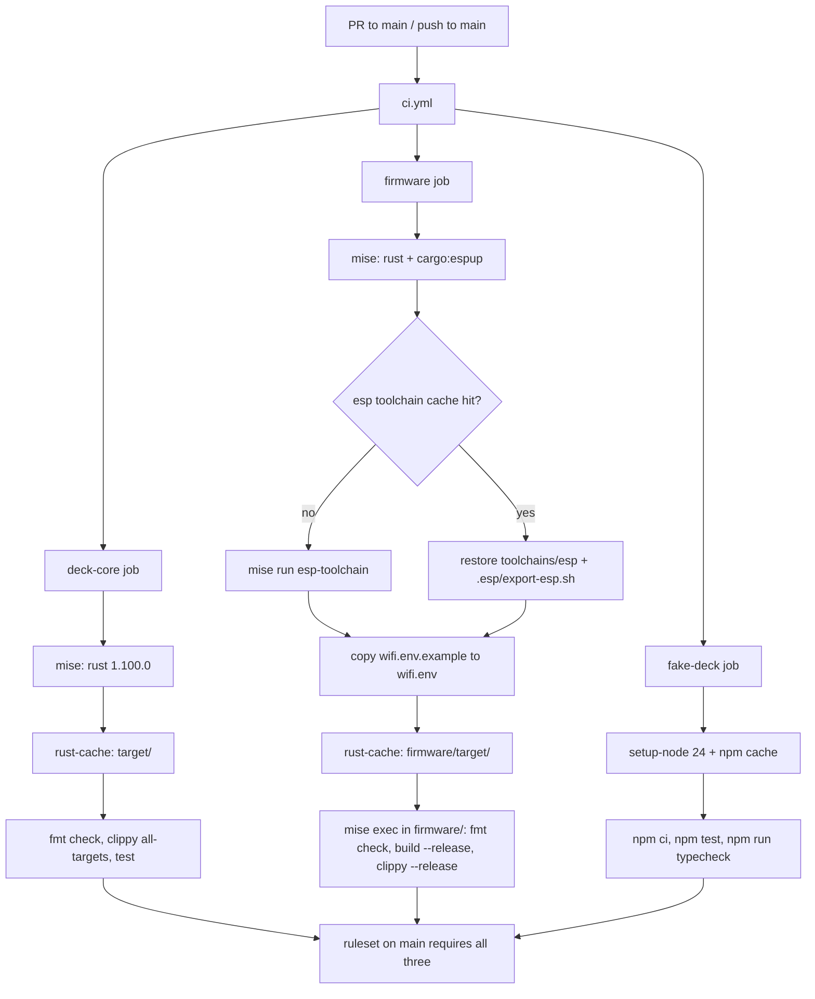

# CI for the Core Crate and Firmware - Plan

## Goal Capsule

- **Objective:** A PR to `main` can only merge after the deck-core, firmware and fake-deck checks pass on GitHub. Whether a PR is ready no longer depends on someone remembering to run the checks by hand.
- **Means:** One GitHub Actions workflow with three jobs (KTD1). The two Rust jobs install their tools through mise, as they are installed locally (KTD2). The fake-deck job uses setup-node (KTD5). The repo goes public, and then a ruleset protects `main` (KTD7, KTD8).
- **Authority:** The Product Contract wins on behaviour. The KTDs win on mechanism. Units override neither. Linear THI-78 is the origin ticket.
- **Execution profile:** U1–U4 are one code PR on `feature/thi-78-set-up-ci-for-the-core-crate-and-firmware`. U5 is a read-only audit that runs alongside them. U6 and U7 change repository settings after that PR merges and the operator confirms the switch. No hardware is involved.
- **Stop conditions:**
  - **Going public.** U5 ends with a report to the operator, who decides on the author-email question and confirms the switch. Never change repo visibility without that confirmation.
  - **Toolchain outside mise.** If the esp toolchain can't be installed in CI through `mise run esp-toolchain`, stop and report. Don't switch to a different installer (such as `esp-rs/xtensa-toolchain`) without asking.
  - **Secrets found.** If the history scan in U5 finds a real credential, stop. Report it, and rotate it before anything else happens. Don't rewrite history on your own.
- **Who finishes:** The implementer lands U1–U4 as a PR. The operator confirms U5, and then the implementer applies U6 and U7.

---

## Product Contract

### Summary

Add a CI workflow that runs formatting, lint, build and test checks for `crates/deck-core`, `firmware/` and `tools/fake-deck` on every PR and every push to `main`, with toolchains and build output cached. Then make the repo public, after checking its history, so a ruleset can require those checks before any merge to `main`.

### Problem Frame

The repo has no CI. PR #3 (P2, the first LCD key) merged with zero checks. Its readiness rested on commands run by hand and on bench tests. Each later stage (P3's second key, encoder and OLED, P4's OTA) adds firmware that can stop compiling, or start failing clippy, without anyone noticing until the next bench session.

Protection is the part with a catch. opendeck-studio is a private repo on GitHub Free, and GitHub refuses both branch protection and rulesets there with a 403. The operator chose to make the repo public so `main` can be protected (KTD7). That also lifts the 2,000-minute monthly Actions cap that a slow firmware build would eat into.

### Key Decisions

- **The repo goes public so `main` can be protected.** (session-settled: user-directed — chosen over upgrading to GitHub Pro and over leaving merges unenforced: protection needs Pro or a public repo, and public also removes the Actions minute cap.) Governs R8, R9.

### Requirements

**Checks**

- R1. Every PR to `main` runs `cargo fmt --check`, `cargo clippy --all-targets -- -D warnings` and `cargo test` for deck-core (`crates/deck-core`, the root Cargo workspace) on the stable Rust pinned in `mise.toml`.
- R2. Every PR to `main` runs `cargo fmt --check`, `cargo build --release` and `cargo clippy --release -- -D warnings` in `firmware/` on the `esp` Xtensa toolchain, installed through mise and `mise run esp-toolchain`.
- R3. Every PR to `main` runs `npm test` and `npm run typecheck` in `tools/fake-deck`.
- R4. The firmware build in CI builds against the vendored `firmware/vendor/xtensa-lx-rt`, the same as a local build.

**Secrets and speed**

- R5. CI builds the firmware with a generated placeholder `firmware/wifi.env`. No real Wi-Fi credentials, and no repository secrets, reach CI.
- R6. Toolchains, mise installs and cargo build output are cached, so a run whose pins and lockfiles haven't changed skips the toolchain downloads and the tool builds.

**Protection**

- R7. All three checks run on every PR regardless of which paths it touches, so no required check is ever left waiting.
- R8. Before the repo goes public, its full git history, tracked files and PR/issue text are checked for secrets and personal data, and the operator confirms the switch.
- R9. `main` requires all three checks to pass, takes changes only through PRs, and refuses force-pushes and deletion. No one bypasses this, including the repo owner.

### Success Criteria

- A PR with a formatting error in `firmware/src/` shows a red firmware check and GitHub refuses to merge it.
- A PR that touches only docs still shows three green checks and can merge.
- A second run of an unchanged PR restores every cache and finishes clearly faster than the cold first run. Record both times in the PR description.

### Scope Boundaries

- Hardware tests. The board has no JTAG, and bench checks stay manual.
- Flashing, release artifacts or uploading firmware images from CI. P4's OTA plan decides how images ship.
- Moving off the vendored `xtensa-lx-rt`. THI-77 owns that.
- Pinning Node in `mise.toml`. CI pins Node 24 itself (KTD5). Moving fake-deck tooling under mise would change the local setup and is not part of this ticket.
- Rewriting history to remove the author email. U5 puts the question to the operator, and a rewrite, if chosen, becomes its own ticket.

Considered and not built:

- **Path filters to skip unaffected jobs.** They would save minutes, but a required check skipped by a path filter leaves merges stuck waiting (R7). Worth revisiting only if CI time becomes a real cost after the repo is public.
- **Requiring branches to be up to date before merge.** One person merges, PRs rarely overlap, and push-to-`main` runs catch a bad merge result. Revisit if concurrent PRs start breaking `main`.
- **A scheduled run to catch toolchain or dependency drift.** All tools and dependencies are pinned and locked, so nothing drifts without a commit.
- **Saving cargo caches only from `main`.** It would keep PR entries from evicting `main`'s cache from the 10 GB quota, but an eviction only costs a slow run that anyone would notice right away. Revisit if `main`'s cache entries start getting evicted.
- **Requiring approval for workflow runs from all outside contributors.** The workflow holds no secrets and its token is read-only, and GitHub's default already gates first-time contributors. Revisit if fork PRs start abusing the runners.

---

## Planning Contract

### Key Technical Decisions

- KTD1. **One workflow, three jobs: `deck-core`, `firmware`, `fake-deck`.** It lives in `.github/workflows/ci.yml`, runs on `pull_request` targeting `main` and on `push` to `main`, and cancels superseded runs on the same PR. The job names are the required-check names in the ruleset (KTD8). Renaming a job later means updating the ruleset in the same change, or every PR waits on a check that never reports. The jobs run in parallel, so the slow firmware job doesn't hold up the fast ones' feedback.
- KTD2. **Rust tools come from mise through `jdx/mise-action`, and each job turns off the tools it doesn't need.** Each job sets `MISE_DISABLE_TOOLS` in its job-level `env`, so mise-action, `mise run` and every `mise exec` call skip those tools. Limiting only the action's install isn't enough, because `mise exec` and `mise run` auto-install any missing configured tool. `deck-core` disables `cargo:espup`, `cargo:espflash` and `cargo:esp-generate`. `firmware` disables `cargo:espflash` and `cargo:esp-generate`, which it doesn't need to build and which cost about 2.5 min to build from source. The action's mise-data cache gets a per-job key prefix, because jobs with different tool sets must not share one cache entry. The action pins the mise version used locally (2026.11.8), so the mise binary changes only with a commit.
- KTD3. **Firmware commands run through `mise exec --` from `firmware/`, as the ticket says.** That applies `firmware/mise.toml`, which sets `RUSTUP_TOOLCHAIN=esp` and sources `.esp/export-esp.sh`. The mise action exports the root `mise.toml` environment, including the root's Rust pin as `RUSTUP_TOOLCHAIN`, to later steps. Any firmware step that calls cargo or rustc without `mise exec` (the cargo cache step in particular) sets `RUSTUP_TOOLCHAIN=esp` on that step.
- KTD4. **The rustup toolchains are cached with `actions/cache`, keyed on the runner OS and the hash of `mise.toml`.** mise's Rust backend only links to rustup, so the real toolchains live under `~/.rustup/toolchains/`, outside mise's data dir and outside rust-cache. Both Rust jobs restore `~/.rustup/toolchains/1.100.0-x86_64-unknown-linux-gnu` before the mise step. Without it, every run downloads 1.100.0 again, and a restored mise link with no toolchain behind it can leave rustfmt and clippy missing. The firmware job also caches `~/.rustup/toolchains/esp` and `.esp/export-esp.sh` as one unit, with the same key, since `mise.toml` holds the `--toolchain-version` pin. On a hit the job skips `mise run esp-toolchain`. On a miss it runs the task with `GITHUB_TOKEN` in the environment, so espup's GitHub API calls aren't rate-limited. The export file contains absolute paths under the runner's home directory. That is why the job pins `ubuntu-24.04` instead of `ubuntu-latest`.
- KTD5. **Cargo output is cached with `Swatinem/rust-cache` with its default save behaviour.** `deck-core` caches the root `target/`. `firmware` caches `firmware/target/`. PR runs save too, so a rerun of the PR that adds CI already shows the warm path (see Scope Boundaries for the main-only alternative). The `fake-deck` job pins Node 24 directly in its `actions/setup-node` step (`package.json` `engines` only says `>=24`). It uses setup-node's npm cache keyed on `tools/fake-deck/package-lock.json`, and installs with `npm ci`.
- KTD6. **The CI `wifi.env` is a copy of `firmware/wifi.env.example`.** The example already holds non-secret placeholders in the format `firmware/build.rs` parses. Copying it means CI fails if the example and the build script ever drift apart. There are no repository secrets at all (R5).
- KTD7. **The repo goes public only after an audit and the operator's go-ahead.** (session-settled: user-directed — chosen over GitHub Pro and over unenforced merges: see Key Decisions.) Governs R8. The audit is a full-history secret scan with gitleaks run through `mise exec`, without adding it to `mise.toml`, plus a read of tracked binary files, notes and the PR and Linear-linked text that becomes public with the repo. Every commit is authored with the owner's personal Gmail address, and going public exposes it. The operator decides whether to accept that or to open a history-rewrite ticket first.
- KTD8. **Protection is a repository ruleset defined in `.github/rulesets/main.json`, applied with `gh api`.** The ruleset targets the default branch. It requires the three checks from KTD1, issued by GitHub Actions, and a pull request with zero required approvals, so a solo owner can still merge their own green PR. It also blocks force-pushes and deletion, and has an empty bypass list (R9). Keeping the JSON in the repo makes the protection reviewable and re-appliable. When the repo goes public, confirm that the default workflow token is read-only, since fork PRs run this workflow.
- KTD9. **Third-party actions are pinned to full commit SHAs, with the version in a trailing comment.** Once the repo is public, an action tag moved upstream would run new code with this repo's token. Set the workflow's `permissions` to `contents: read`.

### High-Level Technical Design

### Assumptions

- espup's esp toolchain includes `rustfmt` and `cargo-clippy`. Confirmed locally in `~/.rustup/toolchains/esp/bin`.
- A rustup toolchain directory restored from cache is usable without rerunning the installer. U2's cache-hit run verifies this. If it fails, the job reruns `mise run esp-toolchain` on every run and the cache holds only the download.

---

## Implementation Units

### U1. Workflow with the deck-core job

- **Goal:** Add `.github/workflows/ci.yml` with its triggers, concurrency, permissions and the `deck-core` job.
- **Requirements:** R1, R6, R7.
- **Dependencies:** None.
- **Files:** `.github/workflows/ci.yml` (new).
- **Approach:**
  1. Set the triggers, concurrency group and `contents: read` permissions per KTD1 and KTD9. Use no path filters (R7).
  2. Add the `deck-core` job on `ubuntu-24.04`: checkout, the stable-toolchain cache (KTD4), mise with the job's disabled tools (KTD2), rust-cache on the root workspace (KTD5), then the three R1 commands at the repo root.
- **Patterns to follow:** The tool pins in `mise.toml`. The host workspace definition in `Cargo.toml`, which already excludes `firmware/`.
- **Test scenarios:** Test expectation: none -- CI configuration. U1 is proven by its own run (Verification).
- **Verification:** The PR shows a green `deck-core` check. Its log shows rust 1.100.0 in use and the deck-core tests running. On a rerun, the log shows no rustup toolchain download, and no cargo tool being built.

### U2. Firmware job

- **Goal:** Add the `firmware` job, which builds and lints the firmware on the esp toolchain.
- **Requirements:** R2, R4, R5, R6.
- **Dependencies:** U1.
- **Files:** `.github/workflows/ci.yml`.
- **Approach:**
  1. Restore the rustup toolchain caches, then install mise with the job's disabled tools under its own cache prefix (KTD2, KTD4).
  2. On an esp toolchain cache miss, run `mise run esp-toolchain` (KTD4).
  3. Write `firmware/wifi.env` per KTD6.
  4. Restore rust-cache for `firmware/target/` with the KTD3 toolchain override.
  5. Run the three R2 commands through `mise exec --` from `firmware/` (KTD3).
- **Execution note:** This is configuration. Prove it with a cold run and then a warm run, not with unit tests. Expect the first cold run to take long, since the build uses release, fat LTO and build-std.
- **Patterns to follow:** `firmware/mise.toml`, `firmware/README.md`'s mise section, and the `esp-toolchain` task in `mise.toml`.
- **Test scenarios:** Test expectation: none -- CI configuration. Proven by the runs below.
- **Verification:**
  - The first run is green, and its log shows `xtensa-lx-rt` compiled from `vendor/xtensa-lx-rt` (R4).
  - A rerun with no changes restores the rustup toolchain, mise and cargo caches, skips `mise run esp-toolchain`, and builds neither espflash nor esp-generate (R6).
  - The workflow file references no secrets other than the built-in `GITHUB_TOKEN` (R5).

### U3. Fake-deck job

- **Goal:** Add the `fake-deck` job, which runs the P0 tests and the typecheck.
- **Requirements:** R3, R6.
- **Dependencies:** U1.
- **Files:** `.github/workflows/ci.yml`.
- **Approach:** Use setup-node with Node 24 and the npm cache (KTD5), then run `npm ci`, `npm test` and `npm run typecheck` with `tools/fake-deck` as the working directory.
- **Patterns to follow:** The scripts in `tools/fake-deck/package.json`. The commands in `tools/fake-deck/README.md`.
- **Test scenarios:** Test expectation: none -- CI configuration. Proven by its run.
- **Verification:** The PR shows a green `fake-deck` check. Its log lists the four test files in `tools/fake-deck/test/` passing.

### U4. Document the checks

- **Goal:** Say in the repo where the checks run and how to run the same ones locally.
- **Requirements:** R1, R2, R3, R5.
- **Dependencies:** U1, U2, U3.
- **Files:** `README.md`, `firmware/README.md`.
- **Approach:**
  1. In `README.md`, add a short section that lists the three CI checks, says `main` requires them, and points to each part's README for the local commands.
  2. In `firmware/README.md`, list the three firmware commands in their `mise exec --` form, and note that CI builds with a copy of `wifi.env.example`.
- **Test scenarios:** Test expectation: none -- documentation.
- **Verification:** Each listed command matches the one the workflow runs.

### U5. Pre-public audit

- **Goal:** Establish that nothing private becomes public with the repo, and get the operator's go-ahead.
- **Requirements:** R8.
- **Dependencies:** None. It can run alongside U1–U4.
- **Files:** None committed. The findings go to the operator in chat.
- **Approach:**
  1. Run a gitleaks scan over the full history of every branch (KTD7).
  2. Grep every commit's patch and message for things gitleaks doesn't flag: private IPv4 addresses, `SSID`/`PASSWORD` assignments, and `.local`/`.lan` hostnames. List the files deleted anywhere in history. Judge the hits the same way as step 3.
  3. Read the tracked files that a pattern scan can't judge: `docs/notes/satellite-spike-images.png`, `docs/notes/deck-wiring.svg`, `tools/fake-deck/companion-config/fake-deck-page.companionconfig` and `.mcp.json`. Check the notes for real LAN addresses, SSIDs or hostnames.
  4. Read the PR and issue bodies and comments on the repo (PR #3 and earlier) for the same.
  5. Report the findings, and note that commits once pushed and later force-pushed away stay fetchable by SHA and can't be scanned locally. Report also that every commit carries the owner's personal Gmail address. Ask the operator to choose: accept it as is, or open a history-rewrite ticket first. Then stop for confirmation (Goal Capsule stop conditions).
- **Test scenarios:** Test expectation: none -- an audit, not code.
- **Verification:** The operator has the scan result and the file review, and has said yes or no to going public.

### U6. Make the repo public and lock down Actions for forks

- **Goal:** Switch the repo to public with fork-PR workflow runs gated.
- **Requirements:** R8, R9.
- **Dependencies:** U5 (operator confirmed), and the U1–U4 PR merged so the workflow exists on `main`.
- **Files:** None. These are repository settings.
- **Approach:**
  1. Change visibility to public.
  2. Confirm the default workflow token permission is read-only (KTD8).
- **Test scenarios:** Test expectation: none -- settings.
- **Verification:** `gh repo view` reports `PUBLIC`, and the repo's Actions settings show a read-only default token.

### U7. Ruleset protecting main

- **Goal:** Make `main` refuse any merge whose three checks haven't passed.
- **Requirements:** R9.
- **Dependencies:** U6.
- **Files:** `.github/rulesets/main.json` (new, in its own small PR, which is the first PR the ruleset gates).
- **Approach:** Write the ruleset per KTD8 with the exact job names from KTD1. Apply it with `gh api`, and record the apply command in the file's PR description.
- **Test scenarios:**
  - A throwaway PR that misformats one line in `firmware/src/main.rs` shows a red `firmware` check, and GitHub reports it can't be merged.
  - A throwaway docs-only PR shows all three checks green and is mergeable.
  - A direct push to `main` is rejected.
- **Verification:** The ruleset is active on `main`, and the scenarios above behave as stated. Close the throwaway PRs and delete their branches afterwards.

---

## Verification Contract

| Gate | Where | Proves |
|---|---|---|
| `cargo fmt --check`, `cargo clippy --all-targets -- -D warnings`, `cargo test` at repo root | `deck-core` job | R1 |
| `mise exec -- cargo fmt --check`, `mise exec -- cargo build --release`, `mise exec -- cargo clippy --release -- -D warnings` in `firmware/` | `firmware` job | R2, R4, R5 |
| `npm ci`, `npm test`, `npm run typecheck` in `tools/fake-deck` | `fake-deck` job | R3 |
| Rerun of an unchanged PR restores all caches | Actions log for the second run | R6 |
| Docs-only PR shows three green checks | U7 scenario | R7 |
| Gitleaks full-history scan and file review reported to the operator | U5 | R8 |
| Misformatted PR blocked, direct push rejected | U7 scenarios | R9 |

Before pushing the U1–U4 PR, run the same commands locally to confirm the tree is clean, so a red first CI run points at the workflow rather than the code.

---

## Definition of Done

- The U1–U4 PR is merged with all three checks green. Its description records the cold and warm firmware run times.
- The repo is public with the U6 settings in place, after the operator's explicit go-ahead.
- The ruleset from `.github/rulesets/main.json` is active, and all three U7 scenarios behaved as stated.
- The throwaway PRs are closed, their branches are deleted, and no experimental workflow files or debug steps remain in the diff.
- THI-78 is linked to the merged PRs.
