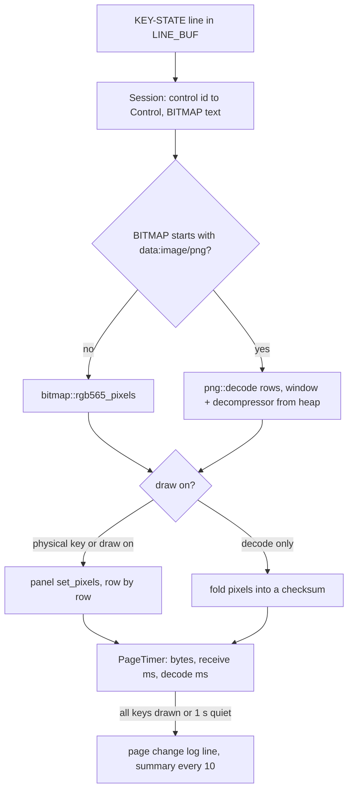

# Page-Change Bench at 16 and 32 Keys, with PNG Key Images - Plan

## Goal Capsule

- **Objective:** When the PoC deck is next on the bench, the operator can measure page-change time at 16 and 32 keys, with `rgb` and with `png` images, using only serial-console commands and two Companion page imports. They then copy the numbers into a note that is already laid out for them. Nothing has to be built on the bench day.
- **Means:** The firmware gets a runtime bench mode that registers 16 or 32 keys (KTD1, KTD2), a streaming PNG decoder in `deck-core` (KTD3, KTD4), and a page-change timer that logs one line per page change (KTD5). The fake deck and the Companion config generator get the same layouts, so the whole path is checked against the Companion container on the desktop (KTD6, KTD7).
- **Authority:** The Product Contract wins on behaviour. The KTDs win on mechanism. Units override neither. Linear THI-76 is the origin ticket, and its P3 baseline comment supplies the `rgb` numbers.
- **Execution profile:** One code PR on `feature/thi-76-measure-page-change-time-at-16-and-32-keys`. Everything is verified off-device: host tests, the firmware build and clippy, the fake-deck tests, and a desktop run against the Companion container when Docker is available. No hardware is attached during this work.
- **Stop conditions:**
  - **DRAM does not fit.** If the firmware no longer links, or the PNG decoder's memory cannot come from the heap without breaking `clippy::large_stack_frames`, stop and report the sizes. Don't move buffers to PSRAM or shrink the 72 KB line buffer without asking. `rgb` at 128×128 still needs that buffer.
  - **Toolchain outside mise.** Same rule as the PoC plan (KTD19 there): tools come only from mise.
- **Who finishes:** The implementer lands the PR. The operator runs the bench session later, fills in the note, and records the two THI-76 decisions.

---

## Product Contract

### Summary

Add a bench mode to the firmware. It registers a 16-key (2×8) or 32-key (4×8) surface with Companion, asks for `rgb` or `png` key images, decodes every key's image, and logs the time from a page-change press to the last key's image. Add a streaming PNG decoder that fits the ESP32's memory. Teach the fake deck the same layouts. Generate two filled Companion bench pages. Prepare the THI-76 note section and runbook, with empty cells for the hardware numbers.

### Problem Frame

THI-76 has to decide two things: keep raw `rgb` or switch to a compressed format, and whether 32 keys page fast enough for the 4×8 deck shape (THI-82, THI-83 depend on it). The P3 bench showed that transfer, not drawing, sets the time: a 128×128 key image is a 65,646 B line, received in a median of 192 ms and drawn in 26 ms. A 32-key page change in `rgb` is therefore about 2 MB and several seconds. PNG should be about 10× smaller, but the deck has no PNG decoder, it has only about 90 KB of free heap, and it cannot register more than two keys. The device isn't connected now, so all of that has to be ready before the next bench session.

### Key Decisions

- **No on-device measurement in this work; the bench run and the two decisions come later.** (session-settled: user-directed — chosen over doing the bench measurements in this run: the device is not connected now.) Governs R12, R13.
- **PNG is the compressed format tried; `webp` is not.** Companion offers `rgb,png,webp`. PNG has a small, known decoder path (zlib inflate plus row filters), and P0 already measured its wire size. A no_std WebP decoder would be a project of its own. Governs R5.

### Requirements

**Bench surface**

- R1. A serial-console command switches the deck between its normal surface (two keys plus the encoder) and a bench surface of 16 or 32 keys. The switch takes effect by re-registering with Companion, and the deck returns to the normal surface after a reboot.
- R2. The bench surface lays its keys out as rows of 8 starting at `0/0`. That is 2×8 for 16 keys and 4×8 for 32, so either fits Companion's default 8×4 page grid.
- R3. The two physical keys act as bench keys `0/0` and `0/1`, so the operator can press them to page up and page down.
- R4. Every bench key's image is received and fully decoded. A console option chooses between decoding only and also drawing each image onto one of the two panels. Drawing adds SPI time, as a real deck would.

**Image format**

- R5. A console command chooses `rgb` or `png` key images for the normal and the bench surface. The deck asks for `png` only when Companion's `CAPS` lists it, and otherwise logs that it fell back to `rgb`.
- R6. In `png` mode the deck decodes Companion's PNG key images (128×128) and OLED images (128×64) and shows them exactly as the `rgb` path would.
- R7. A PNG that the decoder rejects (wrong size, unsupported colour type, corrupt data) is logged and the session stays up. A partly drawn key is acceptable.

**Measurement**

- R8. Each page change logs one line: key count, format, draw mode, the time from the triggering press to the last key drawn, the time from the first image byte to the last key drawn, total bytes on the wire, and the summed and maximum receive and decode times.
- R9. After every 10 page changes the deck logs the median and the maximum press-to-last-key time.
- R10. The deck logs free heap when it registers and when it switches format, so the PNG decoder's memory cost is visible.

**Desktop tooling and notes**

- R11. The fake deck can register the same 16- and 32-key layouts at 128×128, in `rgb` or `png`, and it logs the same page-change summary as the firmware.
- R12. `tools/fake-deck/companion-config/` provides two importable bench pages. Every one of the 32 positions shows a distinct coloured image, and `0/0` and `0/1` page up and page down.
- R13. `docs/notes/satellite-protocol-firmware-notes.md` gains a THI-76 section. It holds a bench runbook, a results table with a row per {16, 32} × {`rgb`, `png`} × {decode only, draw}, cells for wire size, decode time, memory and page-change time, and placeholders for the two decisions. Desktop numbers are filled in where this work measures them.

### Success Criteria

- On the bench day the operator flashes the firmware, imports two pages, types `bench 32` and `image png`, presses key A and key B alternately for ten page changes, and copies a median out of the log. No code change is needed.
- PNG decode of a real Companion 128×128 key image is checked on the host against the same image's `rgb` bytes, pixel for pixel.

### Scope Boundaries

- The encoder and OLED are not part of the bench surface. A page change on the final deck redraws the OLED too; the note records that as one extra image, about 33 KB `rgb`.
- No PSRAM, no Ethernet (THI-84), no faster SPI clock. The note names them as options the decision may call for.
- Bench settings are not saved to flash.
- Bench pages use solid colours and text. Icon-heavy buttons compress less well; the note says so.

### Deferred to Follow-Up Work

- The bench session itself, filling the hardware rows, and the two THI-76 decisions.
- Making `png` the default, if the bench shows it pays off.

---

## Planning Contract

### Key Technical Decisions

- KTD1. **Bench settings live in a `SurfaceConfig` that the session reads at registration.** `deck-core` gets a `SurfaceConfig { layout: Normal | Bench16 | Bench32, format: Rgb | Png, draw: bool }`. The firmware holds it in a static next to `HOST`, and console commands replace it and raise the existing `HOST_CHANGED` signal, so the link drops and re-registers at once. The `DEVICEID` and `SERIAL` stay the same; Companion re-reads the layout from each `ADD-DEVICE`. U6 checks that against the container. A different serial per layout is the fallback if Companion keeps the old layout. Governs R1, R5.
- KTD2. **Controls become indexed and the manifest is built at runtime.** `Control` gains `Bench(u8)`, an index into a const table of the 32 IDs `"0/0"` to `"3/7"`, so `Control::id` still returns `&'static str`. The normal surface keeps `KeyA`, `KeyB`, `Encoder` and its manifest unchanged. The 32-key manifest is about 1.5 KB of JSON, about 2 KB of base64, so the `ADD-DEVICE` line outgrows the 1 KB `OUT_BUF`. `OUT_BUF` grows to 4 KB, and the JSON is written into a static scratch buffer rather than onto a stack. `BITMAP_FORMAT="png"` joins `ADD-DEVICE` only when `CAPS`' `BITMAP_FORMATS` lists `png`. Governs R2, R3, R5.
- KTD3. **The PNG decoder streams from the base64 text to RGB565 rows, with no image buffer.** `deck-core::png` strips the `data:image/png;base64,` prefix. It decodes base64 in small blocks, parses chunks (`IHDR`, one or more `IDAT`, `IEND`, others skipped), inflates with `miniz_oxide::inflate::core::decompress` into a 32 KB wrapping window, unfilters each scanline against the previous one, and hands each finished row to a callback as RGB565 (or as RGB for the OLED threshold). It supports 8-bit, non-interlaced colour types 2 (RGB) and 6 (RGBA, alpha dropped). Anything else is an error. `miniz_oxide` comes in with `default-features = false`, so `deck-core` stays free of `alloc`. Working memory is the 32 KB window, the `DecompressorOxide` (about 11 KB) and two rows of at most 512 B. Chunk CRCs and the zlib Adler-32 are checked. A failure surfaces after some rows were already drawn, which R7 accepts. Governs R6, R7.
- KTD4. **The decoder's memory comes from the heap, on first PNG use, and stays.** The window and the decompressor (about 43 KB) are taken from the heap the first time `png` is selected, never at boot, so the normal `rgb` deck keeps its 90 KB of free heap. They must be allocated without a large stack temporary; `#![deny(clippy::large_stack_frames)]` stays on. Free heap is logged before and after (R10). This is a stop condition in the Goal Capsule if it fails.
- KTD5. **A `PageTimer` in `deck-core` times each page change.** It starts at a sent bench-key press, or at the first `KEY-STATE` line if none is pending. For every drawn bench key it accumulates wire bytes, receive time and decode time. It finishes when every bench key has been drawn at least once since the start, or after 1 s without a `KEY-STATE` (logged as partial, with the count). It keeps a 64-sample window like `RoundTrips` (`crates/deck-core/src/latency.rs`) and reports every 10 page changes (R9). In bench mode the existing `RoundTrips` is not fed.
- KTD6. **The fake deck mirrors the bench layouts instead of growing a second protocol.** `--keys 16|32` swaps `buildLayoutManifest` for the same row-of-8 layout at `--key-size 128`, and the session timer mirrors KTD5 in TypeScript. `--save-raw` writes each received PNG's bytes alongside the decoded image, so U1 can commit real Companion PNGs as fixtures.
- KTD7. **Bench pages are generated by `make-page.ts`, with page-nav controls copied from a real Companion export.** `--bench 1` and `--bench 2` produce two page files whose 32 buttons have distinct background colours and text (`P1 0/3` and so on), with page up at `0/0` and page down at `0/1`. The JSON shape of Companion 5.1.3's page-up and page-down controls is copied from a fresh page exported from the container (new pages contain them), not guessed.

### High-Level Technical Design

Bench `KEY-STATE` path in the firmware link. This is directional, not an interface:

In decode-only mode the pixels go into a checksum that is logged at debug level, so the compiler cannot drop the decode. In draw mode, bench keys with even indices go to panel A and odd ones to panel B. The physical keys `0/0` and `0/1` are always drawn.

Console additions, parsed in `deck-core::console`:

| Command | Effect |
|---|---|
| `bench off` | Normal surface (two keys plus the encoder) |
| `bench 16` / `bench 32` | Bench surface, decode only |
| `bench 16 draw` / `bench 32 draw` | Bench surface, every image also drawn on a panel |
| `image rgb` / `image png` | Image format for whichever surface is active |
| `show` | Also prints the surface config |

### Assumptions

- Companion sends a `KEY-STATE` for every control on the surface when the page changes, including buttons whose image didn't change. That is Companion's page-change behaviour on other surfaces; U6's desktop run confirms it.
- Companion 5.1.3's satellite PNGs are 8-bit RGB or RGBA and not interlaced. U6 confirms this from the captured fixtures; another colour type would extend KTD3.
- Re-registering under the same serial with a new layout is accepted (KTD1). U6 confirms it.
- The P3 throughput (about 290–340 KB/s) holds, so `rgb` at 32 keys takes several seconds per page change. Bursts of that length stay well inside the 5 s silence watchdog, because each line resets it.

### Risks & Dependencies

| Risk | Mitigation |
|---|---|
| The 43 KB decoder plus Wi-Fi's buffers exhaust the heap under a 32-key `rgb` → `png` switch | Logged free heap (R10). The stop condition in the Goal Capsule covers it before the bench day. |
| Blocking decode stalls the executor for a whole page change | Each line is decoded inside the framer callback, as today. PING and input still run between lines, so only per-line stalls (tens of ms) occur. |
| `miniz_oxide` doesn't build for Xtensa no_std | It is pure Rust with `core` only under `default-features = false`. The firmware build in U4 proves it. |

### Sources

- `crates/deck-core/src/bitmap.rs` (table-driven base64, the `rgb` path to mirror)
- `crates/deck-core/src/latency.rs` (`RoundTrips`, the window and summary pattern for KTD5)
- `firmware/src/link.rs:496-620` (`serve`: where draws and timings happen)
- `firmware/src/main.rs:62-73` (static buffers and their sizes)
- `docs/notes/satellite-protocol-firmware-notes.md#images` and `#on-hardware-p3` (P0 wire sizes and the P3 baseline)
- THI-76's P3 baseline comment (2026-11-16)
- `miniz_oxide` 0.8 `inflate::core` (`TINFL_LZ_DICT_SIZE` = 32,768, wrapping output buffer)

---

## Implementation Units

### U1. Streaming PNG decoder in deck-core

- **Goal:** Decode a Companion PNG data URL to RGB565 or RGB rows within KTD3's memory.
- **Requirements:** R6, R7; KTD3.
- **Dependencies:** none. Real fixtures arrive from U5/U6; synthetic tests come first.
- **Files:** `crates/deck-core/src/png.rs` (new), `crates/deck-core/src/lib.rs`, `crates/deck-core/Cargo.toml` (`miniz_oxide`, `default-features = false`; `miniz_oxide` with `with-alloc` as a dev-dependency to build test PNGs), `Cargo.lock`, `crates/deck-core/tests/fixtures/` (real Companion PNG and matching `rgb` bytes, once U6 captures them).
- **Approach:** The caller lends a `PngWorkspace` (window, decompressor, two row buffers) and gets rows through a callback. Share the base64 table with `bitmap.rs` rather than copying it.
- **Test scenarios:**
  - A 2×2 RGB PNG built in the test with each filter type (None, Sub, Up, Average, Paeth) decodes to the expected RGB565 values.
  - An RGBA PNG drops alpha and matches the RGB result.
  - IDAT split across several chunks, and base64 input that ends mid-chunk, decode the same as one chunk.
  - Wrong width or height for the requested size returns a size error before any row.
  - Colour type 3, bit depth 16 and interlaced images return an unsupported error.
  - A flipped byte in IDAT returns a CRC or inflate error. A missing `IEND` returns a truncation error.
  - A missing or wrong data-URL prefix is rejected.
  - A real Companion 128×128 key PNG matches the `rgb` bitmap of the same button pixel for pixel. Same for the 128×64 OLED image. If U6 could not capture real fixtures, use a 128×128 PNG written by `pngjs` (the fake deck's encoder) instead, and say in the PR that a real Companion fixture is still missing.
- **Verification:** `cargo test -p deck-core png`.

### U2. Surface config, bench layouts and console commands in deck-core

- **Goal:** The session registers the normal or a bench surface in either format, and the console parses the new commands.
- **Requirements:** R1, R2, R3, R5; KTD1, KTD2.
- **Dependencies:** none.
- **Files:** `crates/deck-core/src/session.rs`, `crates/deck-core/src/console.rs`.
- **Approach:** `Session::new` keeps its signature and defaults to the normal config. A `set_config` applies at the next `CAPS`. The normal manifest stays byte-identical, and the existing manifest test must still pass unchanged. Add a `BenchCommand` and an `ImageCommand` to `Command`, and extend `HELP`.
- **Test scenarios:**
  - The `bench 16` manifest has exactly 16 controls `0/0`…`1/7`, all `default` at 128×128, and no encoder. `bench 32` gives 32 controls up to `3/7`.
  - `image png` with `BITMAP_FORMATS="rgb,png,webp"` adds `BITMAP_FORMAT="png"`. With `BITMAP_FORMATS="rgb"`, the deck registers without it and reports the fallback.
  - A `KEY-STATE` for `2/5` on a 32-key surface draws on `Bench(21)`. The same line on a 16-key surface is ignored as an unknown control.
  - A bench-key press sends its own `CONTROLID`, and a rotation on a bench surface sends nothing.
  - The 32-key `ADD-DEVICE` line fits a 4 KB writer.
  - The console parses `bench off|16|32 [draw]` and `image rgb|png`, and rejects `bench 8`, `bench 32 fast` and `image webp` with a reason.
- **Verification:** `cargo test -p deck-core`.

### U3. Page-change timer in deck-core

- **Goal:** One summary per page change and a rolling median (R8, R9).
- **Requirements:** R8, R9; KTD5.
- **Dependencies:** U2 (`Control::Bench`).
- **Files:** `crates/deck-core/src/pagetime.rs` (new), `crates/deck-core/src/lib.rs`.
- **Test scenarios:**
  - A press at t=0, then 32 distinct keys drawn by t=900, gives one complete summary: press-to-last 900, the summed bytes, the sums and maxima.
  - The same key drawn twice counts once toward completion and twice toward bytes.
  - Images with no press start a burst at the first line, and press-to-last is reported as absent.
  - Only 20 of 32 keys arrive, then 1 s passes with no line: a partial summary with count 20.
  - A summary falls due on the 10th page change, and the median and maximum cover the last 64.
- **Verification:** `cargo test -p deck-core pagetime`.

### U4. Firmware: bench mode, PNG drawing and logs

- **Goal:** The deck runs U1–U3 on hardware, logs R8–R10, and still builds and passes clippy.
- **Requirements:** R1, R3, R4, R5, R6, R7, R8, R9, R10; KTD1, KTD2, KTD4, KTD5.
- **Dependencies:** U1, U2, U3.
- **Files:** `firmware/src/main.rs` (`SURFACE` static, `OUT_BUF` to 4 KB, manifest scratch), `firmware/src/console.rs`, `firmware/src/link.rs`, `firmware/src/display.rs` (row-wise draw from the PNG callback, decode-only sink), `firmware/src/oled.rs` (PNG path through the existing threshold; a "BENCH 32 png" status while a bench surface is registered), `firmware/Cargo.lock`, `firmware/README.md` (console table, bench section).
- **Approach:** Row-wise drawing sets the panel window once, then pushes each row through `set_pixels`' iterator or the raw interface; the implementer picks whichever stays allocation-free. Bench-key presses from the physical keys feed `PageTimer` instead of `RoundTrips`.
- **Test expectation:** Logic is covered in U1–U3. The firmware has no host tests; hardware checks are the bench runbook (U7).
- **Verification:** `cargo fmt --check`, `cargo build --release --locked`, `cargo clippy --release --locked -- -D warnings` in `firmware/`. Record the `.bss`/`.data` size change from the build output in the PR body.

### U5. Fake deck: bench layouts, PNG capture and page-change summary

- **Goal:** The desktop stand-in measures what the firmware will, and captures real PNG fixtures.
- **Requirements:** R11; KTD6.
- **Dependencies:** none.
- **Files:** `tools/fake-deck/src/protocol.ts`, `tools/fake-deck/src/session.ts`, `tools/fake-deck/src/images.ts`, `tools/fake-deck/src/main.ts`, `tools/fake-deck/src/pagetime.ts` (new), `tools/fake-deck/test/protocol.test.ts`, `tools/fake-deck/test/pagetime.test.ts` (new), `tools/fake-deck/test/images.test.ts`, `tools/fake-deck/README.md`.
- **Approach:** `--keys` implies no encoder control, and the image sink sizes every control as a key. The REPL's `press 0` / `press 1` map to `0/0` / `0/1` on a bench surface.
- **Test scenarios:**
  - `buildLayoutManifest({ keys: 32, keySize: 128 })` decodes to 32 controls in rows of 8 with no encoder.
  - The TS page timer gives the same results as U3's first four scenarios.
  - With `--save-raw`, a PNG `KEY-STATE` writes the PNG bytes unchanged next to the decoded image.
  - `--keys 12` is a usage error.
- **Verification:** `npm test` and `npm run typecheck` in `tools/fake-deck`.

### U6. Companion bench pages and desktop run

- **Goal:** Two importable bench pages, and the desktop numbers and fixtures they produce.
- **Requirements:** R12, plus the desktop half of R13; KTD7.
- **Dependencies:** U5.
- **Files:** `tools/fake-deck/companion-config/make-page.ts`, `tools/fake-deck/companion-config/bench-page-1.companionconfig` and `bench-page-2.companionconfig` (generated), `tools/fake-deck/test/companion-config.test.ts`, fixtures into `crates/deck-core/tests/fixtures/`.
- **Approach:** Export a fresh page from the container to copy the page-nav shape (KTD7). Then, if Docker is available, import both pages and run the fake deck at 16 and 32 keys, `rgb` and `png`, ten page changes each. Keep the logged wire sizes and desktop page-change times, and capture one key and one OLED PNG as fixtures, with their `rgb` twins from an `rgb` run of the same button. If the container can't be set up, generate and unit-test the pages and leave the desktop cells marked "not run".
- **Test scenarios:**
  - `--bench 1` places 32 controls at `0/0`…`3/7`. `0/0` and `0/1` are page-nav controls, and the other 30 have pairwise distinct background colours.
  - `--bench 1` and `--bench 2` differ in every text, so each page change changes every image.
  - The existing `--hardware` and default outputs are unchanged.
- **Verification:** `npm test` in `tools/fake-deck`. The generated files match `node companion-config/make-page.ts --bench N` output.

### U7. THI-76 note section and runbook

- **Goal:** The bench day is copy-numbers-into-a-table.
- **Requirements:** R13.
- **Dependencies:** U4, U6.
- **Files:** `docs/notes/satellite-protocol-firmware-notes.md` (new section "Page change at 16 and 32 keys (THI-76)"; the images table's 128×128 `png` cell from U6), `firmware/README.md` (link to the runbook).
- **Approach:**
  - **Runbook steps:** flash; import the pages as pages 1 and 2; `bench 16` / `bench 32`, `image rgb` / `image png`, with and without `draw`; ten page changes per cell, pressing key A and key B alternately so the surface moves between the two filled pages and never onto an empty page 3; copy the summary.
  - **Results table:** columns for wire bytes per key, decode ms per key, free heap after registration, and median and max press-to-last-key. Hardware cells left empty, desktop cells filled from U6.
  - **Decision placeholders:** "Keep `rgb` or switch" and "Is 32 keys fast enough for the 4×8, or what would it need (compression, Ethernet, faster SPI)".
  - **Other contents:** the Scope Boundaries caveats (OLED not included, icon-heavy pages).
- **Test expectation:** none — documentation.
- **Verification:** The note renders, its links resolve, and every runbook command matches the console's `help`.

---

## Verification Contract

| Gate | Command | Where | Applies to |
|---|---|---|---|
| Core format | `mise exec -- cargo fmt --check` | repo root | U1–U3 |
| Core lint | `mise exec -- cargo clippy --locked --all-targets -- -D warnings` | repo root | U1–U3 |
| Core tests | `mise exec -- cargo test --locked` | repo root | U1–U3 |
| Firmware | `mise exec -- cargo fmt --check`, `cargo build --release --locked`, `cargo clippy --release --locked -- -D warnings` | `firmware/` (needs `firmware/wifi.env`; copy the example if missing) | U4 |
| Fake deck | `npm test`, `npm run typecheck` | `tools/fake-deck` | U5, U6 |
| Desktop run | fake deck against `docker compose up` Companion | `tools/fake-deck` | U6, best effort |

The `--locked` gates mean `Cargo.lock` and `firmware/Cargo.lock` must both be updated for `miniz_oxide`. CI runs the same three jobs.

---

## Definition of Done

- All Verification Contract gates pass locally, except the desktop run, which is either done or marked "not run" in the note.
- R1–R13 are traceable to a unit and covered by the tests listed there.
- The normal surface behaves as before: its manifest test is unchanged, `rgb` stays the default, and no bench setting persists across reboot.
- The note's THI-76 section exists with a runbook, a results table and decision placeholders. Hardware cells stay empty.
- No experimental or abandoned code is left in the diff, and no PSRAM or SPI-clock changes were made.
