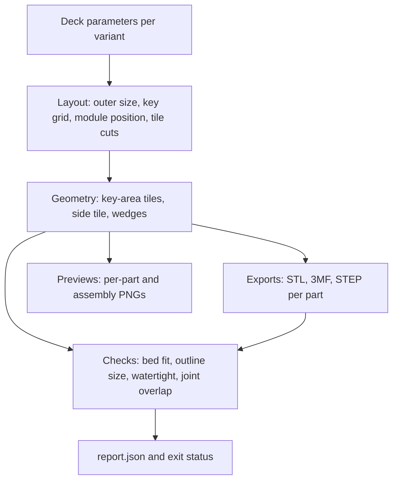

# Case Model Setup and THI-82 Desk Mock-Ups - Plan

## Goal Capsule

- **Objective:** The agent can generate, check and hand over printable case models for the deck from one set of parameters. Its first output is a print-ready set of full-size desk mock-ups of the 4×8 and 1×16 decks, which the operator uses to choose the shape in THI-82.
- **Means:** A pinned build123d project under `cad/` with one parameter module, a tiling and joint layer, exporters, headless previews and a check report (KTD1–KTD7).
- **Authority:** The Product Contract wins on behaviour. The KTDs win on mechanism. Units override neither. Linear THI-82 is the origin ticket. The shape, dial side and tilt decision belong to the operator after the desk try-out, not to this work.
- **Execution profile:** One code PR on a `feature/thi-82-…` branch. Everything is verified on the host: pytest, a full `thi-82` print-set build, and the agent viewing the generated preview PNGs. No printing happens in this work.
- **Stop conditions:**
  - **Toolchain outside mise/uv.** CAD tools come only from `mise.toml` and `cad/uv.lock`. Do not install build123d or Python globally.
  - **A part cannot fit the bed without splitting a keycap footprint.** Stop and report the dimensions rather than shrinking pitch or border.
- **Who finishes:** The implementer lands the PR with a generated, checked `thi-82` print set. The operator slices, prints, tries both decks on the desk and records the THI-82 decision.
- **Open blockers:** None.

---

## Product Contract

### Summary

A parametric case setup in build123d. One set of deck parameters (key pitch, grid, border, side module, target printer bed) drives every part. For THI-82 it produces tiled flat face plates for both deck shapes with engraved key and module marks, a name and size label, and clip-on tilt wedges. Each build writes printable files and preview images and runs dimension and bed-fit checks, so the agent can make and check models without the operator. The work ends with the full THI-82 print set generated and checked, ready for the operator to slice and print.

### Problem Frame

THI-82 asks for full-size flat outlines of the 4×8 block and the 1×16 strip, to try next to the keyboard and monitor before any PCB work. The repo has no CAD setup, and none of the installed tools let the agent produce or check geometry on its own: OpenSCAD 2021.01 is the only CAD program on the machine and it is mesh-only. Both shapes are wider than the 256 × 256 mm bed of the operator's Bambu P1S, so neither prints in one piece. The ticket's size estimates also used a 40 mm side section, but the OLED/encoder module measures 65.2 × 35.1 mm (`docs/notes/oled-encoder-module.md`). The real enclosure will come later and needs the same parameters, so a throwaway mock-up generator would be built twice.

### Key Decisions

- **The setup grows into the real case; THI-82 uses only flat plates.** (session-settled: user-approved — chosen over a mock-up-only generator and over designing the full enclosure now: the parameters are shared, and enclosure detail is not needed yet.) Governs R1, R2.
- **build123d is the modelling base.** (session-settled: user-directed — chosen over OpenSCAD and over 2D SVG/DXF outlines: the real case needs fillets, STEP output and fit checks against the Waveshare STEP files, which OpenSCAD and 2D outlines cannot provide.) Governs R1, R3.
- **Oversize parts are split into tiles that join, not shrunk or printed on paper.** (session-settled: user-directed — chosen over paper templates and over shrinking to fit the bed: the mock-up stays full size and 3D, and the real case will need the same splitting.) Governs R7, R8.
- **The side section is sized from the measured module, not from the ticket's 40 mm estimate.** The 65.2 mm module does not fit in 40 mm. Both decks therefore come out roughly 25–30 mm longer than THI-82's estimates: about 295 × 136 mm for the 4×8 and about 495 × 52 mm for the 1×16. Governs R5.
- **The OLED/dial section is its own tile that joins either end of the key area.** One print lets the operator try the dial on the left and on the right, which THI-82 needs decided. Governs R8.
- **The target printer is the Bambu P1S (256 × 256 mm bed).** This is the printer selected in the operator's Bambu Studio. It is a parameter, so another printer changes only the tile cuts. Governs R7.

### Requirements

**Setup**

- R1. All case geometry comes from one shared set of deck parameters: key pitch, key grid, border, side-module size, plate thickness and printer bed size. Changing one value regenerates every affected part.
- R2. The parameters and part definitions are structured so later enclosure work (key cut-outs, module mount, shell, tilt) can extend them without restarting.
- R3. The CAD toolchain is pinned in the repo and runs with one command from a fresh checkout, following the repo's existing practice of pinning tools.
- R4. One build command generates every part of a named print set. For each part it writes a printable mesh file, a STEP file, and preview images the agent can look at.

**THI-82 mock-up parts**

- R5. Face plates exist for the 4×8 (32 keys) and the 1×16 (16 keys) layout. They use THI-82's key footprint (22.00 × 25.30 mm keycap at about 25 × 28 mm pitch), a 12 mm border, and a side section sized to hold the 65.2 × 35.1 mm OLED/encoder module.
- R6. Each plate has shallow engraved keycap footprints at the planned pitch, an engraved footprint of the OLED/encoder module with the dial position, and an embossed label giving the variant name and the assembled outer size.
- R7. Every part fits the target printer's bed. Any plate wider than the bed is split into tiles that join into a flat, rigid, full-size plate.
- R8. The OLED/dial section is a separate tile that joins either end of the key area, without a second print.
- R9. A set of clip-on tilt wedges at a few angles (for example 0°, 8° and 15°) props a joined plate at that angle on the desk.

**Checks**

- R10. Every build checks and reports each part's outer dimensions, each assembled plate's outer dimensions, and whether every part fits the bed. A failed check fails the build.
- R11. The agent can run the full build, view the previews and read the check report without the operator. The operator's part starts at slicing.

### Acceptance Examples

- AE1. **Covers R7, R10.** Given the P1S bed (256 × 256 mm), when the 1×16 print set is built, then no part is larger than the bed, and the report shows the assembled plate at about 495 × 52 mm.
- AE2. **Covers R1, R7.** Given the bed size is changed to a larger printer, when the set is rebuilt, then the plates are split into fewer tiles and nothing else changes.
- AE3. **Covers R8.** Given a printed 1×16 set, when the operator moves the OLED/dial tile from the right end to the left end, then it joins without reprinting anything.

### Success Criteria

- The THI-82 print set (both plates in tiles, the OLED/dial tiles and the wedges) is generated, passes every R10 check, and opens in Bambu Studio without repair warnings.
- The operator can print and assemble both mock-ups and run THI-82's desk try-out without asking the agent for changes first.

### Scope Boundaries

- Switch and keycap cut-outs, the enclosure shell, PCB standoffs and module mounting are deferred to the real case work.
- Importing the Waveshare keycap/module STEP files for fit checks is deferred to the real case work. The build123d base was chosen so it is possible then.
- Slicing, sending jobs to the printer and filament settings stay with the operator.
- Choosing the shape, the dial side and the tilt, and recording the final dimensions, are THI-82's done criteria and happen after printing, outside this plan.

### Dependencies / Assumptions

- The operator's printer is a Bambu P1S, inferred from the Bambu Studio settings and not confirmed in conversation.
- On the 52 mm tall strip the module (35.1 mm) is taller than the key area inside the 12 mm border, so its footprint runs into the border. That is acceptable for a mock-up.
- THI-82's 25 × 28 mm pitch and 12 mm border are estimates. They are used as given and remain parameters.

### Outstanding Questions

All three planning questions from the brainstorm are resolved in the Planning Contract: tile joints and wedge clips (KTD4, KTD5), previews (KTD6), and plate thickness and engraving depth (KTD3).

Product Contract preservation: Product Contract unchanged.

### Sources / Research

- Linear THI-82: shape estimates, keycap size (Waveshare drawing) and done criteria.
- `docs/notes/oled-encoder-module.md`: module board 65.2 × 35.1 mm with four M3 holes.
- Waveshare 0.85" ScreenKey module STEP/DXF: <https://docs.waveshare.com/0.85inch_ScreenKey_Module/Resources-And-Documents>
- `mise.toml`: the repo pins its tools through mise.

---

## Planning Contract

### Key Technical Decisions

- KTD1. **A uv project at `cad/`, on a uv-managed CPython 3.14, with uv pinned in `mise.toml`.** build123d 0.13.0 requires Python `>=3.11,<3.15` and its OCP wheels stop at cp314, so the system Python 3.15 cannot run it. The linuxbrew Python 3.14 on the dev machine has a broken `pyexpat` (matplotlib fails to import), so the project sets uv's python preference to managed-only. A lockfile pins build123d and every transitive dependency. Implements the build123d Key Decision. Governs R3.
- KTD2. **One frozen parameter object per deck variant, with derived dimensions computed in plain Python, separate from geometry.** `block_4x8` and `strip_1x16` share defaults (keycap 22.00 × 25.30, pitch 25 × 28, border 12, module 65.2 × 35.1, bed 256 × 256) and differ only in grid. The outer sizes, tile cut positions and wedge heights are derived from it, so they can be tested without building any CAD geometry. Governs R1, R2, R5.
- KTD3. **The face plates are 4 mm thick. Keycap and module footprints are 0.6 mm engraved outlines, and the label is embossed 0.6 mm.** 4 mm keeps a 495 mm strip stiff enough to lie flat on a desk. Outline grooves (not pockets) print fast and still show the key density. All three values are parameters. Governs R6.
- KTD4. **Tiles join with in-plane dovetail (jigsaw) tabs and a clearance parameter, default 0.2 mm per side.** Tiles push together flat on the desk and need no glue or hardware. Cuts fall only in the gap between key columns, so no keycap footprint is split. That gap is only 3 mm wide, so the joints between key-area tiles sit in the 12 mm top and bottom border bands: one tab per band, two per seam. Tab size is limited so tab, socket and clearance stay clear of every keycap footprint. Key-area tiles have a socket on each outer end, and the side tile has one tab. Turning the side tile 180° moves it to the other end (R8), so its footprint has to read sensibly either way round, and the variant label sits on a key-area tile. Governs R7, R8.
- KTD5. **The tilt wedges come one per tile per angle, each with a slot that grips the plate's back edge.** The in-plane joints don't keep the tiles level with each other, so every tile needs its own wedge. That is 2 per angle for the 4×8 and 3 for the 1×16, with the count derived from the layout. The slot is the plate thickness plus the joint clearance. The plate's front edge rests on the desk, so the wedge height is `depth × sin(angle)` for that variant's plate depth. The default angles are 8° and 15°. Governs R9.
- KTD6. **Previews are hidden-line projections drawn to PNG with matplotlib (top view and isometric), not shaded renders.** A shaded matplotlib mesh render has depth-sorting artifacts, as the probe showed. build123d's `project_to_viewport` visible edges give clean line drawings the agent can read. Each print set also gets an assembly preview with every tile in its assembled position. Governs R4, R11.
- KTD7. **Checks live in the build itself, and their results go to `report.json` plus a printed table. Any failure exits non-zero.** The checks are:
  1. Every part's bounding box fits the bed, with a 5 mm margin.
  2. Each assembled outline matches the size derived from the parameters.
  3. Every exported mesh is watertight.
  4. Mated joints have zero overlap volume at the nominal clearance.

  The watertight check stands in for "opens in Bambu Studio without repair warnings", which can't be tested headlessly. Governs R10.

### High-Level Technical Design

The build is a one-way pipeline. Each stage depends only on the one before it.



The THI-82 print set, from the defaults in KTD2:

| Variant | Assembled size (approx.) | Tiles |
|---|---|---|
| 4×8 block | 295 × 136 mm | 1 key-area tile (~224 × 136) and 1 side tile (~71 × 136) |
| 1×16 strip | 495 × 52 mm | 2 key-area tiles (~212 × 52 each, cut after column 8) and 1 side tile (~71 × 52) |

Wedges add one per tile per angle (KTD5). The tile count follows from the bed size, so a larger bed gives fewer key-area tiles (AE2).

### Output Structure

```text
cad/
  pyproject.toml          # uv project, build123d pin, `case` entry point
  uv.lock
  .python-version         # 3.14
  README.md               # build, preview, print and assemble
  src/opendeck_case/
    params.py             # KTD2
    layout.py             # derived dims and tile cuts
    joints.py             # KTD4
    parts.py              # plates, side tile, wedges
    export.py             # STL/3MF/STEP
    preview.py            # KTD6
    checks.py             # KTD7
    printsets.py          # named sets, starting with thi-82
    cli.py                # `case build <set>`
  tests/
  out/                    # gitignored build output
```

### Assumptions

- The operator's printer is the Bambu P1S (256 × 256 mm). This is inferred from the Bambu Studio config and is a parameter.
- The P1S prints a 0.2 mm per-side dovetail clearance as a firm push fit. If the first print is too tight or loose, the operator changes the parameter and rebuilds. No test print is planned in this work.
- The side tile's footprint (OLED window and dial circle) is acceptable when turned 180° for the other end. A mirrored second side tile is not built.
- build123d's default text font renders on the dev machine (confirmed by the probe) and on the CI runner. If the CI runner lacks it, the test fails visibly, and the fix is to pin a font file.

### Sequencing

U1 → U2 → U3 → U4 → U5 → U6. U4's exports and previews and U5's checks both read U3's parts. U5's build command ties everything together. U6 documents the result and adds CI.

---

## Implementation Units

### U1. Pinned CAD toolchain

- **Goal:** `cad/` is a uv project that installs build123d from a fresh checkout with one command, using only mise and uv.
- **Requirements:** R3; KTD1.
- **Dependencies:** none.
- **Files:** `mise.toml`, `cad/pyproject.toml`, `cad/uv.lock`, `cad/.python-version`, `.gitignore`, `cad/tests/test_toolchain.py`.
- **Approach:**
  1. Add a pinned `uv` to `mise.toml` `[tools]`, and add mise tasks for the case build and tests that run uv inside `cad/`.
  2. Create the uv project with build123d 0.13.0, matplotlib and trimesh as dependencies and pytest as a dev dependency. Set `requires-python` to 3.14 and uv's python preference to managed-only.
  3. Gitignore `cad/out/` and `cad/.venv/`.
- **Patterns to follow:** `mise.toml` pins and tasks (the `esp-toolchain` task). `firmware/mise.toml` for per-directory tooling.
- **Execution note:** This is mostly packaging. Prove it with an install-and-run smoke test, not unit coverage.
- **Test scenarios:**
  - Building a 10 mm cube with build123d gives a solid whose bounding box is 10 × 10 × 10.
  - Exporting that cube to STL, STEP and 3MF in a temp dir writes three non-empty files.
- **Verification:** The case test task runs green from a clean `cad/` with no global Python packages, on a uv-managed 3.14.

### U2. Deck parameters and layout

- **Goal:** Both THI-82 variants are described by parameters, and every derived dimension can be tested without building any CAD geometry.
- **Requirements:** R1, R2, R5, R7; KTD2, KTD4 (cut positions).
- **Dependencies:** U1.
- **Files:** `cad/src/opendeck_case/params.py`, `cad/src/opendeck_case/layout.py`, `cad/tests/test_layout.py`.
- **Approach:**
  1. Keep a frozen parameter object with every value from KTD2 and KTD3, plus joint clearance and bed margin. Define `block_4x8` and `strip_1x16` as named variants.
  2. Layout derives:
     - the key-area size (grid × pitch plus border) and the side-section width (module width plus a margin)
     - each keycap footprint's centre, and the module footprint's position
     - tile cut positions, taken from the fewest key-column gaps that keep each tile within the bed less the margin
  3. Cuts are placed in column gaps only. If no column-gap cut can fit the bed, layout raises an error naming the variant and widths (a Goal Capsule stop condition).
- **Patterns to follow:** None in the repo (no prior Python). Keep it plain dataclasses and pure functions.
- **Test scenarios:**
  - `block_4x8` gives an assembled outline of about 295 × 136 mm and one key-area tile (no cut).
  - Covers AE1. `strip_1x16` gives an assembled outline of about 495 × 52 mm and one cut, after column 8.
  - Covers AE2. `strip_1x16` with a 350 mm bed gives two key-area tiles. With a 500 mm bed it gives one. Nothing else changes.
  - Every keycap footprint lies fully inside its tile, and no cut line crosses a footprint.
  - A bed narrower than one key pitch plus border raises a clear error, not a silent bad layout.
- **Verification:** The layout tests pass, and the derived sizes match the High-Level Technical Design table.

### U3. Plates, joints and wedges

- **Goal:** Solid parts exist for every tile and wedge of a variant, with the THI-82 marks and working joints.
- **Requirements:** R5, R6, R7, R8, R9; KTD3, KTD4, KTD5.
- **Dependencies:** U2.
- **Files:** `cad/src/opendeck_case/joints.py`, `cad/src/opendeck_case/parts.py`, `cad/tests/test_parts.py`.
- **Approach:**
  1. Key-area tiles: the plate outline is extruded to thickness. Keycap outlines are engraved, and the variant label (name plus assembled size) is embossed on one key-area tile.
  2. Side tile: the module board outline and the dial position are engraved, and the outer corners are rounded.
  3. Joints are a shared dovetail profile added as a tab or cut as a socket with clearance (KTD4). The side tile's tab mates with the outer socket on either end of the key area.
  4. Wedges are generated per angle, one per tile in the layout, from the variant's plate depth (KTD5).
- **Patterns to follow:** The probe sketch-text-extrude flow (BuildPart with BuildSketch on an offset plane).
- **Technical design:** For a key-area tile with cuts on both sides: plate minus cut sockets, plus tabs, minus engraved grooves, plus embossed label. This is directional only.
- **Test scenarios:**
  - Each tile is a single valid solid, and its volume is close to (plate area × thickness) minus grooves plus label.
  - Covers AE3. With the side tile placed at the right end, and then turned 180° and placed at the left end, the tab sits inside the socket's footprint with zero overlap volume. Each time the gap is at most clearance + 0.05 mm.
  - With the two strip key-area tiles placed at their assembled positions, the joint overlap volume is zero and the outline is continuous.
  - The 15° wedge for the 4×8 rises about 35 mm (136 × sin 15°). Its slot is plate thickness + clearance.
  - The 4×8 gets 2 wedges per angle and the 1×16 gets 3, one per tile.
  - No tab or socket profile, including clearance, intersects a keycap or module footprint on any tile.
  - The label text on the `block_4x8` key-area tile contains the assembled size from U2.
- **Verification:** Part tests pass, and the U4 previews show the marks where the layout puts them.

### U4. Exports and previews

- **Goal:** Every part is written as printable and CAD files, together with preview images the agent can inspect.
- **Requirements:** R4, R11; KTD6.
- **Dependencies:** U3.
- **Files:** `cad/src/opendeck_case/export.py`, `cad/src/opendeck_case/preview.py`, `cad/tests/test_export.py`.
- **Approach:**
  1. Write STL, 3MF and STEP for each part into the print set's output directory, using stable file names (`<variant>-<part>.<ext>`).
  2. Each part gets a PNG with a top view and an isometric view side by side, drawn from visible projected edges. Each variant also gets an assembly PNG with all its tiles in position and the outer size annotated.
  3. Previews use the non-interactive matplotlib backend so they run headless and in CI.
- **Patterns to follow:** The probe's `project_to_viewport` plus 2D plotting.
- **Test scenarios:**
  - Exporting a variant writes one STL, 3MF and STEP per part, plus one PNG per part and one assembly PNG. No files are missing.
  - Each exported STL loads with trimesh as a watertight mesh, with a bounding box that matches the part's.
  - The PNG files decode as images of non-trivial size, and rendering runs with no display set.
- **Verification:** The agent opens the generated `thi-82` PNGs and confirms that the marks, joints and wedges look as intended.

### U5. Checks, print sets and the build command

- **Goal:** One command builds a named print set, checks it, and fails loudly when anything is off.
- **Requirements:** R4, R10, R11; KTD7.
- **Dependencies:** U4.
- **Files:** `cad/src/opendeck_case/checks.py`, `cad/src/opendeck_case/printsets.py`, `cad/src/opendeck_case/cli.py`, `cad/tests/test_checks.py`, `cad/tests/test_build.py`.
- **Approach:**
  1. A print set is a named list of (variant, parts). `thi-82` holds both variants' tiles, the side tiles and the 8° and 15° wedges, one per tile per angle.
  2. `case build <set>` builds, exports and previews the set, runs the four checks from KTD7, writes `report.json`, prints a table, and exits non-zero on any failure.
  3. Expose it as a project script, and run it through the mise task from U1.
- **Test scenarios:**
  - Building `thi-82` exits 0, and `report.json` lists every part with its size and all checks passed.
  - Covers AE1. The report shows every 1×16 part within 251 × 251 mm (bed less margin) and the assembled strip at about 495 × 52 mm.
  - A variant with a forced bed of 100 mm fails with the U2 layout error or the bed-fit check, exits non-zero, and names the offending part. That bed is narrower than the 4×8's 136 mm depth, which no column cut can split.
  - An unknown print set name exits non-zero with the list of known sets.
- **Verification:** `case build thi-82` succeeds, and the report and previews in `cad/out/thi-82/` are complete.

### U6. README and CI job

- **Goal:** The operator and future agents can find out how to build, view, print and assemble from the repo, and CI keeps the setup building.
- **Requirements:** R3, R11.
- **Dependencies:** U5.
- **Files:** `cad/README.md`, `README.md`, `.github/workflows/ci.yml`.
- **Approach:**
  1. `cad/README.md` covers:
     - setup and the build command
     - where the outputs land
     - how to slice in Bambu Studio (import the 3MF files)
     - how the tiles join, and which way the side tile goes for dial left or right
     - which parameter to change when the joint fit is off
  2. Add one line to the root README pointing to `cad/`.
  3. Add a `case` CI job that installs uv through mise and runs the case tests. Leave the main ruleset unchanged, so the job reports but isn't required.
- **Patterns to follow:** `tools/fake-deck/README.md`, and the existing CI job layout (pinned action SHAs, mise-action, `MISE_DISABLE_TOOLS` for unneeded tools).
- **Test expectation:** none (docs and CI config). The CI run on the PR is the proof.
- **Verification:** The new CI job passes on the PR, and the README commands work as written from a clean checkout.

---

## Verification Contract

| Gate | Command | Proves |
|---|---|---|
| Case tests | `mise run case-test` (pytest in `cad/`) | U1–U5 scenarios, AE1–AE3 |
| Print set build | `mise run case -- build thi-82` | R4, R10: every part built, exported, previewed and checked; exit 0 |
| Visual check | The agent opens `cad/out/thi-82/*.png` | R6, R8, R9 look right; R11 |
| Existing CI | deck-core, firmware, fake-deck jobs | Untouched jobs stay green |
| New CI | `case` job on the PR | R3 from a clean runner |

The exact mise task names may differ. Whatever they are, the README documents them.

## Definition of Done

- Every unit's verification holds, and the case tests and the `thi-82` build pass locally.
- `cad/out/thi-82/` holds every planned part as STL, 3MF and STEP, plus previews and a passing `report.json`. The agent has looked at the previews and they show the THI-82 marks, joints and wedges.
- No generated output is committed. `cad/out/` is gitignored.
- Abandoned or experimental code from approaches that did not pan out is removed from the diff, including the probe.
- The PR description lists the print-set parts and their sizes, so the operator can print without running the build first.
