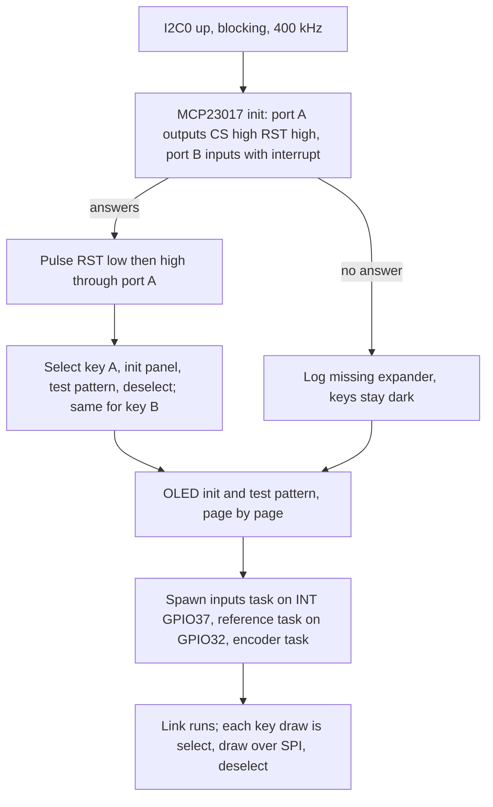

# MCP23017 Key Inputs and Chip Selects Bench - Plan

## Goal Capsule

- **Objective:** THI-83 (the deck PCB) can choose its key-input chip, its chip-select scheme and its ESP32 pin budget from measured numbers, not guesses.
- **Means:** The bench deck is rewired so one Adafruit MCP23017 breakout carries all five buttons and the keys' CS and RST lines, which becomes the deck's wiring on main (KTD1–KTD4). It is then measured against the recorded direct-pin numbers (KTD5).
- **Authority:** Linear THI-89 is the origin ticket. The Product Contract wins on behaviour, the KTDs below win on mechanism, and units override neither. The PoC plan's KTDs (`docs/plans/2026-11-13-1722-feat-companion-network-deck-poc-plan.md`) still govern everything this work does not change. KTD1 here replaces the async part of that plan's KTD22.
- **Execution profile:** One code PR on `feature/thi-89-bench-test-the-mcp23017-for-key-inputs-and`. The hardware is on the bench. An agent can build, host-test and lint everything. Bench results (U5) are recorded only from the operator's reported numbers.
- **Sequencing:** U1 (the wiring docs) lands first as its own commit, so the operator can wire the board while U2–U4 are written.
- **Stop conditions:**
  - The firmware no longer links, or the shared I²C bus can't be borrowed without holding a critical section across a transfer. Stop and report; don't disable interrupts around I²C transfers.
  - The MCP23017 doesn't answer at 0x20 on the bench at either 400 kHz or 100 kHz. Report it; the operator checks the wiring.
  - Toolchain outside mise. Tools come only from mise (PoC plan KTD19).
- **Who finishes:** The implementer lands U1–U4 and the U5 note skeleton in the PR. The operator runs the bench session and reports the numbers. The implementer then fills in the note and posts the THI-83 recommendation.

---

## Product Contract

Product Contract preservation: changed R1, R2 and one Scope Boundary, user-visible only as "no separate baseline session before rewiring". R1: the numbers recorded on 2026-11-16 serve as the baseline, so the operator can rewire straight away. R2: the direct-pin reference comes from a bench-only wire in the same session, because CS lines can't be wired to two places. Scope: the OLED write becomes page-by-page for a mechanism reason (KTD1), not only if numbers demand it. Outstanding Questions are resolved in place by KTD1–KTD5.

### Summary

Rewire the bench deck so the MCP23017 reads the five buttons and drives the two CS lines and the shared RST, and make that the deck's wiring on main. Measure the new wiring against the recorded direct-pin numbers, and write a recommendation for THI-83.

### Problem Frame

The final 2×8 deck needs about 44 signals: CS and KEY for each of the 16 keys, the shared screen lines, I²C, the encoder and the module buttons. The ESP32 has about 22 usable GPIOs, and only about 13 once wired Ethernet takes its fixed EMAC pins. Those pins also clash with today's MOSI (GPIO19) and SDA (GPIO22). An I/O expander is the obvious fix, but nobody has seen one handle key inputs and chip selects on this firmware. The open question is how it behaves on the same I²C bus as the OLED, whose 1 KB frame write holds the bus for about 25 ms. THI-83 is blocked until that is known.

### Key Decisions

- **The expander wiring becomes the deck's default on main; it is not a switchable experiment.** (session-settled: user-directed — chosen over keeping direct pins as a switchable default, and over a throwaway branch: the bench should move toward the final board, and two pin paths would both need maintaining.) Governs R5, R9.
- **The work is measured on the bench in this run, not prepared for a later session.** (session-settled: user-directed — chosen over off-device preparation like PR #7: the Feather and the breakout are on hand.) Governs R1, R10.
- **Only one MCP23017 is built.** The two-chip MCP23017 layout, the TCA8418 keypad scanner and the 74HC154 CS decoder are judged on paper from datasheets and these measurements. Only one breakout is on hand. Governs R11.
- **The shared RST moves to the expander as well as both CS lines.** This frees GPIO15, a strapping pin, which the final board would rather not use. Governs R5.
- **Debounce behaviour does not change.** The same 20 ms stable-time rule applies; only the place the levels are read from changes. Governs R6, R8.

### Requirements

**Baseline on direct pins**

- R1. The direct-pin baseline is the set of numbers already recorded on 2026-11-16 on this bench: the key round trip (median 216 ms, max 516 ms), the page-change table in `docs/notes/satellite-protocol-firmware-notes.md` (16 keys `rgb` draw 3,957 ms median, `png` draw 1,056 ms), and the 26 ms single-key draw.
- R2. The delay from a physical button edge to the moment the firmware detects it is measured for the expander path against a bench-only reference wire, which keeps KEY A also on its old direct pin so both paths see the same press.

**Expander wiring**

- R3. The MCP23017 sits on the OLED's I²C bus at address 0x20, next to the OLED at 0x3C.
- R4. Port B reads KEY A, KEY B, the encoder push, BACK and CONFIRM, and one interrupt line from the expander goes to a freed ESP32 pin. GPA7 and GPB7 carry no inputs, because they are output-only on current chips.
- R5. Port A drives both keys' CS and the shared screen RST. The GPIOs they used are freed.
- R6. The encoder phases stay on their direct PCNT pins.
- R7. If the expander does not answer at boot or later, the deck logs it and keeps running with what still works. A missing OLED is handled the same way today (KTD26).

**Behaviour on the new wiring**

- R8. Every button logs exactly one press and one release per physical press, checked with 20 presses on each of the five buttons, including presses made during an OLED update and during a page change.
- R9. Both keys draw correctly with CS and RST from the expander, including the boot test patterns and a full page change.

**Measurements and recommendation**

- R10. On the expander wiring the operator records the key round trip, the `bench 16 draw` page-change times in `rgb` and `png`, and the R2 edge-to-detection delay, the last both with the bus idle and with presses made while the OLED is being redrawn.
- R11. A results note records the baseline and expander numbers side by side, and a recommendation is posted to THI-83. It covers the key-input chip (two MCP23017s or a TCA8418), the CS scheme (I²C expander or a 74HC154 decoder), and an estimated ESP32 pin count for the 16-key deck next to Ethernet.

### Acceptance Examples

- AE1. **Covers R8, R10.** Given Companion is redrawing the OLED on every encoder detent, when the operator spins the encoder and presses KEY A, then KEY A logs exactly one press and one release, and the logged edge-to-detection delay for that press is recorded even if it includes a wait for the OLED write.
- AE2. **Covers R7.** Given the expander is unplugged at boot, when the deck starts, then it logs that the expander is missing, the OLED and the encoder rotation still work, and the deck does not reset in a loop.
- AE3. **Covers R9.** Given a page change in Companion, when both keys receive new images, then each image appears on its own key and never on both.

### Success Criteria

- THI-83 can choose its input chip and CS scheme from R11 without another bench session.
- The edge-to-detection delay on the expander stays within the 20 ms debounce interval even during an OLED redraw. If it does not, the results note says so and names the mitigation THI-83 should design for (for example a second I²C bus).

### Scope Boundaries

- Whether all of this fits next to Ethernet on the ESP32-POE2's free pins (THI-84). R11 gives an estimate only.
- One SPI bus driving all 16 screens. The plan is two buses of 8.
- Extra controls on the side tile (THI-87), which change the input count.
- Building the TCA8418, the 74HC154 or a second MCP23017.
- Recovering an expander that is plugged in after boot. A missing expander is logged and stays missing until the next boot (R7).

### Dependencies / Assumptions

- The Adafruit MCP23017 breakout runs at 3.3 V on the Feather's 3V rail, so no level shifting is needed.
- The OLED/encoder module's own 10 kΩ pull-ups stay in place on its three buttons. The keys use the expander's internal pull-ups instead of the ESP32's.

### Sources / Research

- `docs/notes/deck-wiring.md` and `docs/notes/deck-wiring.svg`: current pins and calibration. They change together with the pin setup in `firmware/src/main.rs`.
- `docs/notes/satellite-protocol-firmware-notes.md`: the P3 round-trip numbers and the PR #7 page-change table that R1 adopts.
- `docs/plans/2026-11-13-1722-feat-companion-network-deck-poc-plan.md`: KTD21 (shared SPI bus), KTD22 (OLED driver), KTD24 (inputs task and debounce), KTD26 (a missing module never stops the deck), KTD27 (press round trip).
- Microchip MCP23017 datasheet, revision C (2022): GPA7 and GPB7 are output-only.

---

## Planning Contract

### Key Technical Decisions

- KTD1. **The I²C bus becomes blocking and is shared by short, synchronous borrows; the OLED frame is written one 128-byte page at a time with a yield between pages.** Key draws run synchronously inside the link's line callback (`firmware/src/link.rs`, `Displays::bitmap`), so the CS write that brackets a draw can't await an async bus. Nothing awaits while it holds the bus, so no task ever finds it busy, and the borrow never holds a critical section across a transfer (Wi-Fi interrupts must keep running). One page is about 3 ms at 400 kHz, which is less than the 26 ms blocking SPI draw the executor already absorbs. This replaces the async half of the PoC plan's KTD22 and turns the "OLED holds the bus for 25 ms" risk into a wait of at most one page. Governs R3, R8, R10.
- KTD2. **A minimal in-tree MCP23017 driver; the register logic lives in `deck-core`.** The deck needs only init, one port-B read and one port-A write, as the SH1106 needed only init and page writes (KTD22's reasoning). `deck-core` owns the register addresses, the init sequence, the port-A shadow (CS A, CS B, RST bits) and the mapping from a port-B byte to the five button levels, with host tests. The firmware sends the bytes. Port B: GPB0 KEY A, GPB1 KEY B, GPB2 encoder push, GPB3 BACK, GPB4 CONFIRM, all interrupt-on-change against the previous value, with pull-ups on the two key bits. Port A: GPA0 CS A, GPA1 CS B, GPA2 RST, outputs, written from a shadow so one bit never clobbers another. Governs R3, R4, R5.
- KTD3. **CS is held low for a whole draw, not toggled per SPI transaction.** `KeyDisplay` gets a no-op CS for its SPI device and selects its key through the expander before a draw (test pattern, status, bitmap, blank) and deselects after. Per-transaction CS through `RefCellDevice` would cost two I²C writes for each of the 30-plus SPI transactions in a 128×128 frame. Per-draw CS costs two writes, about 0.15 ms. Only one key draws at a time, so this keeps AE3 true. The CS time falls inside the link's timed draw span, so the page-change log already measures its cost. Governs R5, R9.
- KTD4. **The inputs task waits for the interrupt line to go low, then reads port B; while any button is still settling, it reads every 2 ms.** The interrupt goes to GPIO37, which is input-only, freed by CONFIRM, and free of the GPIO36/39 errata (PoC KTD25). The MCP23017's default push-pull active-low interrupt needs no pull-up. A level wait, not an edge wait, means an interrupt left asserted after a failed read wakes the task again instead of being lost. Reading port B clears the interrupt. The existing `Debouncer` runs unchanged on the levels; it needs samples until the level has been stable for 20 ms, hence the 2 ms polling while unsettled. Governs R4, R7, R8.
- KTD5. **Edge-to-detection is timed from a bench-only reference wire: KEY A's switch is also wired to GPIO32, its old direct pin.** A task timestamps GPIO32's falling edge. The inputs task records the time from that edge to the first port-B read that shows KEY A pressed, and logs one line per press plus a median and maximum summary every 20 presses, reusing the `latency::Samples` window. The old direct path sampled every 2 ms, so its detection delay was at most 2 ms by construction. That is the R2 baseline, and the same session shows both. Without the wire, GPIO32 sits high on its pull-up and logs nothing, so the code can stay on main as bench instrumentation, like the page-change bench. Both pull-ups in parallel (ESP32 about 45 kΩ, MCP23017 about 100 kΩ) still read low when the switch closes. Governs R2, R10.
- KTD6. **A missing expander is detected once at boot; key draws are then skipped and inputs stay quiet.** If the init write fails, the deck logs `MCP23017 not found at 0x20`, skips key panel init and every key draw (the CS lines would float), and parks the inputs task. The OLED, the encoder and the link carry on. A failing read or write later is logged and retried on the next interrupt or draw. This is the smallest form of R7; hot-plug recovery is out of scope. Governs R7.

### High-Level Technical Design

Boot order changes because the panels can't be reset or selected until the expander is up.

New pin plan (U1 owns the full tables):

| Signal | Before | After |
|---|---|---|
| KEY A | GPIO32 | MCP GPB0 (bench: also GPIO32 as reference) |
| KEY B | GPIO25 | MCP GPB1 |
| Encoder push | GPIO36 | MCP GPB2 |
| BACK | GPIO39 | MCP GPB3 |
| CONFIRM | GPIO37 | MCP GPB4 |
| CS key A | GPIO33 | MCP GPA0 |
| CS key B | GPIO26 | MCP GPA1 |
| Key RST | GPIO15 | MCP GPA2 |
| MCP INTB | — | GPIO37 |
| MCP SDA / SCL | — | GPIO22 / GPIO20, shared with the OLED |

Freed on the Feather: GPIO15, GPIO25, GPIO26, GPIO33, GPIO36, GPIO39 (GPIO32 is freed once the reference wire is removed).

### Assumptions

- The ScreenKey panels tolerate CS and RST floating for the few milliseconds between power-up and the expander's init, because no SPI traffic happens before it.
- The breakout is wired from the Feather's header pins, not the STEMMA QT port, so no extra power switch is involved. The STEMMA QT port shares SDA/SCL but may have switched power on this board.
- The breakout's RST pin is tied to 3V, and its address jumpers stay open (0x20).

### Sequencing

U1 first and on its own commit (operator priority). U2 before U3 and U4. U3 before U4, because U4 shares U3's bus handle and boot order. U5's note skeleton can land with U4; its numbers come from the bench session.

---

## Implementation Units

### U1. Wiring docs for the expander bench

**Goal:** The operator can wire the board from the docs alone.

**Requirements:** R3, R4, R5, R6, R2 (reference wire)

**Dependencies:** none

**Files:**
- `docs/notes/deck-wiring.md`
- `docs/notes/deck-wiring.svg`

**Approach:**
1. Add an MCP23017 section to the wiring tables: breakout pin to Feather pin (VIN to 3V, GND, SDA GPIO22, SCL GPIO20, INTB GPIO37, RST to 3V, address jumpers open), and expander pin to key or module pin, per the KTD2 port map and the HTD pin table.
2. Update the key and module tables so KEY, CS, RST and the three module buttons point at expander pins. Mark the KEY A to GPIO32 wire as bench-only (KTD5). List the freed GPIOs.
3. Redraw the SVG with a third box for the breakout between the Feather and the peripherals, signals routed through it, and the reference wire dashed and labelled "bench only".
4. Update the status block: the expander wiring dated 2026-11-21, pending the bench check.

**Patterns to follow:** The existing tables and SVG style in `docs/notes/deck-wiring.svg` (boxes per board, one row per signal, footnote marks for strapping pins).

**Test scenarios:** Test expectation: none -- documentation only; checked by the operator wiring from it.

**Verification:** Every pin in the tables matches the HTD pin table and the SVG. No signal appears on two ESP32 pins except the marked reference wire. The SVG renders in a browser.

### U2. MCP23017 register logic in deck-core

**Goal:** Pure, host-tested expander logic that the firmware only has to send.

**Requirements:** R3, R4, R5

**Dependencies:** none

**Files:**
- `crates/deck-core/src/expander.rs` (new)
- `crates/deck-core/src/lib.rs`

**Approach:** Address constant 0x20, register addresses for IOCON.BANK=0, the init byte sequence for KTD2's port directions, pull-ups and interrupt-on-change, a port-A shadow with select-key, deselect-all and set-reset operations that each yield the byte to write, and a function from a port-B byte to the five button levels (active low). The button order matches `firmware/src/inputs.rs`'s `Button`.

**Patterns to follow:** `crates/deck-core/src/mono.rs` and `debounce.rs`: pure, no_std, tests in-module.

**Test scenarios:**
- Init sequence sets IODIRA so GPA0–GPA2 are outputs and leaves GPA7 alone; IODIRB makes GPB0–GPB4 inputs; GPPUB pulls up GPB0 and GPB1; GPINTENB enables GPB0–GPB4; INTCONB compares against the previous value.
- Init leaves the port-A latch with both CS high and RST high, so no panel is selected or held in reset.
- Selecting key A clears GPA0 and keeps GPA1 high; selecting key B after that sets GPA0 high again and clears GPA1.
- Deselect-all sets GPA0 and GPA1 high without touching the RST bit; pulsing RST low then high leaves both CS bits unchanged.
- Port-B byte 0b1111_1110 maps to KEY A pressed and all others released; 0b1110_0000 maps to all five pressed; bits 5–7 are ignored.

**Verification:** `cargo test` in the workspace passes with the new tests.

### U3. Shared blocking I²C, expander driver, and key CS/RST through it

**Goal:** Keys draw correctly with CS and RST from the expander, and the OLED shares the bus page by page.

**Requirements:** R3, R5, R7, R9; AE2, AE3

**Dependencies:** U2

**Files:**
- `firmware/src/expander.rs` (new)
- `firmware/src/oled.rs`
- `firmware/src/display.rs`
- `firmware/src/link.rs`
- `firmware/src/main.rs`

**Approach:**
1. Make I²C0 blocking and share it through a borrow type that is only ever held by synchronous code (KTD1). The SPI bus's `StaticCell<RefCell<…>>` pattern in `main.rs` is the model, but the shared handle must be usable from spawned tasks; if task arguments must be `Send`, wrap it so a borrow never enters a critical section for the length of a transfer.
2. `oled.rs`: write the frame one page at a time, yielding to the executor between pages, and keep KTD26's error handling.
3. `expander.rs`: init, port-B read, and port-A shadow writes on the shared bus, using U2's bytes. Expose select, deselect and reset for the keys, and a read for the inputs task.
4. `display.rs`: replace the per-key `Output` CS with a no-op pin, and bracket every public drawing method with select and deselect through the expander (KTD3). `reset_panels` pulses RST through the expander.
5. `main.rs`: new boot order per the HTD diagram; free GPIO15, GPIO25, GPIO26, GPIO33, GPIO36 and GPIO39; skip key init when the expander is missing (KTD6).
6. `link.rs`: skip key draws when the expander is missing; keep the CS time inside the timed draw span.

**Patterns to follow:** `display::SharedPin` and the `RefCellDevice` sharing (PoC KTD21); `Oled::init`'s log-and-continue on failure (KTD26).

**Execution note:** Firmware has no host tests; prove this unit with the release build, clippy, and the operator's bench check.

**Test scenarios:**
- Covers AE3. On the bench, a page change shows each key's own image and never the other's.
- Boot with the expander present shows both key test patterns and the OLED test pattern.
- Covers AE2. Boot with the expander unplugged logs that the expander is missing, the keys stay dark, and the OLED, encoder rotation and Companion link still work with no reset loop.
- An OLED frame redraw while key images arrive completes without I²C errors in the log.

**Verification:** The firmware builds and passes clippy in release. The bench check above passes as reported by the operator.

### U4. Inputs through the expander and edge-to-detection timing

**Goal:** All five buttons work through the expander with the same debounce, and each KEY A press logs its edge-to-detection delay.

**Requirements:** R2, R4, R6, R7, R8, R10; AE1

**Dependencies:** U2, U3

**Files:**
- `firmware/src/inputs.rs`
- `firmware/src/main.rs`
- `crates/deck-core/src/latency.rs` (only if `Samples` needs a unit label for microseconds)

**Approach:**
1. `inputs.rs`: replace the five-pin sampler with KTD4's loop: wait for GPIO37 low, read port B, feed the five debouncers, and while any is unsettled read every 2 ms. Edges go to `EDGES` exactly as today.
2. A small reference task timestamps GPIO32 falling edges into a shared slot (KTD5). The inputs task turns the first port-B read showing KEY A pressed after a timestamp into one sample, logs `KEY A edge to expander read: N µs`, and logs a median and maximum every 20 samples.
3. Encoder phases and PCNT stay as they are (R6).
4. If a read fails, log it and wait for the next interrupt (KTD6).

**Patterns to follow:** The current `inputs_task` structure and its log wording (`KeyA pressed`), which the calibration runbook in `docs/notes/deck-wiring.md` relies on; `record_round_trip` in `firmware/src/link.rs` for sample and summary logging.

**Test scenarios:**
- Covers AE1. While the encoder is spun with the OLED redrawing, 20 KEY A presses log exactly 20 presses and 20 releases and 20 edge-to-detection samples.
- 20 presses on each of KEY B, encoder push, BACK and CONFIRM log exactly one press and one release each.
- Holding two buttons and releasing them in turn logs each edge once, in order.
- With the reference wire removed, presses work and no edge-to-detection lines appear.

**Verification:** The firmware builds and passes clippy in release. The operator reports the 20-press checks passing.

### U5. Results note and THI-83 recommendation

**Goal:** The numbers and the recommendation exist where THI-83 will look for them.

**Requirements:** R1, R10, R11

**Dependencies:** U3, U4 (for the numbers)

**Files:**
- `docs/notes/io-expander-bench.md` (new)
- `docs/notes/deck-wiring.md` (status block)

**Approach:**
1. Before the bench session, the note holds a short runbook (which commands, which log lines to copy) and a table with the R1 baseline filled in and empty expander cells.
2. After the operator reports, fill in the expander cells, then write the recommendation: input chip, CS scheme, ESP32 pin estimate for 16 keys next to Ethernet, using the Problem Frame's pin budget.
3. Post the recommendation to THI-83 as a comment linking the note, and update the wiring status block.

**Test scenarios:** Test expectation: none -- documentation and a bench record.

**Verification:** Every R10 measurement has a number or a stated reason it's missing. The THI-83 comment exists and links the note.

---

## Verification Contract

| What | Command or check | Applies to |
|---|---|---|
| Host tests | `mise exec -- cargo test --locked` at the repo root | U2, U4 if `latency.rs` changes |
| Workspace lint | `mise exec -- cargo fmt --check` and `mise exec -- cargo clippy --locked --all-targets -- -D warnings` at the repo root | U2 |
| Firmware build | In `firmware/`: `mise exec -- cargo fmt --check`, `mise exec -- cargo build --release --locked`, `mise exec -- cargo clippy --release --locked -- -D warnings` | U3, U4 |
| Bench | The operator's reported results for the U3 and U4 scenarios and the R10 numbers | U3, U4, U5 |

## Definition of Done

- U1 is committed first, on its own.
- All Verification Contract commands pass.
- The operator has reported the U3 and U4 bench checks, and U5's note holds the R10 numbers.
- The THI-83 recommendation is posted.
- No dead code from abandoned approaches is left in the diff; the old direct-pin setup is removed, not commented out.
