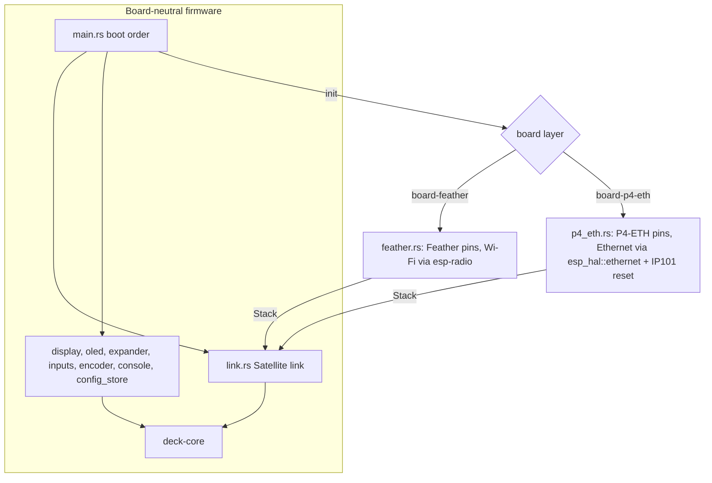
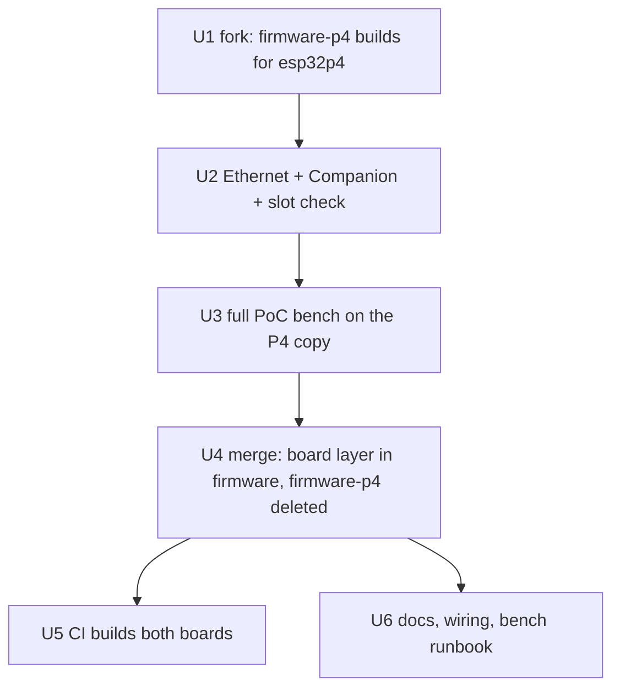

# Port the PoC to the Waveshare ESP32-P4-ETH - Plan

## Goal Capsule

- **Objective:** The PoC deck (keys, OLED, encoder) works with Companion over wired Ethernet on the Waveshare ESP32-P4-ETH, powered over PoE. It still works on the Feather ESP32 V2 over Wi-Fi from the same codebase. THI-83 gets a measured answer on how the P4-ETH fits the final deck.
- **Means:** Fork the firmware into a P4 copy, start it as a hardware spike, grow it to the full PoC bench, then merge both copies behind a board layer (KTD1, KTD4).
- **Product authority:** THI-84 as rewritten on 2026-11-27, then this plan's Product Contract, then its Planning Contract. The whole ticket is in scope, gated by the spike.
- **Open blockers:** None. The spike can redirect the Ethernet driver choice (R4) and the OTA path (R9), but both outcomes are already decided.
- **Execution profile:** Agent work is code, builds, lint and CI only. No board is attached to the build machine, so every requirement that needs hardware is checked through the bench runbook in U6.
- **Stop conditions:** Stop and report if the P4 copy cannot be built with esp-hal 1.2.x at all, or if a tool would have to come from outside mise (PoC plan KTD19). If the P4 needs a newer esp-hal, upgrade both boards rather than stopping (Key Decisions).
- **Who finishes:** The agent lands U1–U6 in one PR with CI green. The operator runs the bench runbook, records results in `docs/notes/p4-eth-bench.md`, and posts the THI-83 recommendation (R19) from them.

---

## Product Contract

### Summary

A P4 copy of the firmware is first a spike: Ethernet, DHCP and a Companion connection on the P4-ETH, plus a bootloader and partition check. It then grows into the full PoC bench, wired as on the Feather and powered over PoE. The two copies then merge into one codebase with a board layer chosen at build time, both on one shared esp-hal version, with CI building both boards. The work closes with P4 page-change timings next to the Feather's and a written fit recommendation for THI-83.

### Problem Frame

The Feather ESP32 V2 was the PoC board, not the final one. The planned PoE board, the Olimex ESP32-POE2, is 59 × 90 mm and does not fit under the 71.2 × 80 mm side section (THI-83 comment, 2026-11-22). It also leaves only about 13 free GPIOs next to Ethernet, which keeps the pin squeeze from THI-89 and THI-83.

The Waveshare ESP32-P4-ETH has 27 free GPIOs, 32 MB PSRAM, two general-purpose SPI controllers and a faster RISC-V core. It has no radio, so it is Ethernet-only. Its Rust support is young: Ethernet in esp-hal is an unstable module, and OTA and bootloader support on the P4 is unconfirmed.

The board design in THI-83 is waiting on two answers: whether the P4-ETH runs the deck at all, and whether it physically fits. The user has the PoE variant (ESP32-P4-POE-ETH) and a PoE source on the bench.

### Key Decisions

- **The whole ticket is one plan, gated by the spike.** PoE, the fit measurement and the THI-83 recommendation stay in scope and are not split into follow-ups. (session-settled: user-directed — chosen over a spike-plus-port plan with PoE and fit as a follow-up, a spike-only plan, and a Feather-only board-layer plan: the user wants the full outcome in one ticket.)
- **Fork, then merge.** The P4 work starts as a separate copy of the firmware, and the two copies merge behind a board layer at the end. Governs R10–R15. (session-settled: user-directed — chosen over abstracting on the Feather first, and over a P4 skeleton spike followed by extracting the layer from two working boards: the user preferred the fastest route to the PoC on the P4, and accepted the drift and merge risk.)
- **The P4 bench is wired like the Feather's.** It uses the same MCP23017, two SPI keys, OLED and encoder. Only the pin numbers change, so the comparison between the boards is like for like. Governs R5. (session-settled: user-approved — chosen over direct GPIOs on the P4, and over supporting both: keeping one input path keeps the code above the board layer the same.)
- **Both boards move to one esp-hal version.** If the P4 needs a newer esp-hal than the Feather's pinned `~1.2.2`, the Feather upgrades too, and accepts the Wi-Fi migration risk that esp-radio brings. Governs R3, R11, R12. (session-settled: user-approved — chosen over separate versions per board, and over stopping to decide after the spike: one version keeps one codebase honest.)
- **A missing A/B boot path on the P4 does not block the ticket.** The P4 is then flashed over USB-C, and OTA on the P4 moves to a follow-up. Governs R9. (session-settled: user-directed — chosen over making OTA required, and over stopping to decide: the rest of the ticket does not depend on OTA.)
- **The P4 copy can land on main as its own CI-built firmware before the merge.** The merge stays part of THI-84, not a follow-up. Governs R10, R13.
- **Page-change time is measured and compared, not targeted.** Making it faster is THI-85. Governs R16.
- **"P4" never names the board on its own.** The PoC plan already uses P4 for its OTA and wrap-up stage, so this work always writes "ESP32-P4" or "P4-ETH".

### Requirements

**Spike on the P4 copy**

- R1. On the P4-ETH, the P4 copy gets an address over Ethernet by DHCP and opens a Companion connection through the existing Satellite link.
- R2. The spike checks whether the P4-ETH boots through the ESP-IDF bootloader from an A/B partition layout like the Feather's, and records the result.
- R3. The spike finds the esp-hal version the P4 needs, and whether the Feather's Wi-Fi stack can move to it, and records both.
- R4. The spike records which Ethernet driver the P4 copy uses, the unstable esp-hal module or the community `esp-p4-eth` crate, and why.

**PoC on the P4-ETH**

- R5. On the P4-ETH, the keys, OLED and encoder work with Companion as they do on the Feather, on the same bench wiring with only pin numbers changed.
- R6. The P4-ETH runs the full PoC bench powered only from PoE through the Waveshare PoE module.
- R7. The Companion host is set from the console and survives reboots and reflashing on the P4-ETH, as on the Feather.
- R8. The link status on the OLED names the network state without assuming Wi-Fi, so it reads correctly on both boards.
- R9. When the A/B boot check (R2) fails, the P4-ETH is flashed over USB-C and THI-84 continues. No OTA update code is part of this ticket on either board.

**Merge into one codebase**

- R10. One codebase builds for the Feather (Wi-Fi) and the P4-ETH (Ethernet), with the board chosen at build time.
- R11. Both boards build against the same esp-hal and esp-rs versions.
- R12. After the merge, the Feather is retested on hardware: it joins Wi-Fi, connects to Companion, and keys, OLED and encoder work.
- R13. CI builds both boards, and both builds are required checks on main.
- R14. Firmware changes that land on main during the fork are carried into the merged codebase.
- R15. `deck-core` stays board-independent. Above the board layer, the Satellite link, display, inputs and OLED code do not depend on which board they run on.

**Measurements and THI-83 recommendation**

- R16. The 16-key page-change time is measured on the P4-ETH with the existing bench surface and compared with the Feather's THI-76 results.
- R17. The PoE power draw of the P4-ETH with the full PoC bench is measured and compared with what the PoE module can supply.
- R18. The P4-ETH with its PoE module is measured against the 71.2 × 80 mm side section, including whether the RJ45 jack can reach the end edge.
- R19. A written recommendation goes to THI-83: mount the P4-ETH as a daughter board under the side section, or copy its circuit onto the deck board. It includes the fit (R18) and power (R17) results.

### Acceptance Examples

- AE1. **Covers R2, R9.** **Given** the spike finds the P4-ETH cannot boot from the A/B layout through the ESP-IDF bootloader, **when** the PoC is brought up, **then** it is flashed over USB-C, the finding is recorded, and a follow-up ticket for OTA on the ESP32-P4 is linked from THI-75.
- AE2. **Covers R3, R11, R12.** **Given** the P4 needs a newer esp-hal than the Feather's `~1.2.2`, **when** the copies merge, **then** the Feather moves to that version too and passes the hardware retest before the merge counts as done.
- AE3. **Covers R4.** **Given** the unstable esp-hal Ethernet module cannot hold a stable Companion connection on the P4-ETH, **when** the spike ends, **then** the P4 copy uses `esp-p4-eth`, and the reason is recorded.
- AE4. **Covers R8.** **Given** the P4-ETH has no Ethernet link, **when** the OLED shows the link status, **then** it reports no network, not no Wi-Fi.
- AE5. **Covers R17, R19.** **Given** the measured PoE draw exceeds what the PoE module supplies, **when** the THI-83 recommendation is written, **then** it states the shortfall and what it means for powering the final deck.

### Scope Boundaries

- The OTA update flow itself (upload, password check, rollback) is THI-75. This ticket only checks the A/B boot path on the P4 (R2).
- Direct-GPIO inputs on the P4, which would drop the MCP23017, belong with the final pin plan in THI-83.
- Speeding up page changes, including PNG decode and SPI tuning on the P4, is THI-85.
- Dropping the vendored `xtensa-lx-rt` patch is THI-77. It stays Feather-only.
- Wi-Fi on the P4-ETH is out of scope: the chip has no radio.
- Static IP or other network configuration beyond DHCP is out of scope.
- The 32-key page-change measurement on the P4 is out of scope. Done needs only the 16-key number (R16).
- Considered and not built: PSRAM for the heap. The internal RAM holds today's buffers. Turn it on if the bench shows heap exhaustion.
- Considered and not built: a partition table that uses the P4-ETH's full 32 MB flash (KTD6). Revisit when THI-75 sizes the OTA images.

### Dependencies / Assumptions

- The user has the ESP32-P4-POE-ETH with its PoE module and a PoE switch or injector.
- The Feather PoC bench stays available for the hardware retest (R12) and as the comparison baseline (R16).
- Other firmware work during the fork is either held back or accepted as porting work at the merge (R14).
- The ESP32-P4 is RISC-V, so its build does not need the `espup` Xtensa toolchain. New targets are installed through mise (KTD19 in the PoC plan).

### Sources / Research

- THI-84 in Linear: board facts, risks and done criteria.
- esp-hal P4 Ethernet status: <https://github.com/esp-rs/esp-hal/issues/6755>. Fallback driver: <https://github.com/babasha/esp-p4-eth>.
- Board docs: <https://www.waveshare.com/esp32-p4-eth.htm> and <https://docs.waveshare.com/ESP32-P4-ETH>.
- Board-specific code today: pins, I²C0, SPI2 and UART set-up in `firmware/src/main.rs`, and Wi-Fi bring-up in `firmware/src/wifi.rs`. The Xtensa target and `--chip esp32` are set in `firmware/.cargo/config.toml`, and `channel = "esp"` in `firmware/rust-toolchain.toml`.
- `firmware/src/link.rs` uses only `embassy_net::Stack`, `TcpSocket` and DNS. Its status names Wi-Fi (`NoWifi`), which R8 addresses.
- `firmware/src` has no OTA code. `firmware/partitions.csv` reserves `otadata`, `ota_0` and `ota_1` and keeps `deckcfg` fixed (KTD14 in `docs/plans/2026-11-13-1722-feat-companion-network-deck-poc-plan.md`).
- Version pins: PoC plan KTD9. Required CI checks: `.github/rulesets/main.json` (`deck-core`, `firmware`, `fake-deck`).
- Page-change bench: `bench 16|32` in `firmware/README.md`, and the THI-76 results in `docs/notes/satellite-protocol-firmware-notes.md`.
- Earlier Ethernet routes for the classic ESP32: `docs/notes/board-and-framework-decision.md`.
- ESP32-P4 Rust support, checked 2026-11-27: esp-hal 1.2.0 (2026-09-01) added the ESP32-P4 (silicon v3.0+) and a P4 `ethernet` module behind `unstable`. 1.2.2 adds the P4 memory-layout fix. Every pinned companion crate has an `esp32p4` feature, and espflash 4.7.0 and esp-generate 2.0.0 support the chip. <https://raw.githubusercontent.com/esp-rs/esp-hal/esp-hal-v1.2.3/esp-hal/CHANGELOG.md>
- P4-ETH schematic: <https://files.waveshare.com/wiki/ESP32-P4-ETH/ESP32-P4-ETH-datasheet.pdf>. It shows an IP101GRI PHY on esp-hal's default RMII pins, PHY reset on GPIO51, and a CH343P USB-UART bridge on UART0 (GPIO37 TX, GPIO38 RX).

**Product Contract preservation:** restructured, no scope change. The five Deferred-to-Planning questions are answered by KTD3–KTD7 and removed from the Product Contract. The page-change Key Decision's citation is corrected from R15 to R16. R-IDs and AE-IDs are unchanged.

---

## Planning Contract

### Key Technical Decisions

- KTD1. **The fork is a sibling cargo root, `firmware-p4/`, copied from `firmware/`, and the merge deletes it.** It keeps the Feather build untouched while the P4 copy is changed freely, and the root workspace and CI treat it exactly like `firmware/`. The fork's commits stay in the branch history, so the operator can flash the P4-only state before the merge. Governs R1–R9. (session-settled: user-directed — chosen over abstracting on the Feather first, and over a P4 skeleton followed by extracting the layer: the user preferred the fastest route to the PoC on the P4.) Conflict call-out: this run ships fork and merge in one PR with no bench between them, so the drift risk the user accepted is small. The cost is that the fork exists only in branch history, not as a separate stage on main.
- KTD2. **Both boards stay on esp-hal `~1.2.2` and the other pinned versions (PoC plan KTD9).** esp-hal 1.2.x already carries the ESP32-P4, its Ethernet driver and every companion crate's `esp32p4` feature, so the Feather upgrade the Key Decisions allow for is not needed. Governs R3, R11. If the P4 copy turns out to need a newer esp-hal, both boards move together, per the Key Decision.
- KTD3. **The merged firmware selects the board with exclusive Cargo features, `board-feather` (the default) and `board-p4-eth`, in one crate, one cargo root and one lockfile.** Each feature turns on its chip features in the esp crates (`esp32` or `esp32p4`). Only `board-feather` turns on `esp-radio` and `esp-rtos/esp-radio`. A `compile_error!` rejects neither or both. The default keeps today's Feather commands working. Governs R10, R11.
- KTD4. **The board layer is one module per board behind a single board-neutral interface.** `main.rs` calls it to get the configured buses and pins, the console receiver, the device MAC and the network stack, and it never names a GPIO. The interface also provides the board's "no network" label and its encoder count source (KTD13). `link.rs`, `display.rs`, `oled.rs`, `expander.rs`, `i2c.rs`, `inputs.rs`, `console.rs` and `config_store.rs` stay board-neutral: they already take esp-hal's chip-neutral types. `encoder.rs` keeps the board-neutral detent and pending-total part, and its count source moves into the board modules. Governs R15.
- KTD5. **Each target has its own cargo config table, and cargo aliases run the P4 build.** `firmware/.cargo/config.toml` keeps the Xtensa default target and adds a `riscv32imafc-unknown-none-elf` table with `--chip esp32p4`. Aliases `p4`, `p4-build` and `p4-clippy` add the target and `--no-default-features --features board-p4-eth`. Both builds use the pinned `esp` toolchain with `build-std`, which compiles `core` and `alloc` for any built-in target. If the RISC-V link fails under that toolchain, the fallback is a mise task for the P4 build. The `esp-toolchain` task also installs the P4 target (`espup --targets esp32,esp32p4`), and the P4 task sets `RUSTUP_TOOLCHAIN` to that espup-installed toolchain for its one command, overriding `firmware/mise.toml`. CI then calls the task. A cargo alias cannot switch toolchains. Governs R10.
- KTD6. **Both boards use the same `partitions.csv` and the 8 MB flash-size header.** `deckcfg` and the A/B slots keep their offsets (PoC plan KTD14), and 8 MB fits inside the P4-ETH's 32 MB. Using the rest of the flash is not needed for this ticket. Governs R2, R7.
- KTD7. **CI keeps the single required job `firmware` and builds both boards inside it.** The job runs fmt, then release build and clippy for each board, so `.github/rulesets/main.json` does not change. A failure in either board's build fails the required check, which is how R13's "both builds are required checks" holds. Governs R13.
- KTD8. **Ethernet uses esp-hal's `esp_hal::ethernet` driver with `GenericPhy` on the board's RMII pins, wired straight into `embassy-net`.** The firmware pulses PHY reset (GPIO51) itself, because `GenericPhy` has no reset-pin handling. `esp-p4-eth` stays a documented fallback only: it pins embassy-executor 0.9 and its own time driver, and it predates esp-hal's driver. Taking the AE3 fallback means vendoring or patching `esp-p4-eth` onto embassy-executor 0.10 and the esp-rtos time driver, so KTD3's single lockfile holds and the Feather's executor never moves. Governs R1, R4.
- KTD9. **The P4 device MAC is the chip's factory base MAC.** The Ethernet MAC and the Companion device ID both come from it, so Companion remembers the surface across reflashes, as it does with the Feather's Wi-Fi MAC. Governs R1, R5.
- KTD10. **The P4 console is UART0 on GPIO38 (RX), behind the board's CH343P bridge, with esp-println's default UART output.** The Feather console code works unchanged. Only the RX pin moves into the board layer. Governs R7.
- KTD11. **The link status is renamed from "no Wi-Fi" to "no network", and the board supplies the label: "No Wi-Fi" on the Feather, "No Ethernet" on the P4-ETH.** The status logic is already medium-neutral (`stack.is_config_up()`), so only the variant name and the label change. Governs R8, AE4.
- KTD12. **A `slot` console command shows the booted app slot, the OTA-data selection, and the running app descriptor's version and build time. `slot next` selects the other slot and restarts.** It uses esp-bootloader-esp-idf's partition and OTA-data API on both boards, and it downloads no image, so R9's "no OTA update code" still holds. The app descriptor matters because the P4 booted-partition read in esp-bootloader-esp-idf 0.6.0 is marked "TODO: verify": the image itself shows which slot runs. `slot next` only rewrites OTA data, so the bench first writes the same build into `ota_1` (U6). A fallback to `ota_0` while `ota_1` is empty is not a failed A/B result. Governs R2, R9, AE1.
- KTD13. **On the P4-ETH, the encoder is decoded in the GPIO interrupt by a quadrature state machine in `deck-core`, and the Feather keeps its PCNT.** esp-hal 1.2.2 enables its PCNT driver only where `pcnt_driver_supported` is set, and its esp32p4 metadata does not set it, so `esp_hal::pcnt` does not exist on the P4. The interrupt handler runs even while a blocking key draw stalls the executor, so the PoC's rule that no edge is lost (PoC plan KTD23) still holds. The state machine replaces PCNT's glitch filter with a minimum edge interval, rejects invalid double steps, and feeds the existing `DetentCounter` and pending total. It shares the GPIO handler with the bench reference wire that `inputs::install_reference` registers. Governs R5, R15.
- KTD14. **The P4 bench uses free header pins away from Ethernet, the SD slot, strapping pins and the console.** Proposed map: I²C SDA GPIO7 and SCL GPIO8 (the header's I²C pair), SPI SCK GPIO20 and MOSI GPIO21, DC GPIO22, backlight GPIO23, MCP23017 INTB GPIO26, encoder phases GPIO32 and GPIO33, and the bench reference wire on GPIO27. `docs/notes/deck-wiring.md` is the authority for the final numbers. Governs R5.

### High-Level Technical Design

The board layer is the only code that knows the board. It hands `main.rs` the configured buses and pins, and it hands `link.rs` an `embassy-net` stack. The link cannot tell whether Wi-Fi or Ethernet is behind that stack.

### Assumptions

- The shipped board has ESP32-P4 silicon v3.0 or newer, which esp-hal requires. The `P4NRW32X` marking suggests v3. The first bench step checks it (U6).
- The IP101GRI comes up with `GenericPhy`'s standard IEEE auto-negotiation, with no vendor-specific registers.
- The `esp` toolchain with `build-std` links `riscv32imafc-unknown-none-elf` with its bundled `rust-lld`. KTD5 names the fallback.
- The P4's default ESP-IDF bootloader, as bundled by espflash 4.7.0, honours `otadata` for A/B selection, as on the ESP32.
- The PoE module's rating is unknown: neither Waveshare's pages nor the research found it. R17 measures the draw, and the operator reads the rating off the module.
- The KTD14 pin map is checked only on paper against the schematic. A pin that turns out to be shared on the board shows up at bench step 4 and changes only the P4 board module and the wiring note.

### Sequencing

U1 → U2 → U3 make up the fork phase: after U3, the branch has a P4-only firmware that runs the full bench. U4 is the merge. U5 and U6 depend on U4. U6's runbook covers both the fork commits and the merged result. Firmware changes on main during this work are rebased into U4 (R14).

**Bench redirect.** The bench runs after this PR has merged, so a spike result that contradicts the desk research arrives after the board layer exists. Examples are an esp-hal version that doesn't work on the P4 (KTD2), an Ethernet driver that doesn't hold a connection (KTD8, AE3), or a failed A/B boot (AE1). The operator records the result in `docs/notes/p4-eth-bench.md`, and the change lands as a follow-up PR against the merged board layer. That PR changes the P4 board module, or bumps esp-hal for both boards together, per the Key Decision. THI-84 is not done until that follow-up passes the Feather retest (R12).

---

## Implementation Units

### U1. Fork the firmware into a P4 copy that builds

**Goal:** A `firmware-p4/` cargo root builds a release image for the ESP32-P4-ETH from a copy of today's firmware.

**Requirements:** R3; KTD1, KTD2, KTD5, KTD6.

**Dependencies:** None.

**Files:**
- `firmware-p4/` (new): copied from `firmware/` without `vendor/`, `wifi.env`, `wifi.env.example` or `src/wifi.rs`
- `firmware-p4/Cargo.toml`, `firmware-p4/.cargo/config.toml`, `firmware-p4/build.rs`, `firmware-p4/mise.toml`, `firmware-p4/espflash.toml`
- `Cargo.toml` (exclude `firmware-p4`, so cargo treats it as its own root)

**Approach:**
1. Copy the cargo root, and switch every esp crate's chip feature from `esp32` to `esp32p4`. Drop `esp-radio`, `esp-rtos/esp-radio` and the `xtensa-lx-rt` patch.
2. Set the target to `riscv32imafc-unknown-none-elf`, with runner `espflash flash --monitor --chip esp32p4`. Keep `build-std` and the `esp` toolchain (KTD5). Compare the rustflags with an esp-generate 2.0.0 P4 template.
3. In `build.rs`, drop the `wifi.env` step, and run the Xtensa linker check only for `xtensa-` targets.
4. Temporarily stub the network in `main.rs`: no `wifi::start`, and the link waits with "no network". Stub the encoder, since `esp_hal::pcnt` does not exist on the P4 (KTD13). Map the remaining pins to placeholders that compile on the P4, to be replaced in U2 and U3.

The fork gets no CI steps of its own: it ships in the same PR as the merge, and U5 adds the merged P4 build to CI.

**Patterns to follow:** `firmware/` layout and `firmware/mise.toml` (the `RUSTUP_TOOLCHAIN = "esp"` override).

**Execution note:** This is packaging. Prove it with the release build and clippy for the P4 target, plus the unchanged Feather build.

**Test expectation:** none -- build scaffolding with no behaviour; the P4 release build and clippy are the check.

**Verification:** `firmware-p4` builds and passes clippy for `riscv32imafc-unknown-none-elf` through mise. The Feather build and the deck-core tests are unchanged. The esp-hal version the P4 needed is noted for the bench note (R3).

### U2. Bring up Ethernet, the Companion link and the slot check on the P4 copy

**Goal:** On the P4-ETH, the P4 copy gets a DHCP address over Ethernet, opens the Companion connection, and can show and switch its app slot.

**Requirements:** R1, R2, R4, R7, R9, AE1, AE3; KTD8, KTD9, KTD10, KTD12.

**Dependencies:** U1.

**Files:**
- `firmware-p4/src/eth.rs` (new)
- `firmware-p4/src/main.rs`, `firmware-p4/src/console.rs`
- `crates/deck-core/src/console.rs`: `slot` and `slot next` commands, with tests
- `firmware/src/console.rs`: the same `slot` handling for the Feather, which the shared deck-core `Command` enum requires

**Approach:**
1. `eth.rs` mirrors `wifi.rs`'s shape: it takes the spawner, the `ETH` peripheral, the RMII pins, the reset pin and the MAC, and returns `Stack<'static>` running DHCPv4 with the existing socket count.
2. It holds PHY reset (GPIO51) low briefly and releases it before creating the driver. It logs link up and down, and the DHCP address.
3. The device MAC comes from the factory base MAC (KTD9). It feeds `DeviceIds::from_mac` unchanged.
4. The console RX is UART0 on GPIO38 (KTD10). The boot log keeps the chip type and revision lines, so the silicon check is visible.
5. The `slot` command logs the booted partition, the OTA-data selection and the app descriptor's version and build time. `slot next` selects the other slot and restarts (KTD12).

**Patterns to follow:** `firmware/src/wifi.rs` (stack set-up, `StaticCell` resources, task spawning). The `#![deny(clippy::large_stack_frames)]` allowances with reasons. The deck-core console parser and its table tests.

**Test scenarios:**
- `parse("slot")` returns the show-slot command.
- `parse("slot next")` returns the switch-slot command.
- `parse("slot other")` returns an unknown-argument error, and `parse("slot next now")` returns too-many-args, matching the existing error kinds.
- `help` text lists `slot` and `slot next`.

**Verification:** deck-core tests pass. Both firmware copies build and pass clippy. Bench steps 1–3 of the runbook (U6) cover DHCP, the Companion connection and A/B boot on hardware.

### U3. Run the full PoC bench on the P4 copy

**Goal:** The P4 copy drives the keys, OLED, encoder and buttons on the P4-ETH header pins, with board-correct status text.

**Requirements:** R5, R6, R8, AE4; KTD11, KTD13, KTD14.

**Dependencies:** U2.

**Files:**
- `firmware-p4/src/main.rs`: pins per KTD14, and the heap sized for the P4's reclaimed RAM
- `firmware-p4/src/encoder.rs`: the GPIO-interrupt count source feeding the existing detent logic
- `firmware-p4/src/inputs.rs`: the GPIO handler shared with the encoder, and pin names in log text taken from the caller
- `firmware-p4/src/display.rs`, `firmware-p4/src/oled.rs`, `firmware-p4/src/link.rs`: the no-network status (KTD11)
- `crates/deck-core/src/quadrature.rs` (new), with tests: the quadrature state machine
- `crates/deck-core/src/lib.rs`, `crates/deck-core/src/encoder.rs`: export the new module, and generalise the doc comment beyond the ESP32

**Approach:**
1. Wire I²C, SPI, DC, backlight, INTB, the reference pin and the two encoder phases to the KTD14 pins.
2. Size the heap from the P4's `ram(reclaimed)` region, so the PNG decoder (44,676 B) and the key buffers fit with margin. Log free heap at boot as today.
3. Rename the status variant to no-network, and take the label from a constant ("No Ethernet" here).
4. Decode the encoder in the GPIO interrupt (KTD13). The handler fires on any edge of either phase. It reads both phase levels and a timestamp, and steps the deck-core state machine. Completed counts go into the same pending total the PCNT path fills, so `DetentCounter` and the link code don't change.

**Patterns to follow:** `firmware/src/main.rs` boot order (expander before any panel reset). `inputs::install_reference` and its `#[handler]` for GPIO interrupts. `docs/notes/deck-wiring.md`'s rule that a pin change updates the wiring note and `main.rs` in the same commit.

**Test scenarios:**
- A full clockwise Gray-code sequence (00 → 01 → 11 → 10 → 00) gives +4 counts, and the reverse sequence gives −4.
- A transition that skips a state (00 → 11) is rejected as invalid and changes no count.
- An edge closer to the previous one than the minimum edge interval is ignored, so contact bounce adds no counts.
- A repeated reading of the same state (an edge on one phase that bounced back) changes no count.
- Counts from the state machine fed into `DetentCounter` give the same detents per turn as the Feather's PCNT path, with the same counts-per-detent setting.

**Verification:** deck-core tests pass, and the P4 copy builds and passes clippy. Bench steps 4–6 cover the keys, OLED, encoder, buttons and PoE power (R5, R6, R17).

### U4. Merge both boards behind a board layer and delete the fork

**Goal:** `firmware/` builds for either board from one codebase, and `firmware-p4/` is gone.

**Requirements:** R10, R11, R14, R15, R8; KTD3, KTD4, KTD5, KTD11.

**Dependencies:** U3.

**Files:**
- `firmware/Cargo.toml`: board features, optional `esp-radio`, and chip features per board
- `firmware/.cargo/config.toml`: the RISC-V target table and the P4 aliases
- `firmware/build.rs`: Xtensa linker check by target, and `wifi.env` only with `board-feather`
- `firmware/src/board/mod.rs`, `firmware/src/board/feather.rs`, `firmware/src/board/p4_eth.rs` (new)
- `firmware/src/main.rs`: board-neutral boot
- `firmware/src/wifi.rs` → Feather board, `firmware/src/eth.rs` (from the fork) → P4 board
- `firmware/src/link.rs`, `firmware/src/display.rs`, `firmware/src/oled.rs`, `firmware/src/encoder.rs`, `firmware/src/inputs.rs`: carried over from the fork
- `firmware-p4/` (deleted), `Cargo.toml` (exclude removed)
- `crates/deck-core/src/session.rs`: doc comment says the device MAC rather than the Wi-Fi MAC

**Approach:**
1. Diff `firmware-p4/` against `firmware/`. Every difference is either board-specific, and moves into its board module, or a neutral improvement (no-network status, `slot`) kept for both boards.
2. Define the board interface (KTD4) around what `main.rs` needs: an init that returns the peripherals bundle, network start, device MAC, status label and encoder count source (PCNT on the Feather, the GPIO-interrupt decoder on the P4).
3. Make chip crates' features board-driven (KTD3). `esp-radio` becomes optional and Feather-only.
4. Rebase onto main, and carry over any firmware change that landed during the fork (R14).
5. Delete `firmware-p4/`. U5 adds the P4 build to CI.

**Patterns to follow:** The esp-generate module layout. Plan-path KTD citations in module doc comments, as `i2c.rs` and `expander.rs` do.

**Execution note:** Keep the Feather build green after every step. It is the regression baseline, and the Feather can't be retested on hardware until the bench.

**Test expectation:** none -- the move changes no behaviour. Proven by both boards' release builds and clippy, the deck-core tests, and a grep showing no GPIO number outside `firmware/src/board/`.

**Verification:** `cargo build --release` (Feather) and `cargo p4-build` both succeed from `firmware/`, along with both clippy runs. `firmware-p4/` no longer exists. `main.rs` and the neutral modules name no GPIO. Bench step 7 retests the Feather (R12).

### U5. Build both boards in CI

**Goal:** The required `firmware` CI job checks formatting, release build and clippy for both boards.

**Requirements:** R13; KTD7.

**Dependencies:** U4.

**Files:**
- `.github/workflows/ci.yml`
- `mise.toml`, only if KTD5's fallback is needed

**Approach:**
1. Replace the fork's P4 steps with steps that run the P4 aliases in `firmware/`.
2. Keep the `wifi.env` copy for the Feather build.
3. Extend the rust-cache key so the two targets don't evict each other.
4. Leave `.github/rulesets/main.json` unchanged.

**Patterns to follow:** The existing firmware job, and its comment about renaming jobs together with the ruleset.

**Test expectation:** none -- CI configuration; the PR's own `firmware` run is the check.

**Verification:** The PR's `firmware` check runs and passes both boards' builds and clippy.

### U6. Update the docs, wiring note and bench runbook

**Goal:** The operator can build, flash and bench either board from the docs, and has a runbook and results page for every hardware requirement.

**Requirements:** R16, R17, R18, R19, R12, AE1, AE2, AE5; KTD14.

**Dependencies:** U4.

**Files:**
- `firmware/README.md`: both boards' tools, build and flash, healthy boot log, the `slot` commands, and the status labels
- `docs/notes/deck-wiring.md`: a `Waveshare ESP32-P4-ETH` column in each board table
- `docs/notes/p4-eth-bench.md` (new): runbook, results and recommendation
- `docs/notes/board-and-framework-decision.md`: a short pointer that the deck board is now the P4-ETH, linking THI-84

**Approach:**
1. In the README, the board-neutral sections stay shared. Board-specific steps (Wi-Fi credentials, P4 aliases, reset behaviour) are marked per board.
2. The bench note follows `docs/notes/io-expander-bench.md`'s shape. Its runbook steps, in order:
   1. silicon revision via `espflash board-info`
   2. DHCP and the Companion connection
   3. A/B boot (AE1): flash normally, then write the same build into `ota_1` with espflash's target-app-partition option, check `slot`, and run `slot next`. A pass needs `slot` to report `ota_1` with the expected app descriptor after the restart, and `ota_0` again after a second `slot next`.
   4. keys, OLED, encoder and buttons
   5. PoE-only power
   6. PoE draw against the module's rating (AE5)
   7. Feather retest (AE2)
   8. 16-key page change with `bench 16 draw` against THI-76's 1,056 / 1,379 ms
   9. fit against the side section
3. The bench note's Results and Recommendation sections say they are waiting for the operator's numbers. The fit section opens with the paper check: the board is 78 × 21 mm against the 71.2 × 80 mm side section, with the PoE module's size, height and the RJ45 direction still to measure (R18).

**Test expectation:** none -- documentation and a bench record.

**Verification:** Every hardware requirement (R1, R2, R5–R7, R12, R16–R18) has a runbook step. Every pin in the KTD14 map appears in `docs/notes/deck-wiring.md`. The README's commands match the cargo aliases.

---

## Verification Contract

| What | Command or check | Applies to |
|---|---|---|
| Host tests | `mise exec -- cargo test --locked` at the repo root | U2, U3, U4 |
| Workspace lint | `mise exec -- cargo fmt --check` and `mise exec -- cargo clippy --locked --all-targets -- -D warnings` at the root | U2, U3, U4 |
| Feather firmware | In `firmware/`: `mise exec -- cargo fmt --check`, `mise exec -- cargo build --release --locked`, `mise exec -- cargo clippy --release --locked -- -D warnings` | every unit |
| P4 firmware, fork phase | The same three commands in `firmware-p4/` | U1–U3 |
| P4 firmware, merged | In `firmware/`: `mise exec -- cargo p4-build` and `mise exec -- cargo p4-clippy` (locked, release, `-D warnings` built into the aliases) | U4–U6 |
| CI | The PR's `firmware`, `deck-core` and `fake-deck` checks pass | U5 |
| Bench | The operator's reported results in `docs/notes/p4-eth-bench.md` | R1, R2, R5–R7, R12, R16–R19 |

---

## Definition of Done

**This PR is done when:**
- U1–U6 have landed.
- Both boards build and pass clippy from `firmware/`, and `firmware-p4/` is gone.
- The deck-core tests pass, including the new `slot` and quadrature tests.
- CI is green.
- No GPIO number appears outside `firmware/src/board/`.
- Abandoned experiments and stubs from the fork phase are removed.

**THI-84 is done when**, after the PR:
- The operator has run the bench runbook on the P4-ETH and the Feather.
- The results meet R1, R2, R5–R7, R12 and R16–R18.
- The THI-83 recommendation (R19) has been posted from those results.
- If A/B boot failed (AE1), the OTA follow-up for the ESP32-P4 has been filed.

**Per unit:** each unit's Verification holds, and its files match its Files list or the PR description explains the difference.
